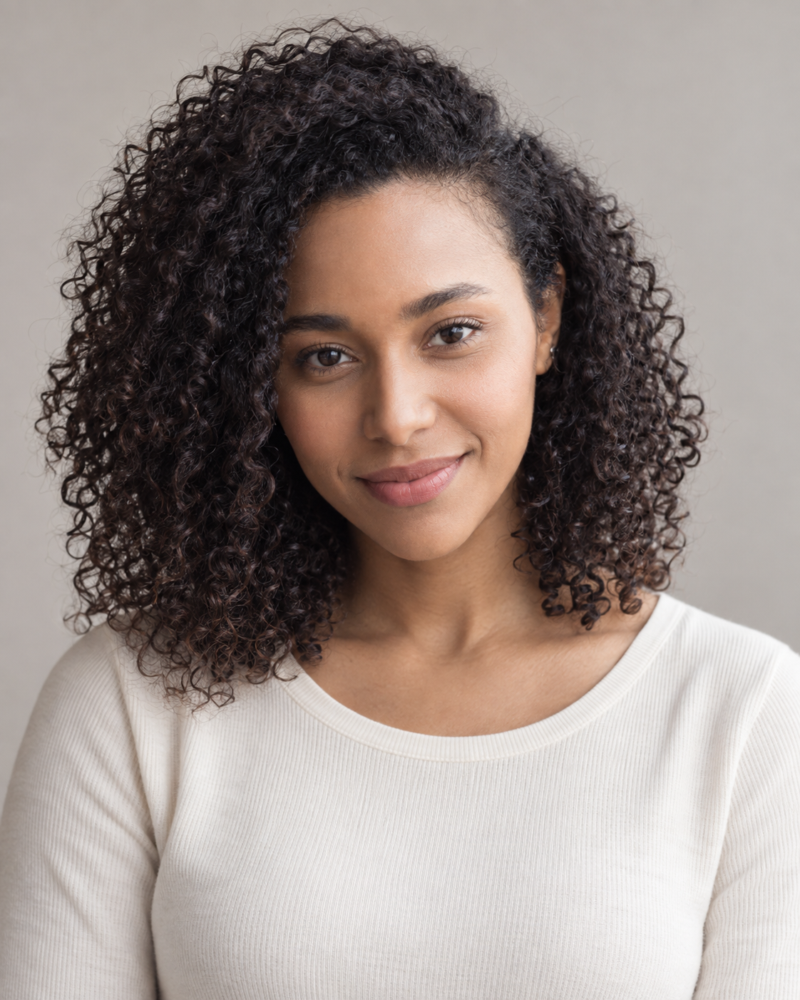

# F005 黑色细卷及肩发人物卡

用于以后读取同一份文字、附上同一张原始参考图，生成外貌风格相近的成年女性角色。版本 v1.0；本轮已完成一次“原图＋固定文字”的新构图试生成。尚未验证纯文字复现或多次重复生成的一致性，不能保证像素一致或五官完全不变。

目录

- [卡片用途与固定重点](#profile)
- [原始参考与生成样例](#reference)
- [六项外貌细节](#appearance)
- [可见范围与生成补足](#limits)
- [固定人物描述](#fixed-description)
- [本轮完整生成提示词](#generation-prompt)
- [原图与生成图对比](#comparison)
- [后续调用方法](#reuse)
- [来源与相关页面](#sources)

<a id="profile"></a>
## 卡片用途与固定重点

- 调用编号：**F005**。
- 角色名称：**黑色细卷及肩发**。
- 设计年龄：27岁，是成人角色创作设定，不代表原素材人物的实际年龄。
- 核心保留点：保持中等暖棕肤色、偏分肩长细螺旋卷、柔和椭圆脸和温暖神态。
- 本卡描述外貌，不根据图片认定真实身份、国籍或族裔。
- 服装、道具、背景、表情可按新任务改变；固定描述的内容和版本应保留。

<a id="reference"></a>
## 原始参考与生成样例

原始素材文件：`veer-388005189.jpg`。原图复制件保留原始内容及水印；新图为重新生成的角色肖像。生成样例仅用于检查本轮效果，默认不得替代原图成为下一轮参考。




- 原图尺寸：1600 × 1068。
- 生成尺寸：1122 × 1402。
- 原图 SHA256：`58056A38FFF46925A6AF4DB9263334A0C947D59E4EFFA2421D71F5707674F297`。
- 生成图 SHA256：`C1FCA473268FD4C50A371564303ED1CC264F58D00E7BCC0AE1D8FBCD7F4A5787`。
- 原图场景：灰色圆领T恤、棕色裤子、窗边盘坐、手机、电脑和杯子均可替换。

<a id="appearance"></a>
## 六项外貌细节

| 维度 | 观察与设计 |
| --- | --- |
| 脸型 | 柔和椭圆脸，额头较舒展，苹果肌在笑时上提；下颌逐渐收窄，下巴圆润。 |
| 眉毛和眼睛 | 深色眉，中等浓度、低缓弧线；偏长杏仁眼，低头时上眼皮遮盖较多，眼尾在笑时略向上收。 |
| 鼻子 | 鼻梁中等高度、轮廓柔和；鼻尖圆润，鼻翼宽度中等，鼻孔边缘因低头和画面尺寸不够清楚。 |
| 嘴唇 | 自然粉棕唇色，嘴巴横向较舒展；原图露齿微笑，笑容使上唇拉薄，不能据此固定闭嘴比例。 |
| 肤色 | 中等暖棕肤色，窗光下额头及双颊亮、脸侧稍深；保留自然色差，不添加未看清的痣或雀斑。 |
| 发型 | 接近黑色的深棕细螺旋卷，长度约肩部；明显偏分，顶部和一侧体积较高，细卷束向脸侧和肩部自然展开。 |

<a id="limits"></a>
## 可见范围与生成补足

- 原图脸部占画面较小，虹膜精确色调、鼻孔形状和毛孔分布不作事实记录。
- 深棕眼和闭嘴上:下唇约1:1.3为生成补足；27岁为设计年龄。

光线、镜头、低头或侧脸、微笑会改变五官的观感。不能将笑时的唇厚、低机位鼻孔可见度或受光高光误当成稳定结构。无法可靠观察的比例不作精确测量；明确标为生成补足的内容只作为创作参数。

<a id="fixed-description"></a>
## 固定人物描述

下面代码块是 v1.0 固定文字。调用时原样读取，不先压缩改写。

```text
F005｜黑色细卷及肩发。角色设计为27岁的成年女性（这是创作设定，不是对照片中人物年龄的确认）。
脸型：柔和椭圆脸，额头较舒展，苹果肌在笑时上提；下颌逐渐收窄，下巴圆润。
眉毛和眼睛：深色眉，中等浓度、低缓弧线；偏长杏仁眼，低头时上眼皮遮盖较多，眼尾在笑时略向上收。
鼻子：鼻梁中等高度、轮廓柔和；鼻尖圆润，鼻翼宽度中等，鼻孔边缘因低头和画面尺寸不够清楚。
嘴唇：自然粉棕唇色，嘴巴横向较舒展；原图露齿微笑，笑容使上唇拉薄，不能据此固定闭嘴比例。
肤色：中等暖棕肤色，窗光下额头及双颊亮、脸侧稍深；保留自然色差，不添加未看清的痣或雀斑。
发型：接近黑色的深棕细螺旋卷，长度约肩部；明显偏分，顶部和一侧体积较高，细卷束向脸侧和肩部自然展开。
生成补足与边界：原图脸部占画面较小，虹膜精确色调、鼻孔形状和毛孔分布不作事实记录。 深棕眼和闭嘴上:下唇约1:1.3为生成补足；27岁为设计年龄。
优先保持：保持中等暖棕肤色、偏分肩长细螺旋卷、柔和椭圆脸和温暖神态。
```

<a id="generation-prompt"></a>
## 本轮完整生成提示词

以下为本轮实际使用的完整文字；输入同时包含上面的原始参考图。生成调用使用 imagegen，透明背景关闭；工具未提供可记录的模型版本和 seed，未虚构这些参数。

```text
Use case: photorealistic-natural.
任务：依据用户提供的原始素材参考图及下面固定外貌文字，创作一张新的自然写实成年女性角色肖像，用于人物卡外貌复用测试。参考图仅提供外貌、发型和肤色依据，不复刻原照片构图、姿势、服装、道具或背景。生成的是新构图的人物肖像。
构图与场景：竖幅4:5，单人，完整头顶到胸口下方，发型完整可见，头部接近正面，镜头与眼睛同高，85mm人像摄影观感。浅暖灰纯净背景，柔和侧前窗光与温和补光，素色奶白圆领上衣，不持物，不戴帽子或墨镜。表情放松、自然闭嘴带极轻微笑意，五官清晰。
皮肤自然真实，有细小毛孔、唇纹、自然色差和少量碎发。保留参考的面部轮廓和毛发结构，避免统一美颜脸、过度磨皮、过分丰唇、极尖下巴、大眼滤镜或机械卷发。
仅一人一张完整新肖像。无拼图、文字、商标或图形覆盖。

F005｜黑色细卷及肩发。角色设计为27岁的成年女性（这是创作设定，不是对照片中人物年龄的确认）。
脸型：柔和椭圆脸，额头较舒展，苹果肌在笑时上提；下颌逐渐收窄，下巴圆润。
眉毛和眼睛：深色眉，中等浓度、低缓弧线；偏长杏仁眼，低头时上眼皮遮盖较多，眼尾在笑时略向上收。
鼻子：鼻梁中等高度、轮廓柔和；鼻尖圆润，鼻翼宽度中等，鼻孔边缘因低头和画面尺寸不够清楚。
嘴唇：自然粉棕唇色，嘴巴横向较舒展；原图露齿微笑，笑容使上唇拉薄，不能据此固定闭嘴比例。
肤色：中等暖棕肤色，窗光下额头及双颊亮、脸侧稍深；保留自然色差，不添加未看清的痣或雀斑。
发型：接近黑色的深棕细螺旋卷，长度约肩部；明显偏分，顶部和一侧体积较高，细卷束向脸侧和肩部自然展开。
生成补足与边界：原图脸部占画面较小，虹膜精确色调、鼻孔形状和毛孔分布不作事实记录。 深棕眼和闭嘴上:下唇约1:1.3为生成补足；27岁为设计年龄。
优先保持：保持中等暖棕肤色、偏分肩长细螺旋卷、柔和椭圆脸和温暖神态。
生成时仍以原图可见部分为参考，不将观察限制中的水印或遮挡画入新肖像。
```

<a id="comparison"></a>
## 原图与生成图对比

偏分细螺旋卷和暖棕肤色保留明显；卷发体积被放大。

**保留的可见特征**

- 近黑深棕细卷、偏分和肩部长度。
- 椭圆脸、暖棕肤色与柔和神态。

**偏差及不能验证的部分**

- 卷发更密、更蓬，脸周体积大于原图。
- 露齿低头改为平视轻笑；眼色、闭嘴唇形属于补足。

**下一轮可调整方向**

下次保留细卷直径，适度降低两侧发量，明确卷发外缘接近原图，不增加横向体积。

以上为可见特征的定性比较，不是身份识别或相似度百分比。建议尚未写回 v1.0 固定文字，本轮结果与实际输入保持对应。

<a id="reuse"></a>
## 后续调用方法

1. 通过编号“F005”检索本卡，获取“固定人物描述”和“本轮完整生成提示词”。若检索片段被截断，不从摘要拼出原文；读取随卡保存的完整 `prompt.txt`，或在用户明确调用完整卡片的范围内获取本卡全文。
2. 提供“原始参考与生成样例”中的**原始参考图**。如果工具不能访问该文件，先恢复原始参考的可用路径，不默认换用生成样例。
3. 需要复用本轮构图时直接使用完整提示词；需要新场景时，保留固定人物描述原文，仅替换场景、动作、服装、光线与画幅要求。
4. 生成后对照原图，检查脸型、眉眼、鼻唇、肤色及发型。不得在生成图上循环迭代，除非用户明确指定。
5. 若确认修改固定外貌，建立新版本并记录变更，不把未确认的生成偏差写成原始特征。

调用示例：

> 调用 F005 黑色细卷及肩发人物卡，读取 v1.0 固定人物描述并原样保留，使用卡片中的原始参考图。场景改为明亮咖啡馆靠窗座位，穿浅蓝衬衫，自然看向镜头。生成后对照原图检查脸型与发型。

只有文字时可以尝试接近相同的外貌类型；本轮没有进行纯文字对照实验，因此不据此承诺纯文字就能锁定脸部。


- [女性人物卡分类索引](女性人物卡索引.md)
- [男性与女性人物卡总索引](../人物卡分类索引.md)

<a id="sources"></a>
## 来源与相关页面

- 用户素材目录：`C:\Users\AI454\Downloads\人物场景 素材`；本卡来源文件为 `veer-388005189.jpg`。
- 用户请求：先做六张人物卡片，再生成并与原图素材比对；沿用此前保存知识库、以后调用相同文字的要求。
- 建卡、试生成及人工视觉对比日期：2026-09-30。
- [本批六张人物卡对比索引](素材人物卡六组对比索引.md)
- [材质人物场景与一致性控制](../../人工智能/图像生成/材质人物场景与一致性控制.md#identity-control)
