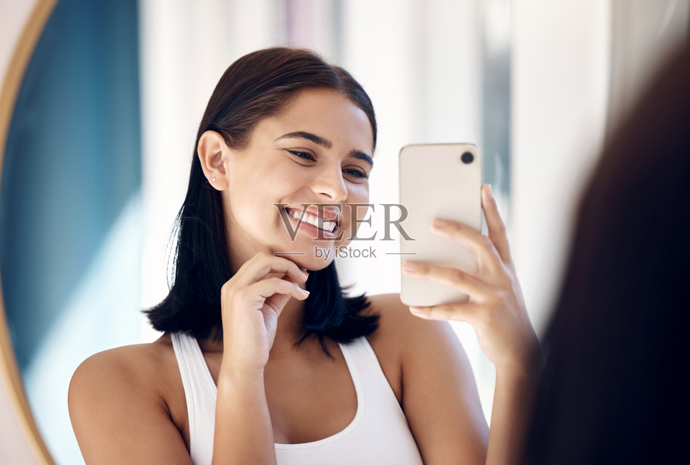
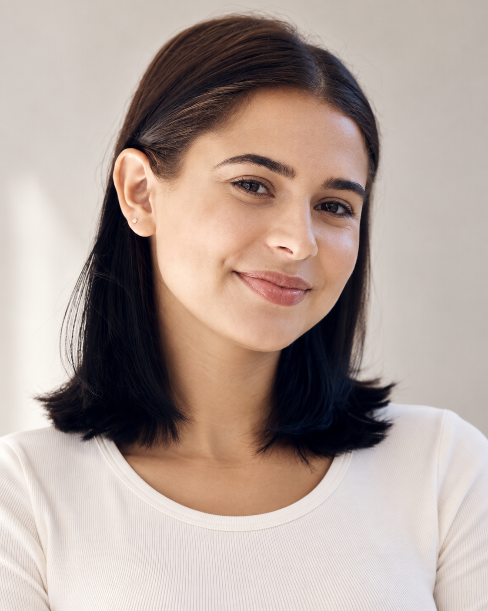

# F009 黑褐利落长波波头人物卡

用于以后读取同一份文字、附上同一张原始参考图，生成外貌风格相近的成年女性角色。版本 v1.0；本轮已完成一次“原图＋固定文字”的新构图试生成。尚未验证纯文字复现或多次重复生成的一致性，不能保证像素一致或五官完全不变。

目录

- [固定店铺与品牌故事使用](#store-assignment)
- [卡片用途与固定重点](#profile)
- [原始参考与生成样例](#reference)
- [六项外貌细节](#appearance)
- [可见范围与生成补足](#limits)
- [固定人物描述](#fixed-description)
- [本轮完整生成提示词](#generation-prompt)
- [原图与生成图对比](#comparison)
- [后续调用方法](#reuse)
- [来源与相关页面](#sources)

<a id="store-assignment"></a>
## 固定店铺与品牌故事使用

- 当前固定店铺：**Moment Dextrad**。2026-10-15核对既有品牌故事后，确认现行归属正确，继续保留女5人物位。
- 最终品牌故事使用场景：05 柜台支付（用户指定的替换图片，原制作记录登记为F009）。
- 店铺归属以[人物总索引现行名单](../人物卡分类索引.md#store-moment-dextrad)为统一维护依据；本卡原始参考、固定描述、版本和既有验收边界保持。
- [Moment Dextrad品牌规范与本次核对证据](../../电商运营/亚马逊/店铺/moment-dextrad品牌规范.md#character-usage)。

<a id="profile"></a>
## 卡片用途与固定重点

- 调用编号：**F009**。
- 角色名称：**黑褐利落长波波头**。
- 设计年龄：27岁，是成人角色创作设定，不代表原素材人物的实际年龄。
- 核心保留点：保持黑褐侧分直发波波头、浓柔弧眉、暖米浅棕肤色及清楚圆润下颌。
- 本卡描述外貌，不根据图片认定真实身份、国籍或族裔。
- 服装、道具、背景、表情可按新任务改变；固定描述的内容和版本应保留。

<a id="reference"></a>
## 原始参考与生成样例

原始素材文件：`veer-436422044.jpg`。原图复制件保留原始内容及水印；新图为重新生成的角色肖像。生成样例仅用于检查本轮效果，默认不得替代原图成为下一轮参考。





- 原图尺寸：1600 × 1080。
- 生成尺寸：1122 × 1402。
- 原图 SHA256：`2DC6D3D076D3C797F972182D875314B4A70BCF0F4F02D56DF8542F34BB7D0E6F`。
- 生成图 SHA256：`2115CCAA55FA8C2B4A5C31718FEF33614454F4ECD3877F886EB7C362F6B118A9`。
- 原图场景：白色背心、小耳钉、手机、镜面、手托下巴和露齿自拍姿势均可变化。

<a id="appearance"></a>
## 六项外貌细节

| 维度 | 观察与设计 |
| --- | --- |
| 脸型 | 椭圆脸，颧骨有柔和立体感，下颌线清楚但转角圆润；笑时脸颊上提，下巴略收。 |
| 眉毛和眼睛 | 浓深棕眉，眉头有体积、眉身舒展、外侧圆弧上抬；眼睛偏长杏仁形，笑时下眼睑上提、眼尾轻扬。 |
| 鼻子 | 中等偏高、较直的鼻梁，鼻尖小巧圆润，鼻翼宽度适中偏收；三分之四角度不能直接确定正面鼻孔宽度。 |
| 嘴唇 | 暖粉棕色唇，嘴巴横向舒展；上唇在露齿笑时较薄，下唇有体积，原图水印经过口部，不能据此精确提取唇峰和闭嘴厚度。 |
| 肤色 | 浅棕至暖米色皮肤，面部有柔和暖色高光；没有清楚可确认的密集雀斑。 |
| 发型 | 黑褐色直发长波波头，长度在肩上至肩部，侧分，前额和耳侧较服帖，一侧别到耳后；发尾齐而有少量自然外翘。 |

<a id="limits"></a>
## 可见范围与生成补足

- 水印遮住部分嘴唇，笑容与侧角影响鼻唇测量。
- 深棕眼、闭嘴唇厚约1:1.4为生成补足；27岁为设计年龄。

光线、镜头、低头或侧脸、微笑会改变五官的观感。不能将笑时的唇厚、低机位鼻孔可见度或受光高光误当成稳定结构。无法可靠观察的比例不作精确测量；明确标为生成补足的内容只作为创作参数。

<a id="fixed-description"></a>
## 固定人物描述

下面代码块是 v1.0 固定文字。调用时原样读取，不先压缩改写。

```text
F009｜黑褐利落长波波头。角色设计为27岁的成年女性（这是创作设定，不是对照片中人物年龄的确认）。
脸型：椭圆脸，颧骨有柔和立体感，下颌线清楚但转角圆润；笑时脸颊上提，下巴略收。
眉毛和眼睛：浓深棕眉，眉头有体积、眉身舒展、外侧圆弧上抬；眼睛偏长杏仁形，笑时下眼睑上提、眼尾轻扬。
鼻子：中等偏高、较直的鼻梁，鼻尖小巧圆润，鼻翼宽度适中偏收；三分之四角度不能直接确定正面鼻孔宽度。
嘴唇：暖粉棕色唇，嘴巴横向舒展；上唇在露齿笑时较薄，下唇有体积，原图水印经过口部，不能据此精确提取唇峰和闭嘴厚度。
肤色：浅棕至暖米色皮肤，面部有柔和暖色高光；没有清楚可确认的密集雀斑。
发型：黑褐色直发长波波头，长度在肩上至肩部，侧分，前额和耳侧较服帖，一侧别到耳后；发尾齐而有少量自然外翘。
生成补足与边界：水印遮住部分嘴唇，笑容与侧角影响鼻唇测量。 深棕眼、闭嘴唇厚约1:1.4为生成补足；27岁为设计年龄。
优先保持：保持黑褐侧分直发波波头、浓柔弧眉、暖米浅棕肤色及清楚圆润下颌。
```

<a id="generation-prompt"></a>
## 本轮完整生成提示词

以下为本轮实际使用的完整文字；输入同时包含上面的原始参考图。生成调用使用 imagegen，透明背景关闭；工具未提供可记录的模型版本和 seed，未虚构这些参数。

```text
Use case: photorealistic-natural.
任务：依据用户提供的原始素材参考图及下面固定外貌文字，创作一张新的自然写实成年女性角色肖像，用于人物卡外貌复用测试。参考图仅提供外貌、发型和肤色依据，不复刻原照片构图、姿势、服装、道具或背景。生成的是新构图的人物肖像。
构图与场景：竖幅4:5，单人，完整头顶到胸口下方，发型完整可见，头部接近正面，镜头与眼睛同高，85mm人像摄影观感。浅暖灰纯净背景，柔和侧前窗光与温和补光，素色奶白圆领上衣，不持物，不戴帽子或墨镜。表情放松、自然闭嘴带极轻微笑意，五官清晰。
皮肤自然真实，有细小毛孔、唇纹、自然色差和少量碎发。保留参考的面部轮廓和毛发结构，避免统一美颜脸、过度磨皮、过分丰唇、极尖下巴、大眼滤镜或机械卷发。
仅一人一张完整新肖像。无拼图、文字、商标或图形覆盖。

F009｜黑褐利落长波波头。角色设计为27岁的成年女性（这是创作设定，不是对照片中人物年龄的确认）。
脸型：椭圆脸，颧骨有柔和立体感，下颌线清楚但转角圆润；笑时脸颊上提，下巴略收。
眉毛和眼睛：浓深棕眉，眉头有体积、眉身舒展、外侧圆弧上抬；眼睛偏长杏仁形，笑时下眼睑上提、眼尾轻扬。
鼻子：中等偏高、较直的鼻梁，鼻尖小巧圆润，鼻翼宽度适中偏收；三分之四角度不能直接确定正面鼻孔宽度。
嘴唇：暖粉棕色唇，嘴巴横向舒展；上唇在露齿笑时较薄，下唇有体积，原图水印经过口部，不能据此精确提取唇峰和闭嘴厚度。
肤色：浅棕至暖米色皮肤，面部有柔和暖色高光；没有清楚可确认的密集雀斑。
发型：黑褐色直发长波波头，长度在肩上至肩部，侧分，前额和耳侧较服帖，一侧别到耳后；发尾齐而有少量自然外翘。
生成补足与边界：水印遮住部分嘴唇，笑容与侧角影响鼻唇测量。 深棕眼、闭嘴唇厚约1:1.4为生成补足；27岁为设计年龄。
优先保持：保持黑褐侧分直发波波头、浓柔弧眉、暖米浅棕肤色及清楚圆润下颌。
生成时仍以原图可见部分为参考，不将观察限制中的水印或遮挡画入新肖像。
```

<a id="comparison"></a>
## 原图与生成图对比

侧分黑褐直发、耳后发束和外翘发尾保留明显；生成图仍是轻侧角度。

**保留的可见特征**

- 侧分黑褐长波波头、一侧耳后发束及外翘发尾。
- 浓柔弧眉、偏长杏仁眼和暖米浅棕肤色。

**偏差及不能验证的部分**

- 原图露齿笑变为闭嘴微笑，唇峰与唇厚有生成补足。
- 仍有侧转和倾斜，不是严格正面人物基准照。

**下一轮可调整方向**

下次保留发型和眉眼，只强调头部竖直、正面平视；口部形态需更多清晰参考才能进一步收紧。

以上为可见特征的定性比较，不是身份识别或相似度百分比。建议尚未写回 v1.0 固定文字，本轮结果与实际输入保持对应。

<a id="reuse"></a>
## 后续调用方法

1. 通过编号“F009”检索本卡，获取“固定人物描述”和“本轮完整生成提示词”。若检索片段被截断，不从摘要拼出原文；读取随卡保存的完整 `prompt.txt`，或在用户明确调用完整卡片的范围内获取本卡全文。
2. 提供“原始参考与生成样例”中的**原始参考图**。如果工具不能访问该文件，先恢复原始参考的可用路径，不默认换用生成样例。
3. 需要复用本轮构图时直接使用完整提示词；需要新场景时，保留固定人物描述原文，仅替换场景、动作、服装、光线与画幅要求。
4. 生成后对照原图，检查脸型、眉眼、鼻唇、肤色及发型。不得在生成图上循环迭代，除非用户明确指定。
5. 若确认修改固定外貌，建立新版本并记录变更，不把未确认的生成偏差写成原始特征。

调用示例：

> 调用 F009 黑褐利落长波波头人物卡，读取 v1.0 固定人物描述并原样保留，使用卡片中的原始参考图。场景改为明亮咖啡馆靠窗座位，穿浅蓝衬衫，自然看向镜头。生成后对照原图检查脸型与发型。

只有文字时可以尝试接近相同的外貌类型；本轮没有进行纯文字对照实验，因此不据此承诺纯文字就能锁定脸部。


- [女性人物卡分类索引](女性人物卡索引.md)
- [男性与女性人物卡总索引](../人物卡分类索引.md)

<a id="sources"></a>
## 来源与相关页面

- 用户素材目录：`C:\Users\AI454\Downloads\人物场景 素材`；本卡来源文件为 `veer-436422044.jpg`。
- 用户请求：先做六张人物卡片，再生成并与原图素材比对；沿用此前保存知识库、以后调用相同文字的要求。
- 建卡、试生成及人工视觉对比日期：2026-09-30。
- [本批六张人物卡对比索引](素材人物卡六组对比索引.md)
- [材质人物场景与一致性控制](../../人工智能/图像生成/材质人物场景与一致性控制.md#identity-control)
