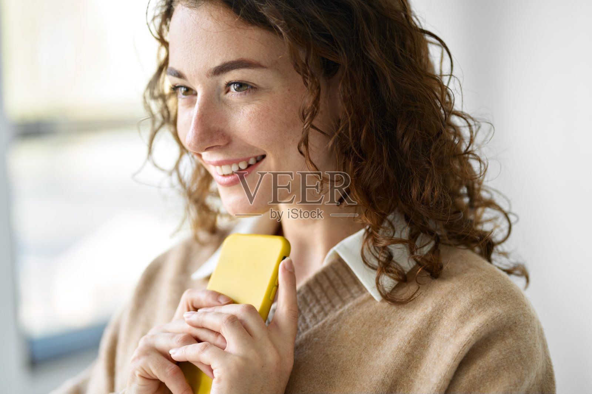
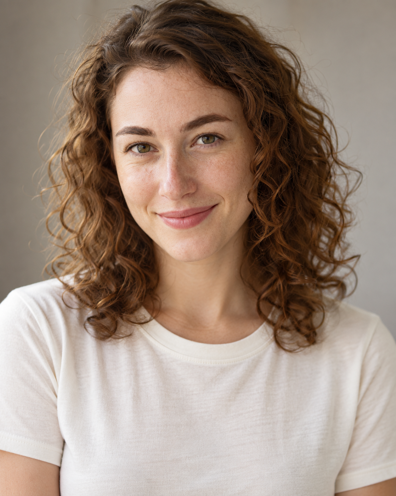

# F018 栗棕及肩螺旋卷雀斑女性人物卡

用于复用固定外貌文字，并配合原始参考图生成相近外貌的成年角色。v1.0 已完成一次基准肖像生成与可见特征对比。

目录

- [人物标识与固定重点](#profile)
- [原始参考与生成样例](#reference)
- [六项外貌细节](#appearance)
- [毛发与配饰](#grooming)
- [观察边界和创作补足](#limits)
- [固定人物描述](#fixed-description)
- [本轮实际完整提示词](#generation-prompt)
- [独立服装模块](#clothing)
- [原图与生成图对比](#comparison)
- [后续调用方法](#reuse)
- [来源与相关页面](#sources)

<a id="profile"></a>
## 人物标识与固定重点

- 编号：**F018**；名称：**栗棕及肩螺旋卷雀斑**；分类：**女性**。
- 设计年龄：27岁，版本 v1.0。
- 固定重点：偏长椭圆脸，颧骨中高、面颊自然，下颌向下收窄，下巴圆润不削尖。 栗棕色及肩螺旋卷，根部自然蓬松，偏侧分；中小卷束混合，脸侧留细碎卷，发尾不整齐同向，脸周层次明显。
- 固定外貌与服装、场景分开维护；配饰独立记录。

<a id="reference"></a>
## 原始参考与生成样例

原始文件：`veer-440952860.jpg`，来自用户提供的“人物场景 素材”目录。保留原文件和原有水印。





本轮生成样例用于对比，默认不替代原始参考。

<a id="appearance"></a>
## 六项外貌细节

**脸型：** 偏长椭圆脸，颧骨中高、面颊自然，下颌向下收窄，下巴圆润不削尖。

**眉毛和眼睛：** 棕色中浓眉，眉峰清楚而缓弧，眉尾轻提；榛绿色杏仁眼，外眼角近水平至微扬，保留眼角小纹。

**鼻子：** 鼻梁中等偏高、偏窄顺直，鼻尖圆而略向前，鼻翼中等偏窄；鼻孔细椭圆。

**嘴唇：** 上唇偏薄、下唇稍厚，约1∶1.45；唇峰清楚圆钝，嘴角轻提，自然浅玫瑰粉。

**肤色：** 白皙暖米色，鼻梁和上脸颊有稀疏浅棕雀斑、大小深浅不一，保留毛孔与眼下细纹。

**发型：** 栗棕色及肩螺旋卷，根部自然蓬松，偏侧分；中小卷束混合，脸侧留细碎卷，发尾不整齐同向，脸周层次明显。

<a id="grooming"></a>
## 毛发与配饰

不加帽子或眼镜，淡妆保留可见雀斑与原生眉毛。

<a id="limits"></a>
## 观察边界和创作补足

- 原图三分之二侧脸且微笑，正面宽度和闭嘴唇比为近似；雀斑分布保留视觉范围，不虚构精确位置。
- 唇部比例指自然闭嘴时可见唇红的视觉厚度，均为设计参考。年龄为成年角色设定，不推断现实身份、国籍或族裔。

<a id="fixed-description"></a>
## 固定人物描述

逐字复用以下文字。换服装、场景时不改此段；外貌变更另记版本。

```text
F018，27岁成年女性角色。脸型：偏长椭圆脸，颧骨中高、面颊自然，下颌向下收窄，下巴圆润不削尖。
眉毛和眼睛：棕色中浓眉，眉峰清楚而缓弧，眉尾轻提；榛绿色杏仁眼，外眼角近水平至微扬，保留眼角小纹。
鼻子：鼻梁中等偏高、偏窄顺直，鼻尖圆而略向前，鼻翼中等偏窄；鼻孔细椭圆。
嘴唇：上唇偏薄、下唇稍厚，约1∶1.45；唇峰清楚圆钝，嘴角轻提，自然浅玫瑰粉。
肤色：白皙暖米色，鼻梁和上脸颊有稀疏浅棕雀斑、大小深浅不一，保留毛孔与眼下细纹。
发型：栗棕色及肩螺旋卷，根部自然蓬松，偏侧分；中小卷束混合，脸侧留细碎卷，发尾不整齐同向，脸周层次明显。
胡须与配饰：不加帽子或眼镜，淡妆保留可见雀斑与原生眉毛。
保持自然真实的日常肖像，保留皮肤纹理、轻微左右差异和碎发。
```

<a id="generation-prompt"></a>
## 本轮实际完整提示词

以下为本次生成实际输入。还需附上本卡原始参考图。

```text
Use case: photorealistic-natural.
参考角色卡 F018。附图是本次唯一人物外貌参考，使用其中主要前景成年人物；保持可见面部结构、发色、肤色与毛流。生成一张新的自然写实胸像摄影，不复制原场景。
固定人物描述：
F018，27岁成年女性角色。脸型：偏长椭圆脸，颧骨中高、面颊自然，下颌向下收窄，下巴圆润不削尖。
眉毛和眼睛：棕色中浓眉，眉峰清楚而缓弧，眉尾轻提；榛绿色杏仁眼，外眼角近水平至微扬，保留眼角小纹。
鼻子：鼻梁中等偏高、偏窄顺直，鼻尖圆而略向前，鼻翼中等偏窄；鼻孔细椭圆。
嘴唇：上唇偏薄、下唇稍厚，约1∶1.45；唇峰清楚圆钝，嘴角轻提，自然浅玫瑰粉。
肤色：白皙暖米色，鼻梁和上脸颊有稀疏浅棕雀斑、大小深浅不一，保留毛孔与眼下细纹。
发型：栗棕色及肩螺旋卷，根部自然蓬松，偏侧分；中小卷束混合，脸侧留细碎卷，发尾不整齐同向，脸周层次明显。
胡须与配饰：不加帽子或眼镜，淡妆保留可见雀斑与原生眉毛。
保持自然真实的日常肖像，保留皮肤纹理、轻微左右差异和碎发。
观察边界：原图三分之二侧脸且微笑，正面宽度和闭嘴唇比为近似；雀斑分布保留视觉范围，不虚构精确位置。
本次画面：竖幅4:5单人头肩胸像，完整发顶与双肩入镜，头基本正对相机，平视镜头，眉间放松，自然闭嘴微笑。柔和漫射窗光，暖灰素背景。统一奶白色圆领棉T恤，常规合身但不紧，哑光柔软细棉纹，短袖，无口袋与图案。配饰按人物卡要求。保留真实毛孔、眼下纹理和少量碎发，妆容克制。禁止塑料磨皮、过分锐利下颌、夸张眼唇、过度对称、浓重时尚妆。无文字、拼图、标牌、手持手机、耳机或画框。只输出这一张独立新肖像。
```

<a id="clothing"></a>
## 独立服装模块

| 层次 | 本轮基准设定 | 后续可替换方式 |
| --- | --- | --- |
| 色彩搭配逻辑 | 低对比中性色，人物肤色与发色作为主要视觉差异 | 同色系、邻近色或小面积点缀 |
| 轮廓结构 | 常规合身、不过紧、肩线自然 | 宽松、落肩、修身等 |
| 材质质感 | 柔软哑光棉布，保留细棉纹 | 针织、挺括棉布、垂坠面料等 |
| 设计类型 | 奶白圆领短袖T恤，无口袋和图案 | 指定领型、袖型、门襟和口袋 |

调用时替换服装条款，避免与旧服装叠加。

<a id="comparison"></a>
## 原图与生成图对比

栗棕及肩螺旋卷、榛绿眼与鼻颊雀斑保留。 雀斑覆盖比原图更均匀，卷发更蓬松。

**保留的可见特征**

- 栗棕及肩螺旋卷、榛绿眼与鼻颊雀斑保留。
- 自然眼下纹理及圆润下巴保留。

**偏差与未验证细节**

- 雀斑覆盖比原图更均匀，卷发更蓬松。
- 发顶贴边，闭嘴表情下唇形与原微笑不同。

**后续建议：** 减少雀斑均匀度，让卷束松紧更不一致，构图略后退。

以上建议未回写到本版实际提示词，不声称本轮已实现。对比不用于确认现实人物身份，也不提供未经验证的相似度百分比。

<a id="reuse"></a>
## 后续调用方法

> 调用知识库女性人物卡 F018，逐字使用固定人物描述，并附上本卡原始参考图；换成宽松哑光针织上衣，在咖啡馆窗边拍摄自然半身照。

1. 按 F018 检索对应分类卡片，获取完整固定描述。
2. 附上登记的原始参考图；默认不在本轮生成图上反复迭代。
3. 只调整本次服装、场景、动作与构图。若要求修改外貌，应另记版本。
4. 生成后再次和原图比较。本卡只完成一次“原图＋固定文字”生成，未验证纯文字或多次重复一致性，不能保证完全相同人脸。

<a id="sources"></a>
## 来源与相关页面

来源：用户于2026-09-30要求继续新增男性、女性各10张卡。文字外貌描述基于所列素材的可见特征与明确标记的创作补足。

- [女性人物卡索引](女性人物卡索引.md)
- [人物卡分类总索引](../人物卡分类索引.md)
