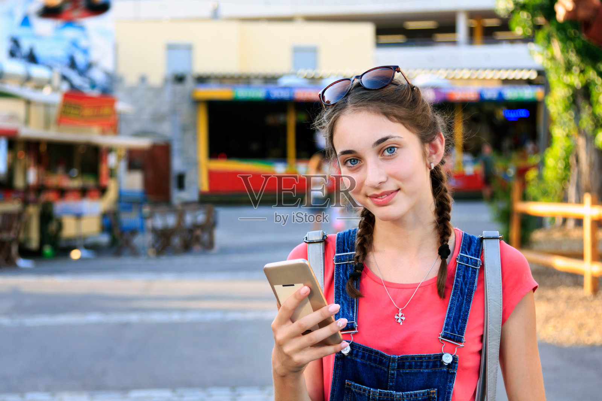
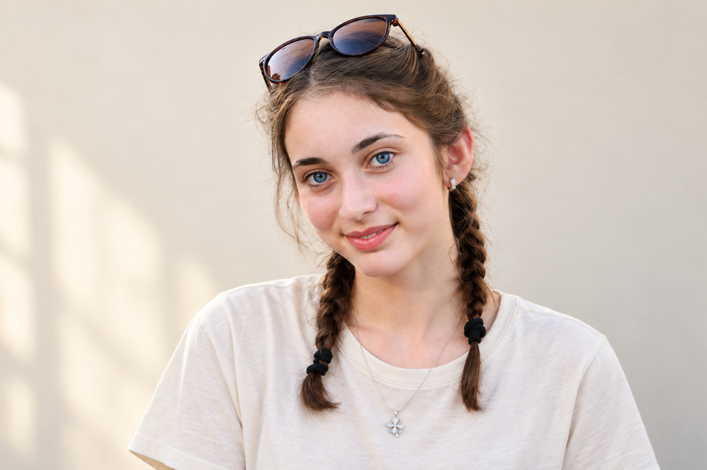

# F023 棕色双辫蓝眼柔椭圆脸女性人物卡

基于用户原图记录可见外貌，用于后续按编号调用固定文字和参考图。服装独立替换，遮挡或无法确认的结构明确保留为未知。

> 当前调用状态：F023 常用；本组旧编号 F033 统一指向本卡。

目录

- [A+使用定位](#aplus-role)
- [删除执行记录](#deletion-20261007)
- [常用状态与相近设定整理](#consolidation-20261007)
- [人物标识](#profile)
- [原始参考](#reference)
- [六项外貌细节](#appearance)
- [毛发配饰与妆容](#grooming)
- [观察边界](#limits)
- [固定描述原文](#fixed)
- [调用提示词](#prompt)
- [独立服装模块](#clothing)
- [调用与核对方法](#reuse)
- [来源与授权状态](#rights)
- [相关入口](#related)
- [生成验收与修正](#validation)
- [提示词版本记录](#prompt-history)

<a id="aplus-role"></a>
## A+使用定位

**2026-10-20用户确认：F023在A+中仅作配角，不担任首张封面主角。**

A+首张封面完整名单：女性F006、F008、F010、F011、F016；男性M002、M006、M007。用于店铺时还须满足固定人物归属；选择封面主角时先查[人物总索引·A+首张封面与配角使用规则](../人物卡分类索引.md#aplus-cover)。人物固定描述、原始参考和既有生成验收边界分别按本卡原文执行。

来源：2026-10-20用户指定“女性06 08 10 11 16；男性02 06 07”可当A+首张封面，其余只适合当配角；同日进一步纠正F006与F030是完全不同的人物。

<a id="deletion-20261007"></a>
## 删除执行记录

2026-10-07，用户列出6个完整文件路径并确认删除。本组保留卡继续常用，旧编号替代关系继续有效。

F033文档已删除，默认使用F023。

5次GBrain删除已提交，对应Markdown文件已从知识库工作目录移除，普通知识库读取不再返回这些页面；GBrain保留72小时恢复窗口。原始照片和生成样例保留。F006的MCP删除返回source_changed，直接删除本地文件又被系统执行策略拒绝（blocked by policy），因此不能记为删除成功。2026-10-20用户纠正：F006与F030是完全不同的人物。此前把F006排除常用并映射到F030的记录作废；F006独立恢复为常用卡，取消待删除状态，后续按F006自身原图与固定描述调用。

<a id="consolidation-20261007"></a>
## 常用状态与相近设定整理

**F023 为本组唯一常用卡。** 相近设定旧编号 F033 已停用；按这些旧编号调用时，先说明替代关系，再使用本卡固定文字和本卡原始参考图。保留本卡已有验收范围，服装与场景仍独立替换。

整理日期：2026-10-07。依据用户“相似的卡片只保留一个”的要求，按“棕色双辫、蓝灰眼”设定归组。F023已有基础验收记录，且没有F033记录的手机遮挡面部边缘限制。

本次整理针对卡片设定与日常调用，不认定不同原图为同一真实人物。最初整理阶段仅停用；后续按用户逐文件确认执行删除，进度见本页“删除执行记录”。本卡固定描述和已执行提示词不变。

<a id="profile"></a>
## 人物标识

编号：**F023**；分类：**女性**；版本：v1.1（验收及调用提示词更新，固定外貌原文保留）。

设计年龄：23岁，属于成年角色设定，不判断原图人物真实年龄。

制作状态：**已完成原图＋文字基础试生成；基础通过。**

<a id="reference"></a>
## 原始参考



原始文件名：`veer-318446846.jpg`。

尺寸：1600×1067；SHA256：`72b0bea5ba92e8bb959102af25e69cc56e414a79edd06de3489fad7c15aa29e5`。参考图按原文件字节复制，保留原有水印与画面，不做去水印或重绘。

<a id="appearance"></a>
## 六项外貌细节

**脸型：** 椭圆形略偏圆，额头较开阔，面颊柔软，下颌平缓收窄，下巴短圆；脸部没有夸张尖锐折角。

**眉毛和眼睛：** 深棕自然较浓眉，眉头宽、外侧柔弧略上扬；眼睛为开度较大的杏仁形，眼尾近平至轻扬，蓝灰虹膜外缘偏深。

**鼻子：** 鼻根中等偏低，鼻梁细直，鼻尖小而圆润，鼻翼窄；正面鼻孔只显露少量暗边，宽度偏窄。

**嘴唇：** 上唇略薄，下唇圆润饱满，双唇峰浅而清楚；近闭嘴微笑，珊瑚粉唇色。上∶下约1∶1.4为视觉参考。

**肤色：** 白皙中性偏粉，鼻尖和两颊有自然红润，眼下浅阴影；不把水印边缘误写成肤色斑点。

**发型：** 中棕长发接近中分，分成两条低双辫落在前肩，辫尾到上胸；发际线和耳侧有蓬松碎发，顶部不紧绷。

<a id="grooming"></a>
## 毛发配饰与妆容

太阳镜架在头顶，没有遮住眼睛；耳钉、花形项链和头顶墨镜均是可替换配饰。

<a id="limits"></a>
## 观察边界

- 头部略倾斜，双侧高度差不能当作固定骨相不对称。
- 23岁是成年角色设定，不作为照片人物真实年龄认定。
- 若存在唇部数字比例，仅为视觉设计参考，不能由单张侧脸或笑脸视为精确量测。

<a id="fixed"></a>
## 固定描述原文

后续调用逐字复用以下内容；若修改外貌，应新增版本并记录原因。

```text
人物卡F023：棕色双辫蓝眼柔椭圆脸。成年女性角色，设计年龄23岁；年龄仅为创作参数。
脸型：椭圆形略偏圆，额头较开阔，面颊柔软，下颌平缓收窄，下巴短圆；脸部没有夸张尖锐折角。
眉毛和眼睛：深棕自然较浓眉，眉头宽、外侧柔弧略上扬；眼睛为开度较大的杏仁形，眼尾近平至轻扬，蓝灰虹膜外缘偏深。
鼻子：鼻根中等偏低，鼻梁细直，鼻尖小而圆润，鼻翼窄；正面鼻孔只显露少量暗边，宽度偏窄。
嘴唇：上唇略薄，下唇圆润饱满，双唇峰浅而清楚；近闭嘴微笑，珊瑚粉唇色。上∶下约1∶1.4为视觉参考。
肤色：白皙中性偏粉，鼻尖和两颊有自然红润，眼下浅阴影；不把水印边缘误写成肤色斑点。
发型：中棕长发接近中分，分成两条低双辫落在前肩，辫尾到上胸；发际线和耳侧有蓬松碎发，顶部不紧绷。
毛发配饰与妆容：太阳镜架在头顶，没有遮住眼睛；耳钉、花形项链和头顶墨镜均是可替换配饰。
观察限制：头部略倾斜，双侧高度差不能当作固定骨相不对称。；23岁是成年角色设定，不作为照片人物真实年龄认定。
```

<a id="prompt"></a>
## 调用提示词

以下为本卡选定样例实际使用的完整生成提示词。仅验证原图角度；不代表纯文字、多角度或多次随机生成的稳定性。

```text
Use case: photorealistic-natural. Generate one new photographic portrait based on input image 1, the ORIGINAL user-provided reference. This is a character consistency test. Preserve the visible person's facial structure, natural age impression, hair silhouette, grooming, gaze, exact head angle and facial expression. Do not impose generic idealized beauty, sharpen the jaw, enlarge eyes or add facial hair. Original visible geometry takes priority over numeric design estimates in the text.

固定人物描述，逐字复用：
人物卡F023：棕色双辫蓝眼柔椭圆脸。成年女性角色，设计年龄23岁；年龄仅为创作参数。
脸型：椭圆形略偏圆，额头较开阔，面颊柔软，下颌平缓收窄，下巴短圆；脸部没有夸张尖锐折角。
眉毛和眼睛：深棕自然较浓眉，眉头宽、外侧柔弧略上扬；眼睛为开度较大的杏仁形，眼尾近平至轻扬，蓝灰虹膜外缘偏深。
鼻子：鼻根中等偏低，鼻梁细直，鼻尖小而圆润，鼻翼窄；正面鼻孔只显露少量暗边，宽度偏窄。
嘴唇：上唇略薄，下唇圆润饱满，双唇峰浅而清楚；近闭嘴微笑，珊瑚粉唇色。上∶下约1∶1.4为视觉参考。
肤色：白皙中性偏粉，鼻尖和两颊有自然红润，眼下浅阴影；不把水印边缘误写成肤色斑点。
发型：中棕长发接近中分，分成两条低双辫落在前肩，辫尾到上胸；发际线和耳侧有蓬松碎发，顶部不紧绷。
毛发配饰与妆容：太阳镜架在头顶，没有遮住眼睛；耳钉、花形项链和头顶墨镜均是可替换配饰。
观察限制：头部略倾斜，双侧高度差不能当作固定骨相不对称。；23岁是成年角色设定，不作为照片人物真实年龄认定。

Test scene: quiet softly lit warm off-white background, natural soft daylight. Crop to head and upper torso, show entire hairstyle, normal lens perspective; retain the ORIGINAL head angle and body orientation, including a reclined pose where applicable. Replace clothing only with a simple cream cotton crewneck T-shirt, relaxed regular shoulder fit, matte fabric, no graphics. Preserve sunglasses and any hand or phone occlusion over facial areas where the source gives no facial evidence. Do not invent a new view of unseen eyes or obscured mouth. Hands/props away from the face may be outside the portrait frame. Keep natural skin texture, mild asymmetry, authentic hair fibers and fine facial lines, no heavy retouching. Do not make existing stubble denser, existing curls tighter or hair substantially more voluminous. Preserve source smile rather than applying the closed-mouth lip ratios. Output a single photograph, no labels or collage.
```

<a id="clothing"></a>
## 独立服装模块

原图服装仅作穿搭参考，不并入固定人物身份。

| 层次 | 原图可见穿搭 |
| --- | --- |
| 色彩搭配逻辑 | 明亮内搭与深色外层对比 |
| 轮廓和结构 | 常规T恤搭配背带裤 |
| 材质和质感 | 柔软棉T恤与较挺牛仔布 |
| 设计类型 | 圆领短袖、金属背带扣、胸贴袋 |

默认调用服装为奶白圆领棉T恤。换装时替换完整服装模块，按配色逻辑、轮廓结构、材质质感和设计类型描述，不把互相冲突的旧服装条款保留在提示词中。

<a id="reuse"></a>
## 调用与核对方法

1. 按F023检索，读取固定描述原文及观察边界。
2. 附上本卡原始参考图，保留可见的五官方向、发型及毛发细节。
3. 独立指定服装、动作、场景和构图；未知结构需补充参考或明确为创作补足。
4. 首次生成后逐项核对六项外貌；本卡已有基础样例与验收记录，不承诺结果完全相同。
5. 每次编辑仍使用用户原始参考，除非用户明确指定其他基础图。

<a id="rights"></a>
## 来源与授权状态

来源为用户指定的“人物场景 素材”目录。2026-10-06用户明确要求先把该目录中的人物整理成卡片。

照片版权许可、肖像许可及AI使用范围均**待核实**；人物卡整理不等于商用授权。人物真实身份、姓名及是否公众人物未核验，不凭人脸命名或贴名人标签。

<a id="related"></a>
## 相关入口

- [女性人物卡索引](女性人物卡索引.md)
- [人物卡分类总索引](../人物卡分类索引.md)


<a id="validation"></a>
## 生成验收与修正

验收日期：2026-10-06；状态：**基础通过**；采用样例：v1。



- 保留情况：双辫、头顶墨镜、蓝眼、浓眉和轻微闭嘴笑基本保留。
- 首轮偏差：近景下唇色和脸颊粉色略鲜明，头部倾斜轻微变化。
- 修正或调用注意：保持轻微闭嘴笑、自然蓝眼和原双辫位置；设计年龄仅作参数，不额外增加成熟妆感。
- 重测情况：首轮主要可见特征保留，未进行第二次生成。

本卡未额外重测；调用注意是根据首轮观察记录的约束，不宣称其单独效果已验证。

验收仅比较可见外貌，不进行真实身份判断或相似度百分比检测。所有试生成和重测都使用用户原始参考图；生成样例只用于验收，不自动替代下一轮的原始参考。手机、墨镜、水印或拍摄角度遮住的细节仍未验证。

<a id="prompt-history"></a>
## 提示词版本记录

2026-10-06：从文字卡v1.0更新为验收卡v1.1。固定描述原文未改写；当前调用提示词替换为实际试生成输入，新增验收状态、修正与已知限制。

以下保留创建时的v1.0提示词，供追溯，不作为当前默认调用：

```text
使用本卡登记的用户原始参考图，参考下列固定外貌生成自然、真实的成年人物。优先保持可见脸部结构、发型和毛发特征。

人物卡F023：棕色双辫蓝眼柔椭圆脸。成年女性角色，设计年龄23岁；年龄仅为创作参数。
脸型：椭圆形略偏圆，额头较开阔，面颊柔软，下颌平缓收窄，下巴短圆；脸部没有夸张尖锐折角。
眉毛和眼睛：深棕自然较浓眉，眉头宽、外侧柔弧略上扬；眼睛为开度较大的杏仁形，眼尾近平至轻扬，蓝灰虹膜外缘偏深。
鼻子：鼻根中等偏低，鼻梁细直，鼻尖小而圆润，鼻翼窄；正面鼻孔只显露少量暗边，宽度偏窄。
嘴唇：上唇略薄，下唇圆润饱满，双唇峰浅而清楚；近闭嘴微笑，珊瑚粉唇色。上∶下约1∶1.4为视觉参考。
肤色：白皙中性偏粉，鼻尖和两颊有自然红润，眼下浅阴影；不把水印边缘误写成肤色斑点。
发型：中棕长发接近中分，分成两条低双辫落在前肩，辫尾到上胸；发际线和耳侧有蓬松碎发，顶部不紧绷。
毛发配饰与妆容：太阳镜架在头顶，没有遮住眼睛；耳钉、花形项链和头顶墨镜均是可替换配饰。
观察限制：头部略倾斜，双侧高度差不能当作固定骨相不对称。；23岁是成年角色设定，不作为照片人物真实年龄认定。

画面要求：自然日常摄影，轻柔日光，中性白平衡，皮肤保留毛孔、细纹、碎发和适度左右差异。保持原图可观察的头部角度与配饰状态；没有明确补充时，不把遮挡区域的猜测当作原人物事实。

独立服装模块：默认奶白色圆领棉T恤，常规合肩、自然宽松，柔软哑光棉布，简洁短袖和无标识衣身。服装可以单独替换，不改变上面的固定外貌文字。

调用边界：本提示词尚未试生成；没有验证跨角度或跨场景的一致性。需要无遮挡正脸或摘墨镜时，先补充原始参考，或明确标注新增结构为创作补足。用户未明确指定时，不用上轮生成图替代原始参考图。
```
