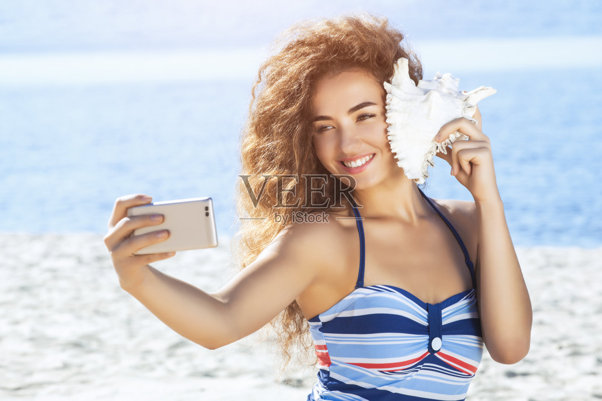

# F031 暖栗棕长蓬卷浓弧眉女性人物卡

固定外貌、独立服装、原图与测试记录一起保存。

目录

- [人物标识](#profile)
- [原始参考](#reference)
- [六项外貌细节](#appearance)
- [毛发配饰与妆容](#grooming)
- [观察边界](#limits)
- [固定描述原文](#fixed)
- [已测试调用提示词](#prompt)
- [独立服装模块](#clothing)
- [原图对比与验收](#validation)
- [调用方法](#reuse)
- [来源记录](#rights)
- [相关入口](#related)

<a id="profile"></a>
## 人物标识

编号：**F031**；分类：女性；版本：v1.0；归档日期：2026-10-07。

设计年龄：25岁，仅是成年角色创作参数。当前状态：**基础特征通过**。

<a id="reference"></a>
## 原始参考



文件：`veer-305071439.jpg`；尺寸：1600×1067。

SHA256：`bd37384f97ac93ea5c0dab6d0695c3c7882f02bf1be219629c09da718f152988`。

原图按字节保存，未改动原始照片。多人图取景规则：Select the only woman. Keep large loose voluminous hair, toothy smile and shell/hand beside the face where they occlude the outline.

<a id="appearance"></a>
## 六项外貌细节

**脸型：** 柔和的椭圆脸，颧区较宽，脸颊笑时饱满，下颌逐步内收，下巴短圆而不尖。

**眉毛和眼睛：** 深棕浓眉，眉身上扬、眉峰较清楚，尾部落下；杏仁形笑眼略收窄，浅棕榛色观感受强日光影响，不锁定精确色值。

**鼻子：** 鼻梁中等偏高、宽度适中，鼻尖小圆，鼻翼中窄；鼻孔细节受亮光影响，不夸大外露。

**嘴唇：** 露齿笑，上唇中等、下唇稍厚，双峰柔圆，嘴角上扬，珊瑚粉唇色；笑态不量测静态比例。

**肤色：** 浅暖小麦色，颧骨和额头受阳光偏金，没有明确可确认雀斑；保留自然细纹。

**发型：** 暖栗棕长卷发，侧分偏向一边，根部蓬松，宽松卷束夹杂细碎卷曲，长度过胸，侧面外轮廓丰厚而不形成规则小螺旋。

<a id="grooming"></a>
## 毛发配饰与妆容

自然睫毛与浅暖唇妆；贴近脸侧的白色海螺及手保留以免凭空补被遮挡轮廓。

<a id="limits"></a>
## 观察边界

- 强日光改变肤发色，虹膜精确颜色未知
- 海螺覆盖一侧太阳穴与脸缘，背后结构不可见
- 五官比例为视觉描述；无法观察的结构保持未知。
- 未验证纯文字复现、多角度或多次随机生成一致性。

<a id="fixed"></a>
## 固定描述原文

后续调用逐字复用，服装和场景在外部替换。

```text
人物卡F031：暖栗棕长蓬卷浓弧眉。成年女性角色，设计年龄25岁；年龄仅为创作参数。
脸型：柔和的椭圆脸，颧区较宽，脸颊笑时饱满，下颌逐步内收，下巴短圆而不尖。
眉毛和眼睛：深棕浓眉，眉身上扬、眉峰较清楚，尾部落下；杏仁形笑眼略收窄，浅棕榛色观感受强日光影响，不锁定精确色值。
鼻子：鼻梁中等偏高、宽度适中，鼻尖小圆，鼻翼中窄；鼻孔细节受亮光影响，不夸大外露。
嘴唇：露齿笑，上唇中等、下唇稍厚，双峰柔圆，嘴角上扬，珊瑚粉唇色；笑态不量测静态比例。
肤色：浅暖小麦色，颧骨和额头受阳光偏金，没有明确可确认雀斑；保留自然细纹。
发型：暖栗棕长卷发，侧分偏向一边，根部蓬松，宽松卷束夹杂细碎卷曲，长度过胸，侧面外轮廓丰厚而不形成规则小螺旋。
毛发配饰与妆容：自然睫毛与浅暖唇妆；贴近脸侧的白色海螺及手保留以免凭空补被遮挡轮廓。
观察限制：强日光改变肤发色，虹膜精确颜色未知；海螺覆盖一侧太阳穴与脸缘，背后结构不可见
```

<a id="prompt"></a>
## 已测试调用提示词

下面是当前选用样例实际执行过的完整提示词。固定文字未因生成结果而改写。

```text
Use case: photorealistic-natural. Create one new photographic character portrait based on input image 1, the ORIGINAL user-provided reference. Preserve visible face structure, natural age impression, exact head angle, gaze, expression, hair silhouette and grooming. Original visible geometry takes priority over numeric estimates. Do not impose generic idealized beauty.

固定人物描述，逐字复用：
人物卡F031：暖栗棕长蓬卷浓弧眉。成年女性角色，设计年龄25岁；年龄仅为创作参数。
脸型：柔和的椭圆脸，颧区较宽，脸颊笑时饱满，下颌逐步内收，下巴短圆而不尖。
眉毛和眼睛：深棕浓眉，眉身上扬、眉峰较清楚，尾部落下；杏仁形笑眼略收窄，浅棕榛色观感受强日光影响，不锁定精确色值。
鼻子：鼻梁中等偏高、宽度适中，鼻尖小圆，鼻翼中窄；鼻孔细节受亮光影响，不夸大外露。
嘴唇：露齿笑，上唇中等、下唇稍厚，双峰柔圆，嘴角上扬，珊瑚粉唇色；笑态不量测静态比例。
肤色：浅暖小麦色，颧骨和额头受阳光偏金，没有明确可确认雀斑；保留自然细纹。
发型：暖栗棕长卷发，侧分偏向一边，根部蓬松，宽松卷束夹杂细碎卷曲，长度过胸，侧面外轮廓丰厚而不形成规则小螺旋。
毛发配饰与妆容：自然睫毛与浅暖唇妆；贴近脸侧的白色海螺及手保留以免凭空补被遮挡轮廓。
观察限制：强日光改变肤发色，虹膜精确颜色未知；海螺覆盖一侧太阳穴与脸缘，背后结构不可见

Test scene: quiet warm off-white backdrop with soft natural daylight, head and upper torso framing, normal lens perspective, whole visible hairstyle in frame. Preserve the original head and body orientation, including reclined pose if present. Clothing: simple cream cotton crewneck T-shirt, relaxed regular shoulder fit, matte fabric, no graphics. Keep reference facial accessories, glasses, hat, and any phone/hand/prop occlusion that covers facial areas. Do not invent unseen eyes or concealed mouth. Props away from face can be outside frame. Preserve natural pores, fine lines and mild asymmetry. Do not enlarge eyes, sharpen jaw, intensify makeup, thicken beard, tighten curls or increase hair volume. Match source smile instead of imposing closed-mouth proportions. Single photograph, one character, no labels or collage.

Target selection: Select the only woman. Keep large loose voluminous hair, toothy smile and shell/hand beside the face where they occlude the outline.
```

<a id="clothing"></a>
## 独立服装模块

原图穿搭作为独立参考，不并入脸部固定文字。

| 层次 | 原图观察 |
| --- | --- |
| 色彩搭配逻辑 | 浅底与深色条纹对比，小面积暖色点缀 |
| 轮廓和结构 | 贴合轮廓、上部有结构 |
| 材质和质感 | 平滑略有弹性织物 |
| 设计类型 | 细挂脖肩带、横条纹胸部结构 |

本轮统一测试服装：奶白圆领棉T恤，常规合肩、自然宽松、柔软哑光、无图案。换装时替换完整服装条款，避免新旧要求冲突。

<a id="validation"></a>
## 原图对比与验收


测试方式：原始参考图＋固定描述，统一基础服装，保留参考角度和表情。每次重测仍从原图出发。

选用：v1；结论：基础特征通过。

保留特征：暖棕蓬卷、浓弧眉、笑眼和海螺遮挡关系保持。

首轮偏差与限制：局部卷束更清楚，强光下发色更亮；精确眼色仍不作为已验证事实。

本卡没有进行第二轮重测。

这是可见外貌的定性比对，不是身份识别或量化相似率。

<a id="reuse"></a>
## 调用方法

1. 按编号 F031 检索并读取完整固定描述。
2. 附上本卡登记的用户原始参考图；本轮生成样例只作结果对照。
3. 使用当前已测试提示词，独立替换服装、场景、构图；仍保持固定文字。
4. 若要求新角度、摘镜或解除遮挡，补充对应原始参考，或明确将未知部分作为创作补足。
5. 新结果继续对照原图。相同文字有助于相似，但不能保证每次完全相同。

<a id="rights"></a>
## 来源记录

2026-10-07 用户要求继续新增男女各10张卡，来源为指定的“人物场景 素材”目录。照片版权、肖像及AI使用范围沿用待核实状态；真实身份与是否公众人物未核验。

本批按文件SHA256排除已归档的相同照片；这不等于确认所有照片都来自不同人物。

<a id="related"></a>
## 相关入口

- [女性人物卡索引](女性人物卡索引.md)
- [人物卡分类索引](../人物卡分类索引.md)
