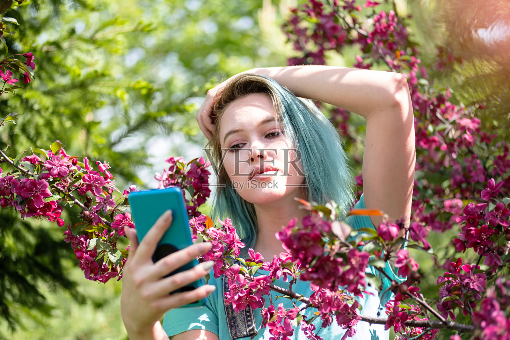
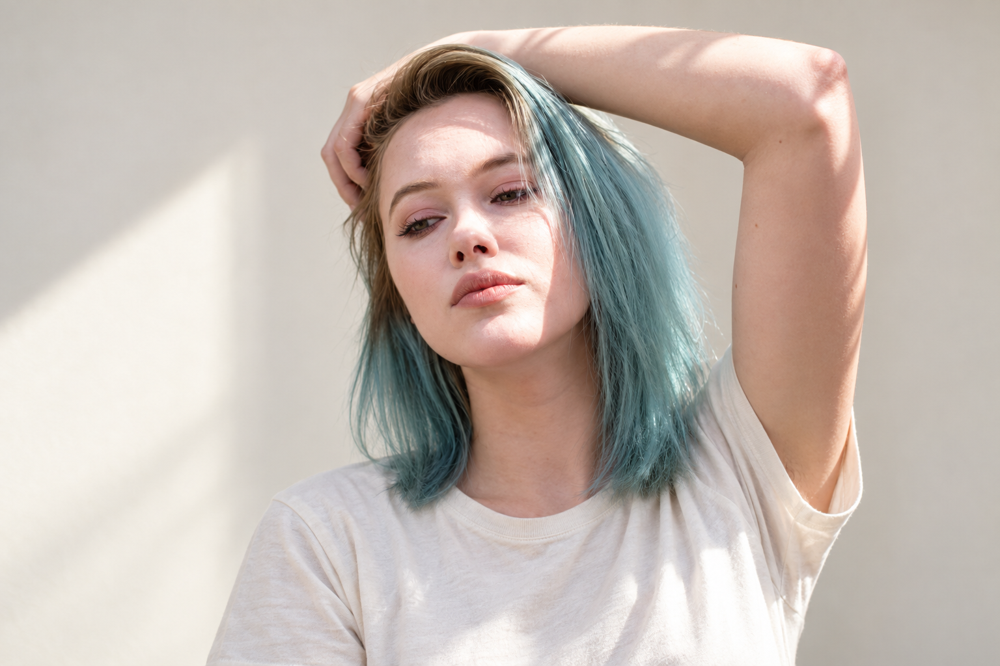

# F035 灰青蓝齐肩直发侧扫发根女性人物卡

固定外貌、独立服装、原图与测试记录一起保存。

目录

- [人物标识](#profile)
- [原始参考](#reference)
- [六项外貌细节](#appearance)
- [毛发配饰与妆容](#grooming)
- [观察边界](#limits)
- [固定描述原文](#fixed)
- [已测试调用提示词](#prompt)
- [独立服装模块](#clothing)
- [原图对比与验收](#validation)
- [调用方法](#reuse)
- [来源记录](#rights)
- [相关入口](#related)

<a id="profile"></a>
## 人物标识

编号：**F035**；分类：女性；版本：v1.0；归档日期：2026-10-07。

设计年龄：24岁，仅是成年角色创作参数。当前状态：**基础特征通过**。

<a id="reference"></a>
## 原始参考



文件：`veer-420116712.jpg`；尺寸：1600×1067。

SHA256：`868762011c5584094ebf315d0ac0b3f5baf00561b698e3f7aef8f17b5a0a3437`。

原图按字节保存，未改动原始照片。多人图取景规则：Select the only woman. Keep blue-green shoulder-length straight hair with darker blonde-brown roots, lifted chin, subtle pursed lips and arm bent over head.

<a id="appearance"></a>
## 六项外貌细节

**脸型：** 偏长椭圆脸，颧区中等宽，下颌柔和收拢，下巴圆钝；抬下巴形成的轮廓拉长不当永久脸长。

**眉毛和眼睛：** 浅棕中等浓眉，低弧形，眉尾轻落；眼睛偏长，视线向侧下方，上睑褶皱可见，虹膜在阴影中不确定。

**鼻子：** 鼻梁中等高度、鼻背较窄，鼻尖小圆；抬头使鼻孔椭圆暗部更可见，鼻翼中等宽，不等于固定上翘鼻。

**嘴唇：** 闭嘴略微噘唇，上下唇中等厚、下唇稍厚，唇峰清楚且圆；唇色玫瑰珊瑚，姿态不支持静态数值比例。

**肤色：** 白皙偏粉米色，日照下鼻与颧部光亮，局部花影不作为肤色斑点；没有可确认雀斑。

**发型：** 齐肩灰青蓝直发，深金棕发根可见，较深侧分，前额一束向后侧扫起，发丝稍蓬但主体顺直，尾端轻碎层次。

<a id="grooming"></a>
## 毛发配饰与妆容

保留浅粉眼妆和睫毛，抬起的手臂与触碰头顶的手对应原图；染发色是外观锚点。

<a id="limits"></a>
## 观察边界

- 花枝、水印与强日照遮住局部细节
- 鼻孔外露、唇形与脸长受抬头和噘唇影响
- 五官比例为视觉描述；无法观察的结构保持未知。
- 未验证纯文字复现、多角度或多次随机生成一致性。

<a id="fixed"></a>
## 固定描述原文

后续调用逐字复用，服装和场景在外部替换。

```text
人物卡F035：灰青蓝齐肩直发侧扫发根。成年女性角色，设计年龄24岁；年龄仅为创作参数。
脸型：偏长椭圆脸，颧区中等宽，下颌柔和收拢，下巴圆钝；抬下巴形成的轮廓拉长不当永久脸长。
眉毛和眼睛：浅棕中等浓眉，低弧形，眉尾轻落；眼睛偏长，视线向侧下方，上睑褶皱可见，虹膜在阴影中不确定。
鼻子：鼻梁中等高度、鼻背较窄，鼻尖小圆；抬头使鼻孔椭圆暗部更可见，鼻翼中等宽，不等于固定上翘鼻。
嘴唇：闭嘴略微噘唇，上下唇中等厚、下唇稍厚，唇峰清楚且圆；唇色玫瑰珊瑚，姿态不支持静态数值比例。
肤色：白皙偏粉米色，日照下鼻与颧部光亮，局部花影不作为肤色斑点；没有可确认雀斑。
发型：齐肩灰青蓝直发，深金棕发根可见，较深侧分，前额一束向后侧扫起，发丝稍蓬但主体顺直，尾端轻碎层次。
毛发配饰与妆容：保留浅粉眼妆和睫毛，抬起的手臂与触碰头顶的手对应原图；染发色是外观锚点。
观察限制：花枝、水印与强日照遮住局部细节；鼻孔外露、唇形与脸长受抬头和噘唇影响
```

<a id="prompt"></a>
## 已测试调用提示词

下面是当前选用样例实际执行过的完整提示词。固定文字未因生成结果而改写。

```text
Use case: photorealistic-natural. Create one new photographic character portrait based on input image 1, the ORIGINAL user-provided reference. Preserve visible face structure, natural age impression, exact head angle, gaze, expression, hair silhouette and grooming. Original visible geometry takes priority over numeric estimates. Do not impose generic idealized beauty.

固定人物描述，逐字复用：
人物卡F035：灰青蓝齐肩直发侧扫发根。成年女性角色，设计年龄24岁；年龄仅为创作参数。
脸型：偏长椭圆脸，颧区中等宽，下颌柔和收拢，下巴圆钝；抬下巴形成的轮廓拉长不当永久脸长。
眉毛和眼睛：浅棕中等浓眉，低弧形，眉尾轻落；眼睛偏长，视线向侧下方，上睑褶皱可见，虹膜在阴影中不确定。
鼻子：鼻梁中等高度、鼻背较窄，鼻尖小圆；抬头使鼻孔椭圆暗部更可见，鼻翼中等宽，不等于固定上翘鼻。
嘴唇：闭嘴略微噘唇，上下唇中等厚、下唇稍厚，唇峰清楚且圆；唇色玫瑰珊瑚，姿态不支持静态数值比例。
肤色：白皙偏粉米色，日照下鼻与颧部光亮，局部花影不作为肤色斑点；没有可确认雀斑。
发型：齐肩灰青蓝直发，深金棕发根可见，较深侧分，前额一束向后侧扫起，发丝稍蓬但主体顺直，尾端轻碎层次。
毛发配饰与妆容：保留浅粉眼妆和睫毛，抬起的手臂与触碰头顶的手对应原图；染发色是外观锚点。
观察限制：花枝、水印与强日照遮住局部细节；鼻孔外露、唇形与脸长受抬头和噘唇影响

Test scene: quiet warm off-white backdrop with soft natural daylight, head and upper torso framing, normal lens perspective, whole visible hairstyle in frame. Preserve the original head and body orientation, including reclined pose if present. Clothing: simple cream cotton crewneck T-shirt, relaxed regular shoulder fit, matte fabric, no graphics. Keep reference facial accessories, glasses, hat, and any phone/hand/prop occlusion that covers facial areas. Do not invent unseen eyes or concealed mouth. Props away from face can be outside frame. Preserve natural pores, fine lines and mild asymmetry. Do not enlarge eyes, sharpen jaw, intensify makeup, thicken beard, tighten curls or increase hair volume. Match source smile instead of imposing closed-mouth proportions. Single photograph, one character, no labels or collage.

Target selection: Select the only woman. Keep blue-green shoulder-length straight hair with darker blonde-brown roots, lifted chin, subtle pursed lips and arm bent over head.
```

<a id="clothing"></a>
## 独立服装模块

原图穿搭作为独立参考，不并入脸部固定文字。

| 层次 | 原图观察 |
| --- | --- |
| 色彩搭配逻辑 | 上衣与染发近色呼应，牛仔作中性过渡 |
| 轮廓和结构 | 基础上衣叠背带结构 |
| 材质和质感 | 棉布柔软、牛仔粗纹理 |
| 设计类型 | 短袖圆领上衣配牛仔背带 |

本轮统一测试服装：奶白圆领棉T恤，常规合肩、自然宽松、柔软哑光、无图案。换装时替换完整服装条款，避免新旧要求冲突。

<a id="validation"></a>
## 原图对比与验收



测试方式：原始参考图＋固定描述，统一基础服装，保留参考角度和表情。每次重测仍从原图出发。

选用：v1；结论：基础特征通过。

保留特征：灰青蓝直发与深根、抬头鼻唇关系和手臂姿态保持。

首轮偏差与限制：水印下局部五官由生成补足；皮肤细纹更清楚，发尾整齐度略提高。

本卡没有进行第二轮重测。

这是可见外貌的定性比对，不是身份识别或量化相似率。

<a id="reuse"></a>
## 调用方法

1. 按编号 F035 检索并读取完整固定描述。
2. 附上本卡登记的用户原始参考图；本轮生成样例只作结果对照。
3. 使用当前已测试提示词，独立替换服装、场景、构图；仍保持固定文字。
4. 若要求新角度、摘镜或解除遮挡，补充对应原始参考，或明确将未知部分作为创作补足。
5. 新结果继续对照原图。相同文字有助于相似，但不能保证每次完全相同。

<a id="rights"></a>
## 来源记录

2026-10-07 用户要求继续新增男女各10张卡，来源为指定的“人物场景 素材”目录。照片版权、肖像及AI使用范围沿用待核实状态；真实身份与是否公众人物未核验。

本批按文件SHA256排除已归档的相同照片；这不等于确认所有照片都来自不同人物。

<a id="related"></a>
## 相关入口

- [女性人物卡索引](女性人物卡索引.md)
- [人物卡分类索引](../人物卡分类索引.md)
