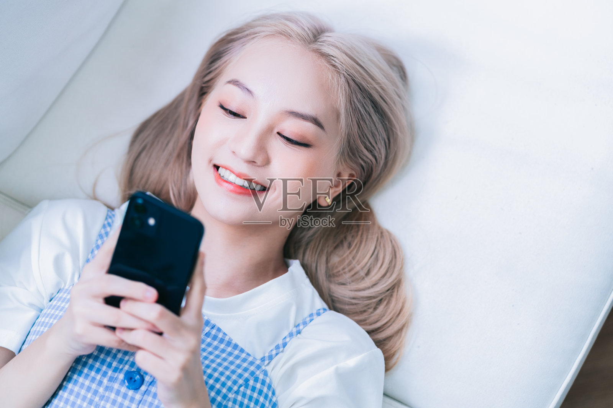

# F038 灰米金长发弧形眼线女性人物卡

固定外貌、独立服装、原图与测试记录一起保存。

目录

- [人物标识](#profile)
- [原始参考](#reference)
- [六项外貌细节](#appearance)
- [毛发配饰与妆容](#grooming)
- [观察边界](#limits)
- [固定描述原文](#fixed)
- [已测试调用提示词](#prompt)
- [独立服装模块](#clothing)
- [原图对比与验收](#validation)
- [调用方法](#reuse)
- [来源记录](#rights)
- [相关入口](#related)

<a id="profile"></a>
## 人物标识

编号：**F038**；分类：女性；版本：v1.0；归档日期：2026-10-07。

设计年龄：24岁，仅是成年角色创作参数。当前状态：**基础特征通过**。

<a id="reference"></a>
## 原始参考



文件：`veer-419384286.jpg`；尺寸：1600×1067。

SHA256：`a5a1d17e6fad9ffb97d56b05d8c6869ab8a80df81b7bb2d0855420d834d991b2`。

原图按字节保存，未改动原始照片。多人图取景规则：Select the only woman. Keep reclining/lying pose and original head orientation, modest coral lipstick, black eyeliner and ash-beige blonde hair spread on the cushion.

<a id="appearance"></a>
## 六项外貌细节

**脸型：** 柔和椭圆脸，颧区宽度适中，脸颊平顺，下颌较柔，下巴短圆；躺姿的外轮廓不作为直立精确比例。

**眉毛和眼睛：** 灰棕中细眉，眉峰柔圆、尾部下落；向下看的眼睛偏长，上眼睑褶皱部分可见，外眼线微扬，虹膜不能可靠识别。

**鼻子：** 鼻梁中等偏低、鼻背较窄，鼻尖小圆，鼻翼适中偏窄；当前角度鼻孔少量可见。

**嘴唇：** 笑时露上排牙，上唇中等偏薄、下唇稍厚，双峰柔和，珊瑚红唇色明显，不能改成浓厚丰唇。

**肤色：** 白皙粉米色，冷亮室内光下较浅，眼颊有淡粉妆色，未见明显雀斑。

**发型：** 灰米金长发，侧分，发根略深，顺直部分在躺姿下向两侧摊开，发梢自然大弯，耳侧顺贴；不能当作蓬松卷发。

<a id="grooming"></a>
## 毛发配饰与妆容

清晰黑色上眼线、珊瑚色唇妆，小金色耳钉；保留卧躺头部方向。

<a id="limits"></a>
## 观察边界

- 卧躺与亮冷光影响脸部和发尾形状
- 不从图片推断国籍或族裔，年龄仅为设计参数
- 五官比例为视觉描述；无法观察的结构保持未知。
- 未验证纯文字复现、多角度或多次随机生成一致性。

<a id="fixed"></a>
## 固定描述原文

后续调用逐字复用，服装和场景在外部替换。

```text
人物卡F038：灰米金长发弧形眼线。成年女性角色，设计年龄24岁；年龄仅为创作参数。
脸型：柔和椭圆脸，颧区宽度适中，脸颊平顺，下颌较柔，下巴短圆；躺姿的外轮廓不作为直立精确比例。
眉毛和眼睛：灰棕中细眉，眉峰柔圆、尾部下落；向下看的眼睛偏长，上眼睑褶皱部分可见，外眼线微扬，虹膜不能可靠识别。
鼻子：鼻梁中等偏低、鼻背较窄，鼻尖小圆，鼻翼适中偏窄；当前角度鼻孔少量可见。
嘴唇：笑时露上排牙，上唇中等偏薄、下唇稍厚，双峰柔和，珊瑚红唇色明显，不能改成浓厚丰唇。
肤色：白皙粉米色，冷亮室内光下较浅，眼颊有淡粉妆色，未见明显雀斑。
发型：灰米金长发，侧分，发根略深，顺直部分在躺姿下向两侧摊开，发梢自然大弯，耳侧顺贴；不能当作蓬松卷发。
毛发配饰与妆容：清晰黑色上眼线、珊瑚色唇妆，小金色耳钉；保留卧躺头部方向。
观察限制：卧躺与亮冷光影响脸部和发尾形状；不从图片推断国籍或族裔，年龄仅为设计参数
```

<a id="prompt"></a>
## 已测试调用提示词

下面是当前选用样例实际执行过的完整提示词。固定文字未因生成结果而改写。

```text
Use case: photorealistic-natural. Create one new photographic character portrait based on input image 1, the ORIGINAL user-provided reference. Preserve visible face structure, natural age impression, exact head angle, gaze, expression, hair silhouette and grooming. Original visible geometry takes priority over numeric estimates. Do not impose generic idealized beauty.

固定人物描述，逐字复用：
人物卡F038：灰米金长发弧形眼线。成年女性角色，设计年龄24岁；年龄仅为创作参数。
脸型：柔和椭圆脸，颧区宽度适中，脸颊平顺，下颌较柔，下巴短圆；躺姿的外轮廓不作为直立精确比例。
眉毛和眼睛：灰棕中细眉，眉峰柔圆、尾部下落；向下看的眼睛偏长，上眼睑褶皱部分可见，外眼线微扬，虹膜不能可靠识别。
鼻子：鼻梁中等偏低、鼻背较窄，鼻尖小圆，鼻翼适中偏窄；当前角度鼻孔少量可见。
嘴唇：笑时露上排牙，上唇中等偏薄、下唇稍厚，双峰柔和，珊瑚红唇色明显，不能改成浓厚丰唇。
肤色：白皙粉米色，冷亮室内光下较浅，眼颊有淡粉妆色，未见明显雀斑。
发型：灰米金长发，侧分，发根略深，顺直部分在躺姿下向两侧摊开，发梢自然大弯，耳侧顺贴；不能当作蓬松卷发。
毛发配饰与妆容：清晰黑色上眼线、珊瑚色唇妆，小金色耳钉；保留卧躺头部方向。
观察限制：卧躺与亮冷光影响脸部和发尾形状；不从图片推断国籍或族裔，年龄仅为设计参数

Test scene: quiet warm off-white backdrop with soft natural daylight, head and upper torso framing, normal lens perspective, whole visible hairstyle in frame. Preserve the original head and body orientation, including reclined pose if present. Clothing: simple cream cotton crewneck T-shirt, relaxed regular shoulder fit, matte fabric, no graphics. Keep reference facial accessories, glasses, hat, and any phone/hand/prop occlusion that covers facial areas. Do not invent unseen eyes or concealed mouth. Props away from face can be outside frame. Preserve natural pores, fine lines and mild asymmetry. Do not enlarge eyes, sharpen jaw, intensify makeup, thicken beard, tighten curls or increase hair volume. Match source smile instead of imposing closed-mouth proportions. Single photograph, one character, no labels or collage.

Target selection: Select the only woman. Keep reclining/lying pose and original head orientation, modest coral lipstick, black eyeliner and ash-beige blonde hair spread on the cushion.
```

<a id="clothing"></a>
## 独立服装模块

原图穿搭作为独立参考，不并入脸部固定文字。

| 层次 | 原图观察 |
| --- | --- |
| 色彩搭配逻辑 | 浅色内搭与浅冷色细格纹低对比叠穿 |
| 轮廓和结构 | 宽松内搭、细肩带直身结构 |
| 材质和质感 | 棉质针织搭轻织物 |
| 设计类型 | 圆领短袖T恤叠细肩带格纹服装 |

本轮统一测试服装：奶白圆领棉T恤，常规合肩、自然宽松、柔软哑光、无图案。换装时替换完整服装条款，避免新旧要求冲突。

<a id="validation"></a>
## 原图对比与验收


测试方式：原始参考图＋固定描述，统一基础服装，保留参考角度和表情。每次重测仍从原图出发。

选用：v1；结论：基础特征通过。

保留特征：卧躺角度、灰米金长发、细眼线、珊瑚唇和柔和脸型保持。

首轮偏差与限制：皮肤比原图略暖、整体较平滑；只验证了当前卧躺与笑态。

本卡没有进行第二轮重测。

这是可见外貌的定性比对，不是身份识别或量化相似率。

<a id="reuse"></a>
## 调用方法

1. 按编号 F038 检索并读取完整固定描述。
2. 附上本卡登记的用户原始参考图；本轮生成样例只作结果对照。
3. 使用当前已测试提示词，独立替换服装、场景、构图；仍保持固定文字。
4. 若要求新角度、摘镜或解除遮挡，补充对应原始参考，或明确将未知部分作为创作补足。
5. 新结果继续对照原图。相同文字有助于相似，但不能保证每次完全相同。

<a id="rights"></a>
## 来源记录

2026-10-07 用户要求继续新增男女各10张卡，来源为指定的“人物场景 素材”目录。照片版权、肖像及AI使用范围沿用待核实状态；真实身份与是否公众人物未核验。

本批按文件SHA256排除已归档的相同照片；这不等于确认所有照片都来自不同人物。

<a id="related"></a>
## 相关入口

- [女性人物卡索引](女性人物卡索引.md)
- [人物卡分类索引](../人物卡分类索引.md)
