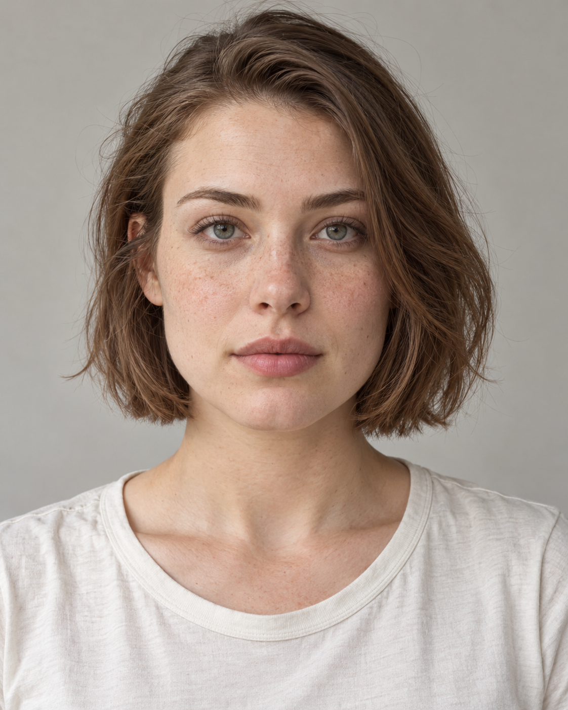

# F001 人物一·清爽短发女性人物卡

> **重点：** F001 是本次选定的 24 岁清爽短发成年女性。以后调用“人物一”或“F001人物卡”，复用下方固定文字与参考原图。相同文字用于保持设定，参考原图用于稳定面部身份；重新生成不保证像素级一致。

## 目录

- [目录](#toc)
- [1. 人物标识与调用入口](#identity)
- [2. 固定参考原图](#master-reference)
- [3. 固定外貌文字](#fixed-appearance)
- [4. 首次生成的完整原始提示词](#original-prompt)
- [5. 下次调用与生成流程](#reuse-workflow)
- [6. 一致性边界与验收](#consistency-boundary)
- [7. 相关知识](#related-knowledge)
- [8. 来源与维护](#provenance)

## 1. 人物标识与调用入口

- **固定编号：** F001。
- **固定名称：** 人物一·清爽短发女性。
- **版本：** v1.0；归档日期：2026-09-30。
- **检索别名：** 人物一、清爽利落型、清爽短发女性、灰绿眼雀斑短发女孩、F001人物卡。
- **年龄与身份：** 24 岁的虚构成年女性；当代美国／西方日常人物语境，不对应现实中的具体个人。
- **核心识别点：** 方圆下颌、平直眉、灰绿色虹膜、鼻梁与上脸颊的自然雀斑、浅栗棕侧分短波波头。
- **调用示例：** “调用知识库 F001 人物卡，使用固定文字和参考原图，让她穿浅蓝色衬衫坐在咖啡馆，保持同一人物。”
- **默认目标：** 保持这位人物的视觉身份和稳定外貌；场景、服装、姿势按本次要求变化。

## 2. 固定参考原图

- **知识库图片相对路径：** `人物一-清爽短发女性-参考原图.png`，与本人物卡放在同一目录。
- **原始文件名：** `01_fresh_short_hair.png`。
- **文件规格：** PNG，1122 × 1402 像素，原图未经编辑或重新压缩。
- **SHA-256：** `b3ebb2bdc38a4b010ed32219b083cbb5896688e95c597c82e9f91b06dabc721b`。
- **来源：** 2026-09-30 本次 Codex 对话使用内置 image_gen 生成的第一位人物；用户在看到结果后明确要求将“人物一”归档为可复用人物卡。
- **使用约定：** 将此图作为固定身份参考。用户本次指定这张生成图作为人物卡依据；后续每次生成都回到此原图，不自动把后续生成的衍生图替换成身份基准，也不在衍生图上连续迭代，除非用户明确指定。
- **图文优先级：** 本次用户明确要求的变化优先；其余身份细节以此参考原图为视觉依据，以固定文字补充说明。文字中的厚度比例、鼻梁高度和雀斑疏密属于设计描述，不是对原图的精密测量。

## 3. 固定外貌文字

以下文字逐字摘自本次实际使用的生图提示词。需要同一个人物时保留该段，不临时改写五官或混入人物二、人物三的特征。

~~~text
人物一，24岁，气质清爽利落，放松而稍有运动感。
脸型：方圆脸，正面近短矩形，脸长略大于脸宽。额头和下颌宽度接近，颧骨略宽。下颌角能看见但转角柔和，脸颊适度饱满，面中部平整，下巴短而偏宽，底缘浅圆弧，必须保留方圆轮廓。
眉眼：中等偏浓的平直棕眉，眉头自然向上毛流，眉身平直，外侧三分之一略抬起，眉峰钝，眉尾稍短末端轻落。中等大小的长杏仁眼，眼尾仅轻微上扬，浅上眼皮褶皱、外侧略覆盖，下眼睑较平。灰绿色虹膜，外缘颜色略深。
鼻子：鼻根中等高度，中高鼻梁，以直线为主、侧面极轻微骨性起伏；鼻尖中等且略圆，朝向水平。鼻翼总宽略小于两内眼角间距。鼻孔偏窄、纵向椭圆，正面只露少量下缘。
嘴唇：中等厚度，上下唇可见唇红厚度约1:1.4，上唇清晰但不尖的双唇峰，浅中央凹口，舒展M形；下唇中央饱满、两侧渐薄，嘴角水平。低饱和玫瑰粉唇色、细小唇纹。
肤色：白皙暖米色，鼻尖脸颊轻微泛红，鼻梁和上脸颊有稀疏且深浅大小不规则的浅棕雀斑，淡淡眼下阴影。
发型：浅栗棕发、发根略深，短波波头长度在下巴与肩膀之间，六四侧分，一侧额头更露出，另一侧几缕头发贴近颧骨。顶部饱满、整体有分量，发尾及脸周轻层次，发尾自然微弯、局部外翘，耳侧碎发。
最重要辨识点：方圆下颌、平直眉、灰绿眼、稀疏雀斑、侧分浅棕短发。
~~~

**六项锁定检查：** 方圆脸和短宽下巴；平直眉及轻微上扬的灰绿杏仁眼；中高鼻梁及偏窄鼻孔；上下唇约 1∶1.4 与清楚的圆钝唇峰；白皙暖米色皮肤和自然雀斑；浅栗棕六四侧分短发。比例均为视觉参考。

**未定义信息：** 全身身高、体重、职业、姓名、国籍证件信息、不可见身体特征和精确侧后面结构没有设定，不作为已知事实补写进人物卡。

## 4. 首次生成的完整原始提示词

以下区块为原始提示词原文，已与保存的生成记录逐字核对。默认复现同款正面肖像时原样使用；其中的服装、背景和镜头描述属于首次肖像的画面设定。

~~~text
Use case: photorealistic-natural.
生成一张高度写实的成年女性人物设定肖像，像真实相机拍摄的自然人像，重点准确展示脸型、眉眼、鼻孔、唇形、皮肤细节及完整发型。
统一拍摄规范：竖幅4:5，单人正面，镜头与眼睛齐平，头部摆正，平视镜头，自然闭嘴，表情放松。取景从完整头顶至胸口下方，全部发型和发尾完整可见，人物居中，头脸占据画面主要区域。85mm人像镜头观感，五官清楚，避免广角变形。
背景为纯净的浅暖灰色室内背景。柔和窗光略从侧前方照入，以温和阴影展示鼻梁和颧骨结构，肤色准确。穿简单素色米白圆领棉质T恤。
皮肤保留细小毛孔、细微色差和自然眼下纹理；自然眉毛毛流、细小唇纹、碎发和轻微左右不对称。近素颜，不用浓妆、美颜磨皮、夸张睫毛、修容或玻璃皮肤。不是插画、3D或时尚精修广告。
仅一个人，一张完整肖像，无拼图，无对照面板，无文字、标签、标尺、水印或装饰元素。人物为虚构的当代美国／西方年轻成年女性。

人物一，24岁，气质清爽利落，放松而稍有运动感。
脸型：方圆脸，正面近短矩形，脸长略大于脸宽。额头和下颌宽度接近，颧骨略宽。下颌角能看见但转角柔和，脸颊适度饱满，面中部平整，下巴短而偏宽，底缘浅圆弧，必须保留方圆轮廓。
眉眼：中等偏浓的平直棕眉，眉头自然向上毛流，眉身平直，外侧三分之一略抬起，眉峰钝，眉尾稍短末端轻落。中等大小的长杏仁眼，眼尾仅轻微上扬，浅上眼皮褶皱、外侧略覆盖，下眼睑较平。灰绿色虹膜，外缘颜色略深。
鼻子：鼻根中等高度，中高鼻梁，以直线为主、侧面极轻微骨性起伏；鼻尖中等且略圆，朝向水平。鼻翼总宽略小于两内眼角间距。鼻孔偏窄、纵向椭圆，正面只露少量下缘。
嘴唇：中等厚度，上下唇可见唇红厚度约1:1.4，上唇清晰但不尖的双唇峰，浅中央凹口，舒展M形；下唇中央饱满、两侧渐薄，嘴角水平。低饱和玫瑰粉唇色、细小唇纹。
肤色：白皙暖米色，鼻尖脸颊轻微泛红，鼻梁和上脸颊有稀疏且深浅大小不规则的浅棕雀斑，淡淡眼下阴影。
发型：浅栗棕发、发根略深，短波波头长度在下巴与肩膀之间，六四侧分，一侧额头更露出，另一侧几缕头发贴近颧骨。顶部饱满、整体有分量，发尾及脸周轻层次，发尾自然微弯、局部外翘，耳侧碎发。
最重要辨识点：方圆下颌、平直眉、灰绿眼、稀疏雀斑、侧分浅棕短发。
~~~

**已知生成记录：** 内置 `image_gen`；首次为纯文字生图，没有输入参考图；`transparent_background=false`；提示词要求竖幅 4∶5，实际结果为 1122 × 1402。工具未向本次调用暴露可保存的随机种子、底层模型版本或采样参数，不能补写或假设这些值。

## 5. 下次调用与生成流程

1. 通过 GBrain 搜索“F001 人物卡”或“人物一 清爽短发女性”，确认命中本页；优先使用相关 chunk，按当次用户授权和知识库规则决定是否读取全文。
2. 取得固定外貌文字、完整原始提示词和固定参考原图位置。需要完全相同文字时逐字复用对应区块；不要把检索摘要、截断 chunk 或重新概括的描述当成原文。
3. 在当前知识库根目录下解析图片相对路径，先查看图片，确认读取的是本页原图。有条件时核对 SHA-256；不要默认依赖上一次聊天的图片上下文。
4. **复现相同肖像：** 以固定参考原图作为身份参考，配合完整原始提示词，再加本节的身份保持指令。
5. **更换场景、服装或姿势：** 固定外貌段保持原文；将首次提示词中与新要求冲突的背景、服装和姿势条款移到本次画面要求中替换。不要同时要求“浅灰背景”与“咖啡馆背景”等互相冲突的画面。
6. 若使用带本地图片路径输入的图像工具，将解析后的原图路径作为参考图参数，并明确其角色为“身份参考”；若工具无法读取或图片丢失，先寻找本页登记的归档图或请用户重新提供参考图。只有文字时只能生成相似人物，不能宣称已保持同一张脸。
7. 每次检查脸型、眉眼、鼻型、嘴唇、肤色、雀斑和发型；发现变化时从固定原图重做本次任务。新的图片单独保存，不覆盖原图或本卡固定文字。

**固定身份保持指令：**

~~~text
使用所附 F001 固定参考原图作为唯一人物身份参考，生成同一位24岁的成年女性。保持原图的脸型、颧骨与下颌轮廓、五官间距、眉形、灰绿色眼睛、鼻梁与鼻翼、唇形、肤色、雀斑分布、发际线、浅栗棕发色和短发长度一致，保留自然皮肤纹理和年龄感。本次只调整用户明确要求的服装、姿势、表情、背景、光线或构图；其他人物身份特征保持不变。以原图中的人物为准，不把她重新设计成另一张脸。
~~~

**场景变化调用范例：**

~~~text
调用 F001／人物一·清爽短发女性。使用人物卡的固定参考原图、固定外貌文字和身份保持指令。画面改为：浅蓝色衬衫、咖啡馆窗边、上半身坐姿、自然日光、看向镜头。保持同一个人的脸、灰绿色眼睛、雀斑和浅栗棕短发。
~~~

## 6. 一致性边界与验收

- **文字复用：** 人物卡保存完整原文，后续可以逐字复用；摘要、别名和编号只是检索入口，不能代替完整提示词。
- **相似与同一人的区别：** 相同文字有助于重复外貌特征，但独立采样仍可能改变脸部。固定原图与固定文字配合，更有利于维持同一人物；仍不能承诺每次像素完全一致。
- **完全相同的图片：** 直接使用归档 PNG；重新生成不等于复制原文件。
- **主要验收：** 方圆下颌、灰绿色眼睛、平直眉、原图鼻唇形态、自然雀斑、浅栗棕短发和年龄感没有变成另一人；服装、背景与姿势符合本次请求。
- **本次核验范围：** 原图完整复制、哈希匹配、原始文字保真、目录锚点、知识库写入和检索。未额外生成第二张图测试跨场景身份一致性，不能把未来复现效果标为已验证。

## 7. 相关知识

- [AI 生图能力知识索引](../../人工智能/图像生成/图像生成知识索引.md)：本人物卡的知识库入口。
- [人物身份与面孔控制](../../人工智能/图像生成/材质人物场景与一致性控制.md#identity-control)：人物身份锁定的通用方法。
- [生图基础、提示词与参考图工作流](../../人工智能/图像生成/生图基础提示词与参考图工作流.md)：提示词结构和参考图使用。

- [女性人物卡分类索引](女性人物卡索引.md)
- [男性与女性人物卡总索引](../人物卡分类索引.md)

## 8. 来源与维护

- **用户原始目标：** 将人物一做成人物卡并放入知识库，下次能调用相同文字生成相同或类似人物。
- **资料来源：** 2026-09-30 本次对话的已确认文字设定、实际生图提示词、第一张输出 PNG 和本次归档请求。
- **原始会话标识：** `01a0efec-1d80-7f53-bba4-e2d149dfa7bc`。
- **归档方式：** 按知识库现有“Codex 对话知识整理模板”组织，通过 GBrain MCP 保存正文；参考图原样复制到同一目录；复用既有 `AI人物卡/` 目录。
- **版本原则：** v1.0 固定原图和原始提示词保留。用户以后明确修改角色身份或选定新基准图时另记版本，记录变化，不静默覆盖旧基准。
- **时间记录：** 2026-09-30 创建 F001 人物卡，并关联图像生成知识索引。
