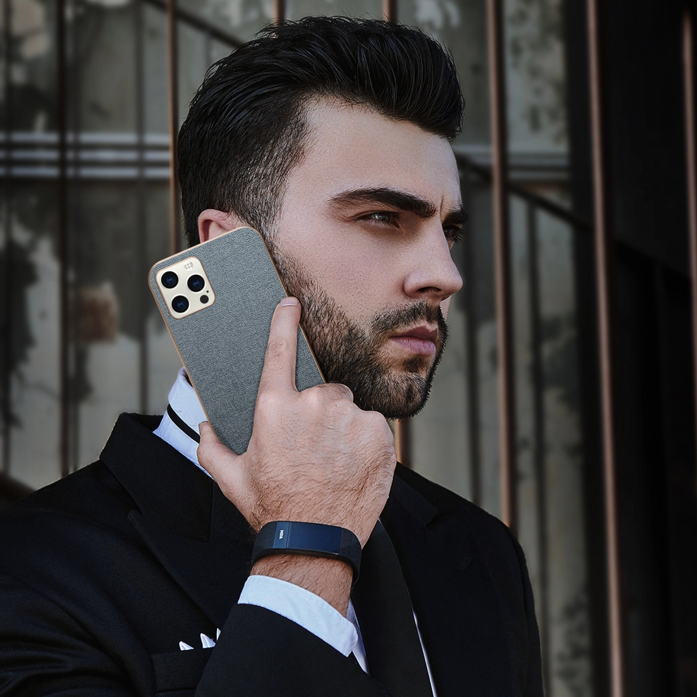
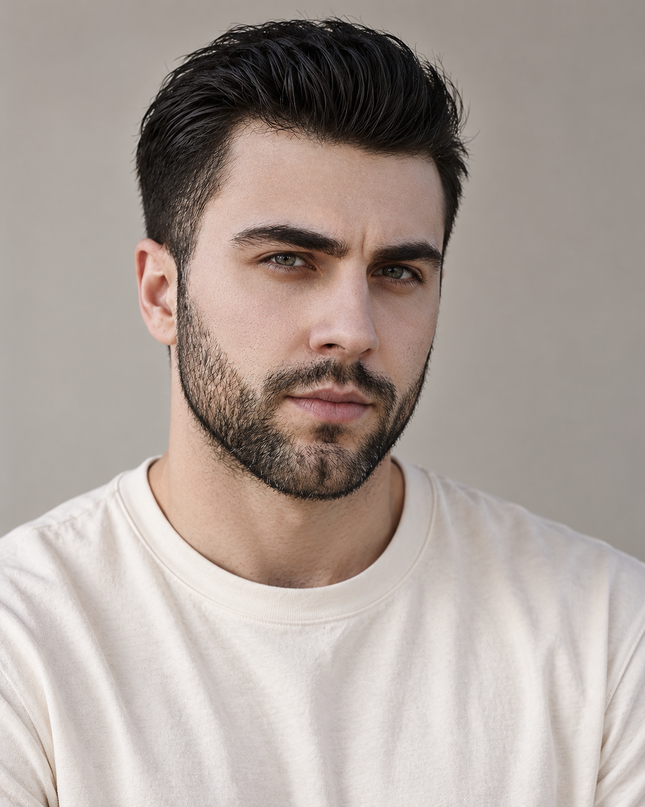

# M001 黑发后梳短胡须男性人物卡

用于逐字复用固定外貌描述，并配合本卡原始参考图生成相近外貌的成年男性角色。v1.0 已完成一次“原图＋固定文字”的新构图试生成；未进行纯文字复现或多次重复一致性测试。

目录

- [人物标识与固定重点](#profile)
- [原始参考与生成样例](#reference)
- [六项外貌细节](#appearance)
- [胡须与配饰](#grooming)
- [观察边界和创作补足](#limits)
- [固定人物描述](#fixed-description)
- [本轮完整生成提示词](#generation-prompt)
- [独立服装模块](#clothing)
- [原图与生成图对比](#comparison)
- [后续调用方法](#reuse)
- [来源与相关页面](#sources)

<a id="profile"></a>
## 人物标识与固定重点


- 编号：**M001**；分类：**男性**。
- 名称：**黑发后梳短胡须**。
- 设计年龄：28岁，为成年角色创作参数，不是实际年龄认定。
- 核心保留点：黑色高顶后梳短发、浓直眉、浅灰绿眼、方椭圆脸和修整短胡须。
- 固定的是外貌描述；服装、场景、动作和配饰可按用户要求调整。国籍、族裔和现实身份不从图片推断。

<a id="reference"></a>
## 原始参考与生成样例


原始素材：`393a4321a665093356594600095b349cf11aa2b0f7866-iyGD7W.jpg`。原始文件、水印或标记均保留。新生成图是本轮样例，默认不替代原图成为下一轮输入。





- 原图：1440 × 1440。
- 生成图：1122 × 1402。
- 原图 SHA256：`B4531E26B3BE84FB6EEE8446FEFB8EB0E24F152817768011A7561FB7586F0F8E`。
- 生成图 SHA256：`25A19ED48EFDF604C23149B1940A66BFB00621509D00869D7469ADB8B9DC5303`。
- 原图场景：深色西装与白衬衫，侧脸打电话，室外建筑背景。

<a id="appearance"></a>
## 六项外貌细节


| 维度 | 原图观察与设计 |
| --- | --- |
| 脸型 | 偏长的方椭圆脸，额头较宽，颧骨轮廓清楚，下颌有方感，下巴中等偏宽；胡须和手部遮挡使完整下颌骨缘不完全可见。 |
| 眉毛和眼睛 | 深黑棕浓眉，内侧粗、眉身近直，外侧轻抬；眼睛偏长、眼窝较深，上眼睑覆盖适中。原图虹膜呈浅灰绿色观感。 |
| 鼻子 | 中高而较直的鼻梁，鼻尖圆而略向前，鼻翼收敛；侧角只可见一侧少量鼻孔，正面宽度不能精确测量。 |
| 嘴唇 | 中等厚度，上唇较薄、唇峰浅而清楚，下唇更饱满；低饱和粉棕色，原图侧角不固定精确厚度比。 |
| 肤色 | 浅米色至浅棕之间，中性偏暖，有可见毛孔、细微泛红和自然眼下阴影；不添加密集雀斑。 |
| 发型 | 接近黑色的深棕发，顶部较长并向上后方梳起，两侧渐短；有分束纹理和明显顶部体积，耳侧贴头。 |

<a id="grooming"></a>
## 胡须与配饰


胡须：短而修整的全脸胡须，鬓角连接下颌和下巴，面颊较浅、下颌较密，保留上唇胡须；不要改成厚长络腮胡。配饰：原图手表和手机属于场景，不固定。

胡须按本卡记录的长度、密度与覆盖范围保持。配饰与五官分开记录，摘下眼镜不代表已从素材取得被遮挡眼部的真实结构。

<a id="limits"></a>
## 观察边界和创作补足


- 原图为侧转角度，手机与手部遮挡一侧下颌，正面鼻孔总宽属于补足。
- 浅灰绿色眼睛是照片光线下的观感；28岁是成年角色设计年龄。

侧转、低头、微笑和光线会改变鼻孔、唇厚、眼裂及肤色的观感。只明确记录可见部分，无法观察的细节标为创作补足；不把本轮生成偏差补写成原图事实。

<a id="fixed-description"></a>
## 固定人物描述


下方为 v1.0 固定描述原文，调用时保留文字，不用检索摘要或临时概括替代。

```text
M001｜黑发后梳短胡须。成年男性角色，设计年龄28岁；年龄为创作参数。
脸型：偏长的方椭圆脸，额头较宽，颧骨轮廓清楚，下颌有方感，下巴中等偏宽；胡须和手部遮挡使完整下颌骨缘不完全可见。
眉毛和眼睛：深黑棕浓眉，内侧粗、眉身近直，外侧轻抬；眼睛偏长、眼窝较深，上眼睑覆盖适中。原图虹膜呈浅灰绿色观感。
鼻子：中高而较直的鼻梁，鼻尖圆而略向前，鼻翼收敛；侧角只可见一侧少量鼻孔，正面宽度不能精确测量。
嘴唇：中等厚度，上唇较薄、唇峰浅而清楚，下唇更饱满；低饱和粉棕色，原图侧角不固定精确厚度比。
肤色：浅米色至浅棕之间，中性偏暖，有可见毛孔、细微泛红和自然眼下阴影；不添加密集雀斑。
发型：接近黑色的深棕发，顶部较长并向上后方梳起，两侧渐短；有分束纹理和明显顶部体积，耳侧贴头。
胡须与配饰：胡须：短而修整的全脸胡须，鬓角连接下颌和下巴，面颊较浅、下颌较密，保留上唇胡须；不要改成厚长络腮胡。配饰：原图手表和手机属于场景，不固定。
观察边界与生成补足：原图为侧转角度，手机与手部遮挡一侧下颌，正面鼻孔总宽属于补足。 浅灰绿色眼睛是照片光线下的观感；28岁是成年角色设计年龄。
优先保持：黑色高顶后梳短发、浓直眉、浅灰绿眼、方椭圆脸和修整短胡须。
```

<a id="generation-prompt"></a>
## 本轮完整生成提示词


本轮实际调用使用内置 imagegen，输入同时附原始参考图，透明背景关闭。工具未提供可记录的 seed 或底层模型版本，不补写假设值。

```text
Use case: photorealistic-natural.
任务：使用所附用户原始素材作为唯一外貌参考，结合下方固定文字，创作一张自然写实的成年男性人物卡肖像。保留可见面部结构、发型、肤色和胡须形态，重新拍摄新构图；不复制原图的手机、手部动作、服装、道具和背景。
构图：单人竖幅4:5，完整头顶至胸口下方，头发顶部和两侧完整可见，头部竖直、正面平视镜头，双肩自然放松。85mm人像摄影观感，避免广角夸张。自然闭嘴轻微笑意，保留原参考的成人年龄感。
背景与光线：浅暖灰纯净背景，柔和侧前窗光和温和补光，肤色自然，眼睛清楚。
独立服装模块：低饱和暖中性色；素色奶白圆领T恤，常规适度宽松版型、正常肩线、短袖；中等厚度柔软哑光棉布，少量自然褶皱；无口袋、无图案、无标志。这是本轮统一服装，可在以后场景中替换，不作为固定人物外貌。
保持毛孔、细小唇纹、眉毛毛流、碎发、短胡茬和轻微自然不对称。避免统一美颜脸、过分锐利下颌、夸张肌肉、磨皮和塑料肤质。只生成一位成年男性、一张完整新肖像，无拼图或文字覆盖。眼镜严格按每张卡的配饰说明处理。

M001｜黑发后梳短胡须。成年男性角色，设计年龄28岁；年龄为创作参数。
脸型：偏长的方椭圆脸，额头较宽，颧骨轮廓清楚，下颌有方感，下巴中等偏宽；胡须和手部遮挡使完整下颌骨缘不完全可见。
眉毛和眼睛：深黑棕浓眉，内侧粗、眉身近直，外侧轻抬；眼睛偏长、眼窝较深，上眼睑覆盖适中。原图虹膜呈浅灰绿色观感。
鼻子：中高而较直的鼻梁，鼻尖圆而略向前，鼻翼收敛；侧角只可见一侧少量鼻孔，正面宽度不能精确测量。
嘴唇：中等厚度，上唇较薄、唇峰浅而清楚，下唇更饱满；低饱和粉棕色，原图侧角不固定精确厚度比。
肤色：浅米色至浅棕之间，中性偏暖，有可见毛孔、细微泛红和自然眼下阴影；不添加密集雀斑。
发型：接近黑色的深棕发，顶部较长并向上后方梳起，两侧渐短；有分束纹理和明显顶部体积，耳侧贴头。
胡须与配饰：胡须：短而修整的全脸胡须，鬓角连接下颌和下巴，面颊较浅、下颌较密，保留上唇胡须；不要改成厚长络腮胡。配饰：原图手表和手机属于场景，不固定。
观察边界与生成补足：原图为侧转角度，手机与手部遮挡一侧下颌，正面鼻孔总宽属于补足。 浅灰绿色眼睛是照片光线下的观感；28岁是成年角色设计年龄。
优先保持：黑色高顶后梳短发、浓直眉、浅灰绿眼、方椭圆脸和修整短胡须。
参考图看不清的内容只按明确补足生成，不将水印或标记画入新肖像。
```

<a id="clothing"></a>
## 独立服装模块


| 层次 | 本轮统一服装 |
| --- | --- |
| 色彩搭配逻辑 | 低饱和暖中性色为大面积主体，与浅暖灰背景保持柔和明暗差；本轮具体颜色为奶白。 |
| 轮廓和结构 | 常规适度宽松版型，正常肩线，圆领短袖；不靠紧身衣改变身体观感。 |
| 材质和质感 | 中等厚度、柔软、哑光棉布，保留少量自然褶皱。 |
| 设计类型与细节 | 简洁圆领、普通短袖、无胸袋、无图案、无标志。 |

服装不是固定五官的一部分。以后更换时，替换完整提示词里的“独立服装模块”，保留固定人物描述；不要同时保留奶白T恤和新衬衫等冲突要求。要比较衣长、腰线或裤型，应采用更宽的取景。

<a id="comparison"></a>
## 原图与生成图对比


黑发后梳轮廓、浓眉、浅灰绿眼与短胡须较清楚；表情仍偏严肃。

**保留的可见特征**

- 黑色高顶后梳发、较短耳侧和浓直眉。
- 方椭圆脸方向、浅灰绿眼与连接下颌的短胡须。

**偏差与未验证细节**

- 生成图的胡须边界更整齐，脸颊胡须分布有变化。
- 仍有轻微侧转，近正面鼻翼宽度及另一侧轮廓是对原图缺失部分的补足。

**下一轮可调整方向**

继续从原始参考图生成，降低胡须边界的刻意感；需要标准正面时明确头部竖直、鼻梁居中、双眼处于同一水平。

建议尚未改写进 v1.0 提示词，保留本轮输入与输出的对应关系。以上为可见特征的定性比较，不提供身份识别结论或未经测量的相似度百分比。

<a id="reuse"></a>
## 后续调用方法


1. 在男性分类中按“M001”检索本卡。需要逐字复用时取得完整固定描述和生成提示词，不使用被截断的片段。用户明确调用完整卡片时可读取本卡全文；本地包另有 `prompt.txt`。
2. 解析本卡原始参考图片的相对路径，先查看图片；默认始终用用户原始素材，不在生成样例上反复迭代，除非用户明确指定。
3. 复用基准肖像时，使用本轮完整提示词与原始参考。换场景时，保持固定描述，替换服装、动作、背景、光线和构图要求。
4. 每次生成后比较脸型、眉眼、鼻唇、肤色、发型和胡须；确认改变固定外貌时建立新版本。
5. 只有文字时可以尝试生成相近类型，本轮未验证纯文字能锁定五官。

> 调用 M001 黑发后梳短胡须男性人物卡，原样保留 v1.0 固定描述，使用原始参考图。服装改为低饱和同色系、常规宽松版型、柔软哑光棉布的小翻领衬衫；场景是咖啡馆窗边。生成后对照原图检查发型、五官与胡须。

<a id="sources"></a>
## 来源与相关页面


- 素材来源：用户提供的“人物场景 素材”目录，具体文件为 `393a4321a665093356594600095b349cf11aa2b0f7866-iyGD7W.jpg`。
- 用户要求：知识库男性、女性分开，并继续做六张男性人物卡；沿用原图对比与以后复用的任务目标。
- 归档、试生成及视觉比较日期：2026-09-30。
- [男性人物卡索引](男性人物卡索引.md)
- [人物卡分类总索引](../人物卡分类索引.md)
- [女性人物卡索引](../女性/女性人物卡索引.md)
- [人物与场景一致性控制](../../人工智能/图像生成/材质人物场景与一致性控制.md#identity-control)
