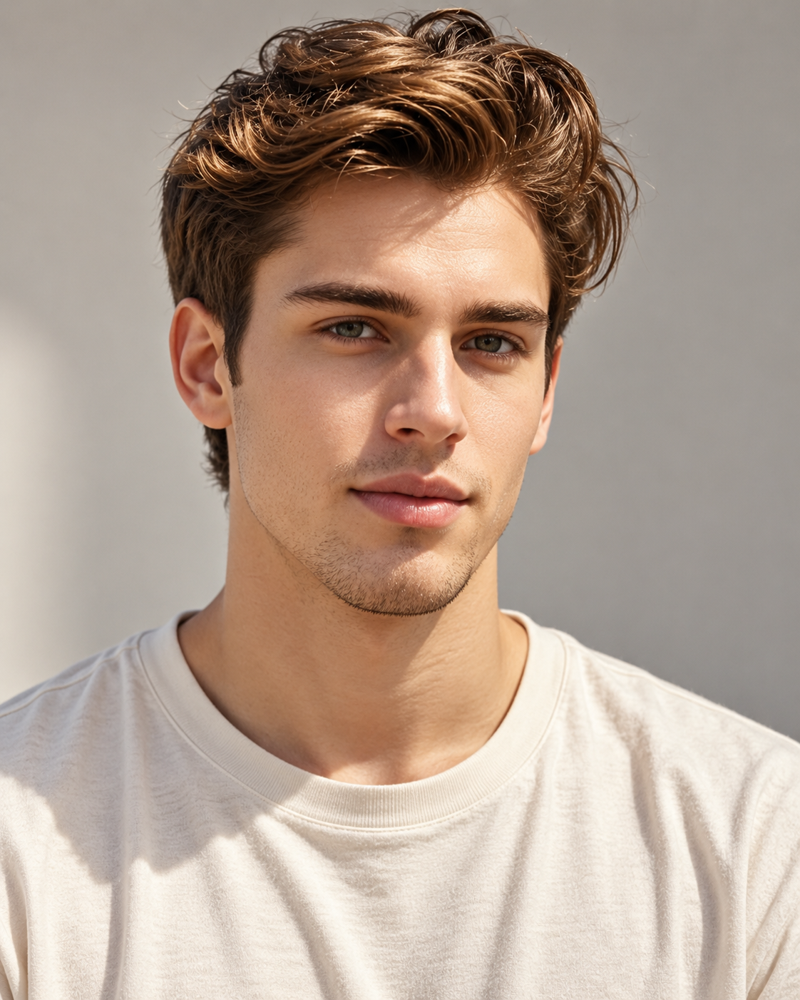

# M006 金棕蓬松短发男性人物卡

用于逐字复用固定外貌描述，并配合本卡原始参考图生成相近外貌的成年男性角色。v1.0 已完成一次“原图＋固定文字”的新构图试生成；未进行纯文字复现或多次重复一致性测试。

目录

- [A+使用定位](#aplus-role)
- [人物标识与固定重点](#profile)
- [原始参考与生成样例](#reference)
- [六项外貌细节](#appearance)
- [胡须与配饰](#grooming)
- [观察边界和创作补足](#limits)
- [固定人物描述](#fixed-description)
- [本轮完整生成提示词](#generation-prompt)
- [独立服装模块](#clothing)
- [原图与生成图对比](#comparison)
- [后续调用方法](#reuse)
- [来源与相关页面](#sources)

<a id="aplus-role"></a>
## A+使用定位

**2026-10-20用户确认：M006可作A+首张封面主角，也可作配角。**

A+首张封面完整名单：女性F006、F008、F010、F011、F016；男性M002、M006、M007。用于店铺时还须满足固定人物归属；选择封面主角时先查[人物总索引·A+首张封面与配角使用规则](../人物卡分类索引.md#aplus-cover)。人物固定描述、原始参考和既有生成验收边界分别按本卡原文执行。

来源：2026-10-20用户指定“女性06 08 10 11 16；男性02 06 07”可当A+首张封面，其余只适合当配角；同日进一步纠正F006与F030是完全不同的人物。

<a id="profile"></a>
## 人物标识与固定重点


- 编号：**M006**；分类：**男性**。
- 名称：**金棕蓬松短发**。
- 设计年龄：24岁，为成年角色创作参数，不是实际年龄认定。
- 核心保留点：金棕亮束的蓬松波浪短发、较浓低弧眉、浅灰绿眼、清楚方椭圆轮廓和极淡胡茬。
- 固定的是外貌描述；服装、场景、动作和配饰可按用户要求调整。国籍、族裔和现实身份不从图片推断。

<a id="reference"></a>
## 原始参考与生成样例


原始素材：`智能手机，手部特写，欧美青年男性侧脸，打电话，蓝天，户外环境，晴(1) (1).png`。原始文件、水印或标记均保留。新生成图是本轮样例，默认不替代原图成为下一轮输入。




- 原图：1024 × 1024。
- 生成图：1122 × 1402。
- 原图 SHA256：`EE51D7A9067D8513F04002506BBD65B16190B1EDF730B574C65987A5E91899D1`。
- 生成图 SHA256：`04BFBE1AD9B51BB61A48A766A89FE9E4E823494EE50BBC4409A98B1BE67C71C0`。
- 原图场景：蓝天下侧脸打电话，深灰圆领针织衫；原图左上角带AI标记。

<a id="appearance"></a>
## 六项外貌细节


| 维度 | 原图观察与设计 |
| --- | --- |
| 脸型 | 略长的方椭圆脸，颧骨清楚但不过尖，脸颊较薄，下颌有方感，下巴中等宽度、末端圆。 |
| 眉毛和眼睛 | 中深棕色较浓眉，眉身舒展、低弧形，眉尾轻轻上扬；眼睛偏长杏仁形，上眼睑覆盖适中，虹膜在原图中呈灰绿至灰榛色观感。 |
| 鼻子 | 中高而较直的鼻梁，鼻尖小而圆，朝向接近水平；鼻翼紧凑，侧角不能直接确定正面鼻孔总宽。 |
| 嘴唇 | 中等厚度，下唇略饱满，上唇唇峰低而圆，唇色自然粉棕；原图轻微分唇，不作精确闭嘴厚度测量。 |
| 肤色 | 浅米棕色偏暖，阳光下有金色高光，脸颊保留轻微毛孔和浅胡茬；不加浓重晒斑或雀斑。 |
| 发型 | 中棕发底带金棕亮束，顶部有中等长度的宽松波浪和上扬分束，侧面较短但保留厚度，后颈略有发尾；不做湿亮硬定型。 |

<a id="grooming"></a>
## 胡须与配饰


胡须：上唇和下巴极短浅胡茬，整体接近剃净；不要增加浓密络腮胡。配饰：手机属于原图动作道具，不固定。

胡须按本卡记录的长度、密度与覆盖范围保持。配饰与五官分开记录，摘下眼镜不代表已从素材取得被遮挡眼部的真实结构。

<a id="limits"></a>
## 观察边界和创作补足


- 参考图带AI标记，按用户提供的角色素材处理，不视为现实人物照片。
- 手机与手部挡住一侧轮廓；24岁为设计年龄，灰绿眼为本轮对素材观感的固定选择。

侧转、低头、微笑和光线会改变鼻孔、唇厚、眼裂及肤色的观感。只明确记录可见部分，无法观察的细节标为创作补足；不把本轮生成偏差补写成原图事实。

<a id="fixed-description"></a>
## 固定人物描述


下方为 v1.0 固定描述原文，调用时保留文字，不用检索摘要或临时概括替代。

```text
M006｜金棕蓬松短发。成年男性角色，设计年龄24岁；年龄为创作参数。
脸型：略长的方椭圆脸，颧骨清楚但不过尖，脸颊较薄，下颌有方感，下巴中等宽度、末端圆。
眉毛和眼睛：中深棕色较浓眉，眉身舒展、低弧形，眉尾轻轻上扬；眼睛偏长杏仁形，上眼睑覆盖适中，虹膜在原图中呈灰绿至灰榛色观感。
鼻子：中高而较直的鼻梁，鼻尖小而圆，朝向接近水平；鼻翼紧凑，侧角不能直接确定正面鼻孔总宽。
嘴唇：中等厚度，下唇略饱满，上唇唇峰低而圆，唇色自然粉棕；原图轻微分唇，不作精确闭嘴厚度测量。
肤色：浅米棕色偏暖，阳光下有金色高光，脸颊保留轻微毛孔和浅胡茬；不加浓重晒斑或雀斑。
发型：中棕发底带金棕亮束，顶部有中等长度的宽松波浪和上扬分束，侧面较短但保留厚度，后颈略有发尾；不做湿亮硬定型。
胡须与配饰：胡须：上唇和下巴极短浅胡茬，整体接近剃净；不要增加浓密络腮胡。配饰：手机属于原图动作道具，不固定。
观察边界与生成补足：参考图带AI标记，按用户提供的角色素材处理，不视为现实人物照片。 手机与手部挡住一侧轮廓；24岁为设计年龄，灰绿眼为本轮对素材观感的固定选择。
优先保持：金棕亮束的蓬松波浪短发、较浓低弧眉、浅灰绿眼、清楚方椭圆轮廓和极淡胡茬。
```

<a id="generation-prompt"></a>
## 本轮完整生成提示词


本轮实际调用使用内置 imagegen，输入同时附原始参考图，透明背景关闭。工具未提供可记录的 seed 或底层模型版本，不补写假设值。

```text
Use case: photorealistic-natural.
任务：使用所附用户原始素材作为唯一外貌参考，结合下方固定文字，创作一张自然写实的成年男性人物卡肖像。保留可见面部结构、发型、肤色和胡须形态，重新拍摄新构图；不复制原图的手机、手部动作、服装、道具和背景。
构图：单人竖幅4:5，完整头顶至胸口下方，头发顶部和两侧完整可见，头部竖直、正面平视镜头，双肩自然放松。85mm人像摄影观感，避免广角夸张。自然闭嘴轻微笑意，保留原参考的成人年龄感。
背景与光线：浅暖灰纯净背景，柔和侧前窗光和温和补光，肤色自然，眼睛清楚。
独立服装模块：低饱和暖中性色；素色奶白圆领T恤，常规适度宽松版型、正常肩线、短袖；中等厚度柔软哑光棉布，少量自然褶皱；无口袋、无图案、无标志。这是本轮统一服装，可在以后场景中替换，不作为固定人物外貌。
保持毛孔、细小唇纹、眉毛毛流、碎发、短胡茬和轻微自然不对称。避免统一美颜脸、过分锐利下颌、夸张肌肉、磨皮和塑料肤质。只生成一位成年男性、一张完整新肖像，无拼图或文字覆盖。眼镜严格按每张卡的配饰说明处理。

M006｜金棕蓬松短发。成年男性角色，设计年龄24岁；年龄为创作参数。
脸型：略长的方椭圆脸，颧骨清楚但不过尖，脸颊较薄，下颌有方感，下巴中等宽度、末端圆。
眉毛和眼睛：中深棕色较浓眉，眉身舒展、低弧形，眉尾轻轻上扬；眼睛偏长杏仁形，上眼睑覆盖适中，虹膜在原图中呈灰绿至灰榛色观感。
鼻子：中高而较直的鼻梁，鼻尖小而圆，朝向接近水平；鼻翼紧凑，侧角不能直接确定正面鼻孔总宽。
嘴唇：中等厚度，下唇略饱满，上唇唇峰低而圆，唇色自然粉棕；原图轻微分唇，不作精确闭嘴厚度测量。
肤色：浅米棕色偏暖，阳光下有金色高光，脸颊保留轻微毛孔和浅胡茬；不加浓重晒斑或雀斑。
发型：中棕发底带金棕亮束，顶部有中等长度的宽松波浪和上扬分束，侧面较短但保留厚度，后颈略有发尾；不做湿亮硬定型。
胡须与配饰：胡须：上唇和下巴极短浅胡茬，整体接近剃净；不要增加浓密络腮胡。配饰：手机属于原图动作道具，不固定。
观察边界与生成补足：参考图带AI标记，按用户提供的角色素材处理，不视为现实人物照片。 手机与手部挡住一侧轮廓；24岁为设计年龄，灰绿眼为本轮对素材观感的固定选择。
优先保持：金棕亮束的蓬松波浪短发、较浓低弧眉、浅灰绿眼、清楚方椭圆轮廓和极淡胡茬。
参考图看不清的内容只按明确补足生成，不将水印或标记画入新肖像。
```

<a id="clothing"></a>
## 独立服装模块


| 层次 | 本轮统一服装 |
| --- | --- |
| 色彩搭配逻辑 | 低饱和暖中性色为大面积主体，与浅暖灰背景保持柔和明暗差；本轮具体颜色为奶白。 |
| 轮廓和结构 | 常规适度宽松版型，正常肩线，圆领短袖；不靠紧身衣改变身体观感。 |
| 材质和质感 | 中等厚度、柔软、哑光棉布，保留少量自然褶皱。 |
| 设计类型与细节 | 简洁圆领、普通短袖、无胸袋、无图案、无标志。 |

服装不是固定五官的一部分。以后更换时，替换完整提示词里的“独立服装模块”，保留固定人物描述；不要同时保留奶白T恤和新衬衫等冲突要求。要比较衣长、腰线或裤型，应采用更宽的取景。

<a id="comparison"></a>
## 原图与生成图对比


金棕蓬松发、浅灰绿眼和淡胡茬保留；金色亮束更明显。

**保留的可见特征**

- 金棕亮束与宽松波浪短发、较浓低弧眉。
- 浅灰绿眼、方椭圆轮廓和极淡上唇下巴胡茬。

**偏差与未验证细节**

- 发顶更高、金色亮束更集中，视觉上更像造型后的头发。
- 侧脸改为近正面后，下颌更宽的观感不能直接当成原图正面结构。

**下一轮可调整方向**

降低发顶高度和亮束对比，保留自然松散发丝；以原始角色素材为参考继续生成，避免在新图上叠加修改。

建议尚未改写进 v1.0 提示词，保留本轮输入与输出的对应关系。以上为可见特征的定性比较，不提供身份识别结论或未经测量的相似度百分比。

<a id="reuse"></a>
## 后续调用方法


1. 在男性分类中按“M006”检索本卡。需要逐字复用时取得完整固定描述和生成提示词，不使用被截断的片段。用户明确调用完整卡片时可读取本卡全文；本地包另有 `prompt.txt`。
2. 解析本卡原始参考图片的相对路径，先查看图片；默认始终用用户原始素材，不在生成样例上反复迭代，除非用户明确指定。
3. 复用基准肖像时，使用本轮完整提示词与原始参考。换场景时，保持固定描述，替换服装、动作、背景、光线和构图要求。
4. 每次生成后比较脸型、眉眼、鼻唇、肤色、发型和胡须；确认改变固定外貌时建立新版本。
5. 只有文字时可以尝试生成相近类型，本轮未验证纯文字能锁定五官。

> 调用 M006 金棕蓬松短发男性人物卡，原样保留 v1.0 固定描述，使用原始参考图。服装改为低饱和同色系、常规宽松版型、柔软哑光棉布的小翻领衬衫；场景是咖啡馆窗边。生成后对照原图检查发型、五官与胡须。

<a id="sources"></a>
## 来源与相关页面


- 素材来源：用户提供的“人物场景 素材”目录，具体文件为 `智能手机，手部特写，欧美青年男性侧脸，打电话，蓝天，户外环境，晴(1) (1).png`。
- 用户要求：知识库男性、女性分开，并继续做六张男性人物卡；沿用原图对比与以后复用的任务目标。
- 归档、试生成及视觉比较日期：2026-09-30。
- [男性人物卡索引](男性人物卡索引.md)
- [人物卡分类总索引](../人物卡分类索引.md)
- [女性人物卡索引](../女性/女性人物卡索引.md)
- [人物与场景一致性控制](../../人工智能/图像生成/材质人物场景与一致性控制.md#identity-control)
