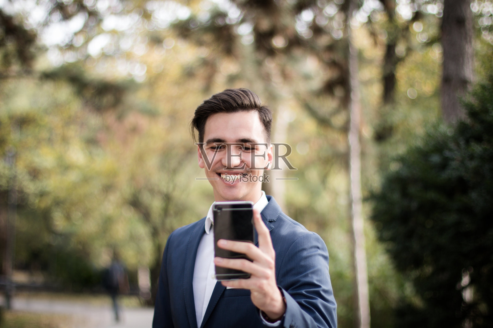
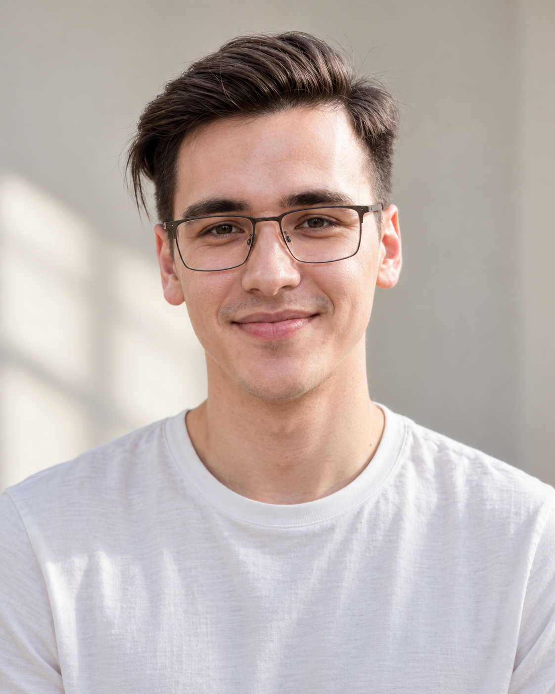

# M015 深棕侧分细框眼镜男性人物卡

用于复用固定外貌文字，并配合原始参考图生成相近外貌的成年角色。v1.0 已完成一次基准肖像生成与可见特征对比。

目录

- [人物标识与固定重点](#profile)
- [原始参考与生成样例](#reference)
- [六项外貌细节](#appearance)
- [毛发与配饰](#grooming)
- [观察边界和创作补足](#limits)
- [固定人物描述](#fixed-description)
- [本轮实际完整提示词](#generation-prompt)
- [独立服装模块](#clothing)
- [原图与生成图对比](#comparison)
- [后续调用方法](#reuse)
- [来源与相关页面](#sources)

<a id="profile"></a>
## 人物标识与固定重点

- 编号：**M015**；名称：**深棕侧分细框眼镜**；分类：**男性**。
- 设计年龄：25岁，版本 v1.0。
- 固定重点：偏长椭圆脸，额头略宽，颧部柔和，下颌向下收窄，下巴小而圆。 深棕色短发七三侧分，前额发束侧扫并略翘，一侧短、另一侧稍长，耳侧清楚，顶部层次柔和。
- 固定外貌与服装、场景分开维护；配饰独立记录。

<a id="reference"></a>
## 原始参考与生成样例

原始文件：`veer-432909268.jpg`，来自用户提供的“人物场景 素材”目录。保留原文件和原有水印。





本轮生成样例用于对比，默认不替代原始参考。

<a id="appearance"></a>
## 六项外貌细节

**脸型：** 偏长椭圆脸，额头略宽，颧部柔和，下颌向下收窄，下巴小而圆。

**眉毛和眼睛：** 深棕较浓眉，眉头稍宽、眉尾柔和下收；中等杏仁眼，眼尾近水平，深棕虹膜作为复用设定。

**鼻子：** 鼻梁中高且较窄直，鼻尖小圆，鼻翼中等偏窄；鼻孔设为窄椭圆，少量露出。

**嘴唇：** 上唇偏薄、下唇中等，约1∶1.5；唇峰浅而圆，闭嘴时嘴角轻扬，浅粉棕色。

**肤色：** 白皙中性暖米色，脸颊微红，眼下自然浅影，不添加明显雀斑。

**发型：** 深棕色短发七三侧分，前额发束侧扫并略翘，一侧短、另一侧稍长，耳侧清楚，顶部层次柔和。

<a id="grooming"></a>
## 毛发与配饰

保留轻细深色圆角矩形眼镜、透明镜片；近乎干净剃须。

<a id="limits"></a>
## 观察边界和创作补足

- 原图脸部有水印叠加、笑容与眼镜遮挡；眼色、鼻孔和闭嘴唇比为补足，镜框细节按可见轮廓概括。
- 唇部比例指自然闭嘴时可见唇红的视觉厚度，均为设计参考。年龄为成年角色设定，不推断现实身份、国籍或族裔。

<a id="fixed-description"></a>
## 固定人物描述

逐字复用以下文字。换服装、场景时不改此段；外貌变更另记版本。

```text
M015，25岁成年男性角色。脸型：偏长椭圆脸，额头略宽，颧部柔和，下颌向下收窄，下巴小而圆。
眉毛和眼睛：深棕较浓眉，眉头稍宽、眉尾柔和下收；中等杏仁眼，眼尾近水平，深棕虹膜作为复用设定。
鼻子：鼻梁中高且较窄直，鼻尖小圆，鼻翼中等偏窄；鼻孔设为窄椭圆，少量露出。
嘴唇：上唇偏薄、下唇中等，约1∶1.5；唇峰浅而圆，闭嘴时嘴角轻扬，浅粉棕色。
肤色：白皙中性暖米色，脸颊微红，眼下自然浅影，不添加明显雀斑。
发型：深棕色短发七三侧分，前额发束侧扫并略翘，一侧短、另一侧稍长，耳侧清楚，顶部层次柔和。
胡须与配饰：保留轻细深色圆角矩形眼镜、透明镜片；近乎干净剃须。
保持自然真实的日常肖像，保留皮肤纹理、轻微左右差异和碎发。
```

<a id="generation-prompt"></a>
## 本轮实际完整提示词

以下为本次生成实际输入。还需附上本卡原始参考图。

```text
Use case: photorealistic-natural.
参考角色卡 M015。附图是本次唯一人物外貌参考，使用其中主要前景成年人物；保持可见面部结构、发色、肤色与毛流。生成一张新的自然写实胸像摄影，不复制原场景。
固定人物描述：
M015，25岁成年男性角色。脸型：偏长椭圆脸，额头略宽，颧部柔和，下颌向下收窄，下巴小而圆。
眉毛和眼睛：深棕较浓眉，眉头稍宽、眉尾柔和下收；中等杏仁眼，眼尾近水平，深棕虹膜作为复用设定。
鼻子：鼻梁中高且较窄直，鼻尖小圆，鼻翼中等偏窄；鼻孔设为窄椭圆，少量露出。
嘴唇：上唇偏薄、下唇中等，约1∶1.5；唇峰浅而圆，闭嘴时嘴角轻扬，浅粉棕色。
肤色：白皙中性暖米色，脸颊微红，眼下自然浅影，不添加明显雀斑。
发型：深棕色短发七三侧分，前额发束侧扫并略翘，一侧短、另一侧稍长，耳侧清楚，顶部层次柔和。
胡须与配饰：保留轻细深色圆角矩形眼镜、透明镜片；近乎干净剃须。
保持自然真实的日常肖像，保留皮肤纹理、轻微左右差异和碎发。
观察边界：原图脸部有水印叠加、笑容与眼镜遮挡；眼色、鼻孔和闭嘴唇比为补足，镜框细节按可见轮廓概括。
本次画面：竖幅4:5单人头肩胸像，完整发顶与双肩入镜，头基本正对相机，平视镜头，眉间放松，自然闭嘴微笑。柔和漫射窗光，暖灰素背景。统一奶白色圆领棉T恤，常规合身但不紧，哑光柔软细棉纹，短袖，无口袋与图案。配饰按人物卡要求。保留真实毛孔、眼下纹理和少量碎发，妆容克制。禁止塑料磨皮、过分锐利下颌、夸张眼唇、过度对称、浓重时尚妆。无文字、拼图、标牌、手持手机、耳机或画框。只输出这一张独立新肖像。
```

<a id="clothing"></a>
## 独立服装模块

| 层次 | 本轮基准设定 | 后续可替换方式 |
| --- | --- | --- |
| 色彩搭配逻辑 | 低对比中性色，人物肤色与发色作为主要视觉差异 | 同色系、邻近色或小面积点缀 |
| 轮廓结构 | 常规合身、不过紧、肩线自然 | 宽松、落肩、修身等 |
| 材质质感 | 柔软哑光棉布，保留细棉纹 | 针织、挺括棉布、垂坠面料等 |
| 设计类型 | 奶白圆领短袖T恤，无口袋和图案 | 指定领型、袖型、门襟和口袋 |

调用时替换服装条款，避免与旧服装叠加。

<a id="comparison"></a>
## 原图与生成图对比

深棕七三分短发与矩形细框眼镜保留。 镜框与鼻托细节更清楚，属于对遮挡处的补足。

**保留的可见特征**

- 深棕七三分短发与矩形细框眼镜保留。
- 偏长脸和接近无胡须状态保留。

**偏差与未验证细节**

- 镜框与鼻托细节更清楚，属于对遮挡处的补足。
- 生成嘴角更平缓，原图露齿笑和水印影响嘴鼻观察。

**后续建议：** 保持当前眼镜外轮廓，鼻托与眼色暂不作为精确识别点。

以上建议未回写到本版实际提示词，不声称本轮已实现。对比不用于确认现实人物身份，也不提供未经验证的相似度百分比。

<a id="reuse"></a>
## 后续调用方法

> 调用知识库男性人物卡 M015，逐字使用固定人物描述，并附上本卡原始参考图；换成宽松哑光针织上衣，在咖啡馆窗边拍摄自然半身照。

1. 按 M015 检索对应分类卡片，获取完整固定描述。
2. 附上登记的原始参考图；默认不在本轮生成图上反复迭代。
3. 只调整本次服装、场景、动作与构图。若要求修改外貌，应另记版本。
4. 生成后再次和原图比较。本卡只完成一次“原图＋固定文字”生成，未验证纯文字或多次重复一致性，不能保证完全相同人脸。

<a id="sources"></a>
## 来源与相关页面

来源：用户于2026-09-30要求继续新增男性、女性各10张卡。文字外貌描述基于所列素材的可见特征与明确标记的创作补足。

- [男性人物卡索引](男性人物卡索引.md)
- [人物卡分类总索引](../人物卡分类索引.md)
