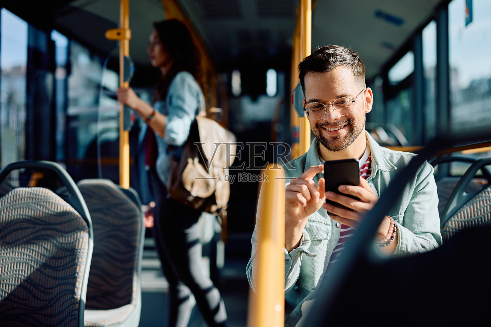

# M016 黑棕短发金属圆框胡须男性人物卡

用于复用固定外貌文字，并配合原始参考图生成相近外貌的成年角色。v1.0 已完成一次基准肖像生成与可见特征对比。

> 当前调用状态：M016 常用；本组旧编号 M031 统一指向本卡。

目录

- [A+使用定位](#aplus-role)
- [删除执行记录](#deletion-20261007)
- [常用状态与相近设定整理](#consolidation-20261007)
- [人物标识与固定重点](#profile)
- [原始参考与生成样例](#reference)
- [六项外貌细节](#appearance)
- [毛发与配饰](#grooming)
- [观察边界和创作补足](#limits)
- [固定人物描述](#fixed-description)
- [本轮实际完整提示词](#generation-prompt)
- [独立服装模块](#clothing)
- [原图与生成图对比](#comparison)
- [后续调用方法](#reuse)
- [来源与相关页面](#sources)

<a id="aplus-role"></a>
## A+使用定位

**2026-10-20用户确认：M016在A+中仅作配角，不担任首张封面主角。**

A+首张封面完整名单：女性F006、F008、F010、F011、F016；男性M002、M006、M007。用于店铺时还须满足固定人物归属；选择封面主角时先查[人物总索引·A+首张封面与配角使用规则](../人物卡分类索引.md#aplus-cover)。人物固定描述、原始参考和既有生成验收边界分别按本卡原文执行。

来源：2026-10-20用户指定“女性06 08 10 11 16；男性02 06 07”可当A+首张封面，其余只适合当配角；同日进一步纠正F006与F030是完全不同的人物。

<a id="deletion-20261007"></a>
## 删除执行记录

2026-10-07，用户列出6个完整文件路径并确认删除。本组保留卡继续常用，旧编号替代关系继续有效。

M031文档已删除，默认使用M016。

5次GBrain删除已提交，对应Markdown文件已从知识库工作目录移除，普通知识库读取不再返回这些页面；GBrain保留72小时恢复窗口。原始照片和生成样例保留。F006的MCP删除返回source_changed，直接删除本地文件又被系统执行策略拒绝（blocked by policy），因此不能记为删除成功。2026-10-20用户纠正：F006与F030是完全不同的人物。此前把F006排除常用并映射到F030的记录作废；F006独立恢复为常用卡，取消待删除状态，后续按F006自身原图与固定描述调用。

<a id="consolidation-20261007"></a>
## 常用状态与相近设定整理

**M016 为本组唯一常用卡。** 相近设定旧编号 M031 已停用；按这些旧编号调用时，先说明替代关系，再使用本卡固定文字和本卡原始参考图。保留本卡已有验收范围，服装与场景仍独立替换。

整理日期：2026-10-07。依据用户“相似的卡片只保留一个”的要求，按“黑棕短发、金属圆框、胡须”设定归组。M016已有基准试生成和对比；M031原图细部清晰度受限。M016镜片和侧光限制仍保留。

本次整理针对卡片设定与日常调用，不认定不同原图为同一真实人物。最初整理阶段仅停用；后续按用户逐文件确认执行删除，进度见本页“删除执行记录”。本卡固定描述和已执行提示词不变。

<a id="profile"></a>
## 人物标识与固定重点

- 编号：**M016**；名称：**黑棕短发金属圆框胡须**；分类：**男性**。
- 设计年龄：29岁，版本 v1.0。
- 固定重点：中等长的方圆脸，额头宽、颧部平缓，下颌转角柔和，下巴宽圆；保留脸颊自然体积。 黑棕色短发，顶部短侧梳、少量纹理，额角有轻微自然退让；两侧较短，顶部不夸张蓬松。
- 固定外貌与服装、场景分开维护；配饰独立记录。

<a id="reference"></a>
## 原始参考与生成样例

原始文件：`veer-441133621.jpg`，来自用户提供的“人物场景 素材”目录。保留原文件和原有水印。




本轮生成样例用于对比，默认不替代原始参考。

<a id="appearance"></a>
## 六项外貌细节

**脸型：** 中等长的方圆脸，额头宽、颧部平缓，下颌转角柔和，下巴宽圆；保留脸颊自然体积。

**眉毛和眼睛：** 中浓深棕眉，眉身较平、眉尾小幅下收；棕色杏仁眼，眼尾近水平，眼角保留轻纹。

**鼻子：** 鼻梁中高，直而中等宽，鼻尖圆钝；鼻翼中等，鼻孔短椭圆，正面少量可见。

**嘴唇：** 中等厚度上下唇约1∶1.35，上唇弓较宽、中央浅凹，下唇饱满，棕玫瑰色。

**肤色：** 浅暖米棕肤色，额头略亮、眼下浅纹，保留鼻颊毛孔和嘴周色差。

**发型：** 黑棕色短发，顶部短侧梳、少量纹理，额角有轻微自然退让；两侧较短，顶部不夸张蓬松。

<a id="grooming"></a>
## 毛发与配饰

保留细银色金属圆角方圆眼镜，透明镜片；唇周与下颌连贯短胡须、边缘自然。

<a id="limits"></a>
## 观察边界和创作补足

- 原图笑容、镜片和强侧光影响眼部与肤色；闭嘴比例与中性光肤色是近似补足。
- 唇部比例指自然闭嘴时可见唇红的视觉厚度，均为设计参考。年龄为成年角色设定，不推断现实身份、国籍或族裔。

<a id="fixed-description"></a>
## 固定人物描述

逐字复用以下文字。换服装、场景时不改此段；外貌变更另记版本。

```text
M016，29岁成年男性角色。脸型：中等长的方圆脸，额头宽、颧部平缓，下颌转角柔和，下巴宽圆；保留脸颊自然体积。
眉毛和眼睛：中浓深棕眉，眉身较平、眉尾小幅下收；棕色杏仁眼，眼尾近水平，眼角保留轻纹。
鼻子：鼻梁中高，直而中等宽，鼻尖圆钝；鼻翼中等，鼻孔短椭圆，正面少量可见。
嘴唇：中等厚度上下唇约1∶1.35，上唇弓较宽、中央浅凹，下唇饱满，棕玫瑰色。
肤色：浅暖米棕肤色，额头略亮、眼下浅纹，保留鼻颊毛孔和嘴周色差。
发型：黑棕色短发，顶部短侧梳、少量纹理，额角有轻微自然退让；两侧较短，顶部不夸张蓬松。
胡须与配饰：保留细银色金属圆角方圆眼镜，透明镜片；唇周与下颌连贯短胡须、边缘自然。
保持自然真实的日常肖像，保留皮肤纹理、轻微左右差异和碎发。
```

<a id="generation-prompt"></a>
## 本轮实际完整提示词

以下为本次生成实际输入。还需附上本卡原始参考图。

```text
Use case: photorealistic-natural.
参考角色卡 M016。附图是本次唯一人物外貌参考，使用其中主要前景成年人物；保持可见面部结构、发色、肤色与毛流。生成一张新的自然写实胸像摄影，不复制原场景。
固定人物描述：
M016，29岁成年男性角色。脸型：中等长的方圆脸，额头宽、颧部平缓，下颌转角柔和，下巴宽圆；保留脸颊自然体积。
眉毛和眼睛：中浓深棕眉，眉身较平、眉尾小幅下收；棕色杏仁眼，眼尾近水平，眼角保留轻纹。
鼻子：鼻梁中高，直而中等宽，鼻尖圆钝；鼻翼中等，鼻孔短椭圆，正面少量可见。
嘴唇：中等厚度上下唇约1∶1.35，上唇弓较宽、中央浅凹，下唇饱满，棕玫瑰色。
肤色：浅暖米棕肤色，额头略亮、眼下浅纹，保留鼻颊毛孔和嘴周色差。
发型：黑棕色短发，顶部短侧梳、少量纹理，额角有轻微自然退让；两侧较短，顶部不夸张蓬松。
胡须与配饰：保留细银色金属圆角方圆眼镜，透明镜片；唇周与下颌连贯短胡须、边缘自然。
保持自然真实的日常肖像，保留皮肤纹理、轻微左右差异和碎发。
观察边界：原图笑容、镜片和强侧光影响眼部与肤色；闭嘴比例与中性光肤色是近似补足。
本次画面：竖幅4:5单人头肩胸像，完整发顶与双肩入镜，头基本正对相机，平视镜头，眉间放松，自然闭嘴微笑。柔和漫射窗光，暖灰素背景。统一奶白色圆领棉T恤，常规合身但不紧，哑光柔软细棉纹，短袖，无口袋与图案。配饰按人物卡要求。保留真实毛孔、眼下纹理和少量碎发，妆容克制。禁止塑料磨皮、过分锐利下颌、夸张眼唇、过度对称、浓重时尚妆。无文字、拼图、标牌、手持手机、耳机或画框。只输出这一张独立新肖像。
```

<a id="clothing"></a>
## 独立服装模块

| 层次 | 本轮基准设定 | 后续可替换方式 |
| --- | --- | --- |
| 色彩搭配逻辑 | 低对比中性色，人物肤色与发色作为主要视觉差异 | 同色系、邻近色或小面积点缀 |
| 轮廓结构 | 常规合身、不过紧、肩线自然 | 宽松、落肩、修身等 |
| 材质质感 | 柔软哑光棉布，保留细棉纹 | 针织、挺括棉布、垂坠面料等 |
| 设计类型 | 奶白圆领短袖T恤，无口袋和图案 | 指定领型、袖型、门襟和口袋 |

调用时替换服装条款，避免与旧服装叠加。

<a id="comparison"></a>
## 原图与生成图对比

银色金属镜框、短侧梳发与连贯短胡须保留。 镜框更圆、镜圈更大，胡须较规整。

**保留的可见特征**

- 银色金属镜框、短侧梳发与连贯短胡须保留。
- 暖米棕肤色和宽圆下巴外观保留。

**偏差与未验证细节**

- 镜框更圆、镜圈更大，胡须较规整。
- 原图强侧光变柔光，皮肤色泽相应改变。

**后续建议：** 镜框略收窄并保留圆角方形，减少胡须边缘过度整齐。

以上建议未回写到本版实际提示词，不声称本轮已实现。对比不用于确认现实人物身份，也不提供未经验证的相似度百分比。

<a id="reuse"></a>
## 后续调用方法

> 调用知识库男性人物卡 M016，逐字使用固定人物描述，并附上本卡原始参考图；换成宽松哑光针织上衣，在咖啡馆窗边拍摄自然半身照。

1. 按 M016 检索对应分类卡片，获取完整固定描述。
2. 附上登记的原始参考图；默认不在本轮生成图上反复迭代。
3. 只调整本次服装、场景、动作与构图。若要求修改外貌，应另记版本。
4. 生成后再次和原图比较。本卡只完成一次“原图＋固定文字”生成，未验证纯文字或多次重复一致性，不能保证完全相同人脸。

<a id="sources"></a>
## 来源与相关页面

来源：用户于2026-09-30要求继续新增男性、女性各10张卡。文字外貌描述基于所列素材的可见特征与明确标记的创作补足。

- [男性人物卡索引](男性人物卡索引.md)
- [人物卡分类总索引](../人物卡分类索引.md)
