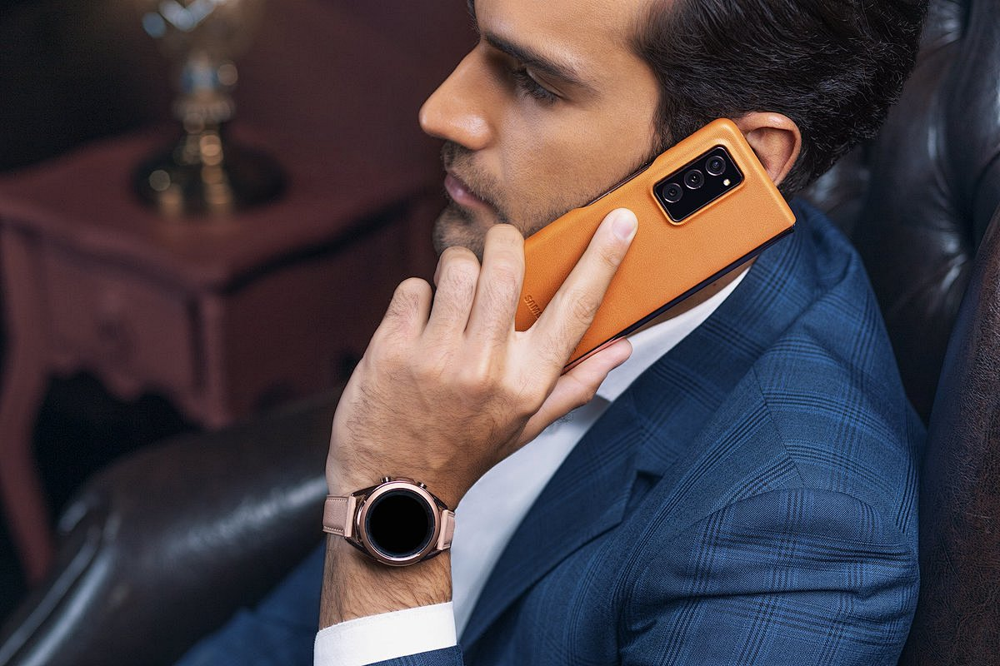
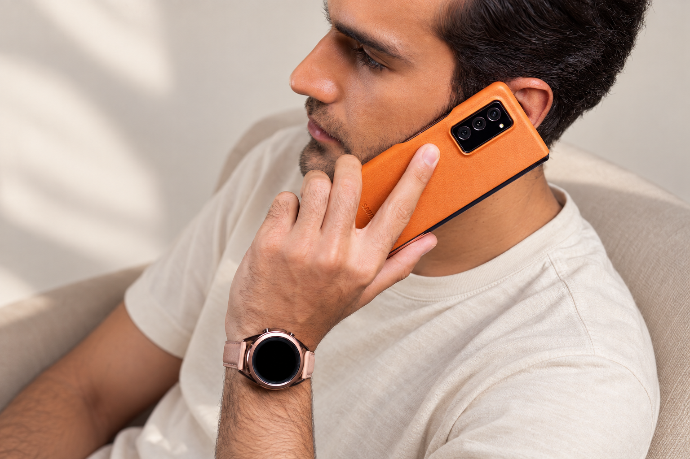

# M027 黑褐后梳短发侧脸浅胡茬男性人物卡

固定外貌、独立服装、原图与测试记录一起保存。

目录

- [人物标识](#profile)
- [原始参考](#reference)
- [六项外貌细节](#appearance)
- [毛发配饰与妆容](#grooming)
- [观察边界](#limits)
- [固定描述原文](#fixed)
- [已测试调用提示词](#prompt)
- [独立服装模块](#clothing)
- [原图对比与验收](#validation)
- [调用方法](#reuse)
- [来源记录](#rights)
- [相关入口](#related)

<a id="profile"></a>
## 人物标识

编号：**M027**；分类：男性；版本：v1.0；归档日期：2026-10-07。

设计年龄：28岁，仅是成年角色创作参数。当前状态：**基础特征通过**。

<a id="reference"></a>
## 原始参考



文件：`82bb85dae0307b20c92be8f9110c92922c77964c25935-vOykiD_fw1200.jpg`；尺寸：1200×800。

SHA256：`24b85c3e5b88dac17c1b76310681d7767799c63c830be2aa0bea69d3e72d787d`。

原图按字节保存，未改动原始照片。多人图取景规则：Select the only man. Preserve the phone held against his ear and adjacent fingers, and the elevated camera view.

<a id="appearance"></a>
## 六项外貌细节

**脸型：** 偏长椭圆脸带方形下颌趋势，颧区较平，侧面下巴圆钝略向前；下颌被手机及手部分遮挡，不据此推定完整正面宽度。

**眉毛和眼睛：** 深色浓眉，眉身较平、外段柔和下降；可见眼睛横向偏长，低垂视线使上睑覆盖增加，眼色在阴影中不可可靠判断。

**鼻子：** 侧面鼻梁中高、线条较直，鼻尖圆厚且朝前；可见鼻翼不夸张，鼻孔下缘被角度藏住，无法测定两侧鼻孔宽度。

**嘴唇：** 闭嘴，上唇较薄、下唇略厚，约1∶1.3仅作视觉参考；唇峰小而钝，浅玫瑰棕唇色，嘴角近水平。

**肤色：** 中等偏浅的暖米棕色，脸颊有细密皮肤纹理，额头与颧部有自然光泽；未见明确雀斑。

**发型：** 黑褐色浓密短发，顶部中短长度向后梳，表面宽松波纹，耳侧较短但不是贴皮剃光，鬓角与短胡茬衔接。

<a id="grooming"></a>
## 毛发配饰与妆容

保留上唇、下巴和面颊薄短胡茬；原图手机和手遮挡靠近耳朵的一侧脸。

<a id="limits"></a>
## 观察边界

- 原图为俯视三分之二侧脸，眼色及远侧五官未知
- 头顶有画面裁切，发高不能精确量测
- 五官比例为视觉描述；无法观察的结构保持未知。
- 未验证纯文字复现、多角度或多次随机生成一致性。

<a id="fixed"></a>
## 固定描述原文

后续调用逐字复用，服装和场景在外部替换。

```text
人物卡M027：黑褐后梳短发侧脸浅胡茬。成年男性角色，设计年龄28岁；年龄仅为创作参数。
脸型：偏长椭圆脸带方形下颌趋势，颧区较平，侧面下巴圆钝略向前；下颌被手机及手部分遮挡，不据此推定完整正面宽度。
眉毛和眼睛：深色浓眉，眉身较平、外段柔和下降；可见眼睛横向偏长，低垂视线使上睑覆盖增加，眼色在阴影中不可可靠判断。
鼻子：侧面鼻梁中高、线条较直，鼻尖圆厚且朝前；可见鼻翼不夸张，鼻孔下缘被角度藏住，无法测定两侧鼻孔宽度。
嘴唇：闭嘴，上唇较薄、下唇略厚，约1∶1.3仅作视觉参考；唇峰小而钝，浅玫瑰棕唇色，嘴角近水平。
肤色：中等偏浅的暖米棕色，脸颊有细密皮肤纹理，额头与颧部有自然光泽；未见明确雀斑。
发型：黑褐色浓密短发，顶部中短长度向后梳，表面宽松波纹，耳侧较短但不是贴皮剃光，鬓角与短胡茬衔接。
毛发配饰与妆容：保留上唇、下巴和面颊薄短胡茬；原图手机和手遮挡靠近耳朵的一侧脸。
观察限制：原图为俯视三分之二侧脸，眼色及远侧五官未知；头顶有画面裁切，发高不能精确量测
```

<a id="prompt"></a>
## 已测试调用提示词

下面是当前选用样例实际执行过的完整提示词。固定文字未因生成结果而改写。

```text
Use case: photorealistic-natural. Create one new photographic character portrait based on input image 1, the ORIGINAL user-provided reference. Preserve visible face structure, natural age impression, exact head angle, gaze, expression, hair silhouette and grooming. Original visible geometry takes priority over numeric estimates. Do not impose generic idealized beauty.

固定人物描述，逐字复用：
人物卡M027：黑褐后梳短发侧脸浅胡茬。成年男性角色，设计年龄28岁；年龄仅为创作参数。
脸型：偏长椭圆脸带方形下颌趋势，颧区较平，侧面下巴圆钝略向前；下颌被手机及手部分遮挡，不据此推定完整正面宽度。
眉毛和眼睛：深色浓眉，眉身较平、外段柔和下降；可见眼睛横向偏长，低垂视线使上睑覆盖增加，眼色在阴影中不可可靠判断。
鼻子：侧面鼻梁中高、线条较直，鼻尖圆厚且朝前；可见鼻翼不夸张，鼻孔下缘被角度藏住，无法测定两侧鼻孔宽度。
嘴唇：闭嘴，上唇较薄、下唇略厚，约1∶1.3仅作视觉参考；唇峰小而钝，浅玫瑰棕唇色，嘴角近水平。
肤色：中等偏浅的暖米棕色，脸颊有细密皮肤纹理，额头与颧部有自然光泽；未见明确雀斑。
发型：黑褐色浓密短发，顶部中短长度向后梳，表面宽松波纹，耳侧较短但不是贴皮剃光，鬓角与短胡茬衔接。
毛发配饰与妆容：保留上唇、下巴和面颊薄短胡茬；原图手机和手遮挡靠近耳朵的一侧脸。
观察限制：原图为俯视三分之二侧脸，眼色及远侧五官未知；头顶有画面裁切，发高不能精确量测

Test scene: quiet warm off-white backdrop with soft natural daylight, head and upper torso framing, normal lens perspective, whole visible hairstyle in frame. Preserve the original head and body orientation, including reclined pose if present. Clothing: simple cream cotton crewneck T-shirt, relaxed regular shoulder fit, matte fabric, no graphics. Keep reference facial accessories, glasses, hat, and any phone/hand/prop occlusion that covers facial areas. Do not invent unseen eyes or concealed mouth. Props away from face can be outside frame. Preserve natural pores, fine lines and mild asymmetry. Do not enlarge eyes, sharpen jaw, intensify makeup, thicken beard, tighten curls or increase hair volume. Match source smile instead of imposing closed-mouth proportions. Single photograph, one character, no labels or collage.

Target selection: Select the only man. Preserve the phone held against his ear and adjacent fingers, and the elevated camera view.
```

<a id="clothing"></a>
## 独立服装模块

原图穿搭作为独立参考，不并入脸部固定文字。

| 层次 | 原图观察 |
| --- | --- |
| 色彩搭配逻辑 | 深色外套衬浅色内搭，以明暗对比集中面部 |
| 轮廓和结构 | 合肩修身西装，结构清楚 |
| 材质和质感 | 西装面料细格织纹、衬衫较平滑 |
| 设计类型 | 平驳领外套搭翻领衬衫 |

本轮统一测试服装：奶白圆领棉T恤，常规合肩、自然宽松、柔软哑光、无图案。换装时替换完整服装条款，避免新旧要求冲突。

<a id="validation"></a>
## 原图对比与验收



测试方式：原始参考图＋固定描述，统一基础服装，保留参考角度和表情。每次重测仍从原图出发。

选用：v1；结论：基础特征通过。

保留特征：侧脸鼻梁、后梳短发、薄胡茬和手机遮挡关系保持。

首轮偏差与限制：皮肤微纹理比原图清楚；顶部仍随原构图裁切，完整头顶未经验证。

本卡没有进行第二轮重测。

这是可见外貌的定性比对，不是身份识别或量化相似率。

<a id="reuse"></a>
## 调用方法

1. 按编号 M027 检索并读取完整固定描述。
2. 附上本卡登记的用户原始参考图；本轮生成样例只作结果对照。
3. 使用当前已测试提示词，独立替换服装、场景、构图；仍保持固定文字。
4. 若要求新角度、摘镜或解除遮挡，补充对应原始参考，或明确将未知部分作为创作补足。
5. 新结果继续对照原图。相同文字有助于相似，但不能保证每次完全相同。

<a id="rights"></a>
## 来源记录

2026-10-07 用户要求继续新增男女各10张卡，来源为指定的“人物场景 素材”目录。照片版权、肖像及AI使用范围沿用待核实状态；真实身份与是否公众人物未核验。

本批按文件SHA256排除已归档的相同照片；这不等于确认所有照片都来自不同人物。

<a id="related"></a>
## 相关入口

- [男性人物卡索引](男性人物卡索引.md)
- [人物卡分类索引](../人物卡分类索引.md)
