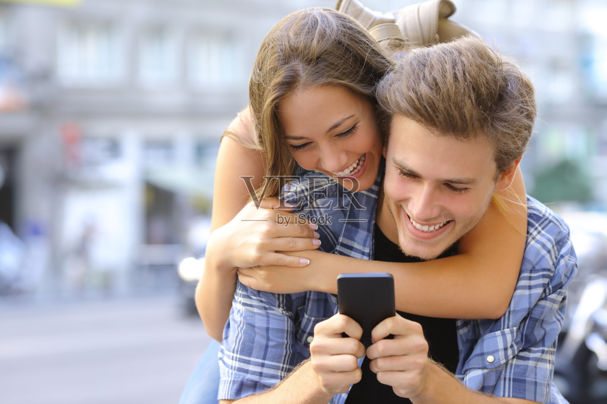
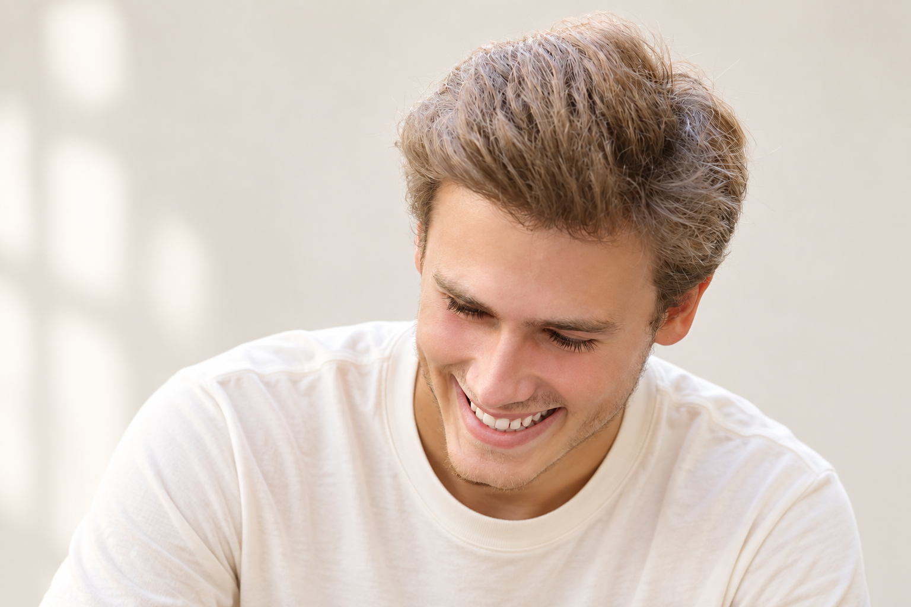

# M030 灰金棕高蓬发清爽笑眼男性人物卡

固定外貌、独立服装、原图与测试记录一起保存。

目录

- [人物标识](#profile)
- [原始参考](#reference)
- [六项外貌细节](#appearance)
- [毛发配饰与妆容](#grooming)
- [观察边界](#limits)
- [固定描述原文](#fixed)
- [已测试调用提示词](#prompt)
- [独立服装模块](#clothing)
- [原图对比与验收](#validation)
- [调用方法](#reuse)
- [来源记录](#rights)
- [相关入口](#related)

<a id="profile"></a>
## 人物标识

编号：**M030**；分类：男性；版本：v1.1；归档日期：2026-10-07。

设计年龄：24岁，仅是成年角色创作参数。当前状态：**重测后限定使用**。

<a id="reference"></a>
## 原始参考



文件：`veer-124275621.jpg`；尺寸：1600×1067。

SHA256：`181c4016eb1d3759af3f8ef6aa50811a4ecc56600e5642dc92aa437bb3fdf7af`。

原图按字节保存，未改动原始照片。多人图取景规则：Select ONLY the man at front/right of the two-person image; render him alone. Preserve his exact down-tilted head and broad toothy smile; no added beard.

<a id="appearance"></a>
## 六项外貌细节

**脸型：** 偏长椭圆脸，下颌向圆钝下巴收窄；笑时脸颊上提，颧区饱满，避免改成宽方下颌。

**眉毛和眼睛：** 中等浓度浅棕眉，低缓弧线，眉尾略下落；低头笑时眼睛眯起，睫毛清楚，不能推断睁眼形态或眼色。

**鼻子：** 鼻梁中高且较窄，鼻尖小圆，略朝前下；低头角度下鼻孔几乎不可见，鼻翼宽度中窄。

**嘴唇：** 笑时露上排牙，上唇较薄、下唇略厚，嘴角大幅上扬；唇峰在笑容中变平，闭嘴比例不固定。

**肤色：** 白皙暖米色，双颊带轻微桃粉，颧部受日光偏暖；未见可确认雀斑。

**发型：** 灰金棕色浓密短发，前额形成高而宽的上梳发束，顶部松软且略后掠，耳侧有厚度，后部短，保留飞散细发。

<a id="grooming"></a>
## 毛发配饰与妆容

脸部接近干净剃须，仅下巴及下颌极浅短绒，不加浓胡须。

<a id="limits"></a>
## 观察边界

- 双人原图仅取画面右侧前景男性，女性不并入本卡
- 低头笑容不提供标准正脸或睁眼虹膜证据
- 五官比例为视觉描述；无法观察的结构保持未知。
- 未验证纯文字复现、多角度或多次随机生成一致性。

<a id="fixed"></a>
## 固定描述原文

后续调用逐字复用，服装和场景在外部替换。

```text
人物卡M030：灰金棕高蓬发清爽笑眼。成年男性角色，设计年龄24岁；年龄仅为创作参数。
脸型：偏长椭圆脸，下颌向圆钝下巴收窄；笑时脸颊上提，颧区饱满，避免改成宽方下颌。
眉毛和眼睛：中等浓度浅棕眉，低缓弧线，眉尾略下落；低头笑时眼睛眯起，睫毛清楚，不能推断睁眼形态或眼色。
鼻子：鼻梁中高且较窄，鼻尖小圆，略朝前下；低头角度下鼻孔几乎不可见，鼻翼宽度中窄。
嘴唇：笑时露上排牙，上唇较薄、下唇略厚，嘴角大幅上扬；唇峰在笑容中变平，闭嘴比例不固定。
肤色：白皙暖米色，双颊带轻微桃粉，颧部受日光偏暖；未见可确认雀斑。
发型：灰金棕色浓密短发，前额形成高而宽的上梳发束，顶部松软且略后掠，耳侧有厚度，后部短，保留飞散细发。
毛发配饰与妆容：脸部接近干净剃须，仅下巴及下颌极浅短绒，不加浓胡须。
观察限制：双人原图仅取画面右侧前景男性，女性不并入本卡；低头笑容不提供标准正脸或睁眼虹膜证据
```

<a id="prompt"></a>
## 已测试调用提示词

下面是当前选用样例实际执行过的完整提示词。固定文字未因生成结果而改写。

```text
Use case: photorealistic-natural. Create one new photographic character portrait based on input image 1, the ORIGINAL user-provided reference. Preserve visible face structure, natural age impression, exact head angle, gaze, expression, hair silhouette and grooming. Original visible geometry takes priority over numeric estimates. Do not impose generic idealized beauty.

固定人物描述，逐字复用：
人物卡M030：灰金棕高蓬发清爽笑眼。成年男性角色，设计年龄24岁；年龄仅为创作参数。
脸型：偏长椭圆脸，下颌向圆钝下巴收窄；笑时脸颊上提，颧区饱满，避免改成宽方下颌。
眉毛和眼睛：中等浓度浅棕眉，低缓弧线，眉尾略下落；低头笑时眼睛眯起，睫毛清楚，不能推断睁眼形态或眼色。
鼻子：鼻梁中高且较窄，鼻尖小圆，略朝前下；低头角度下鼻孔几乎不可见，鼻翼宽度中窄。
嘴唇：笑时露上排牙，上唇较薄、下唇略厚，嘴角大幅上扬；唇峰在笑容中变平，闭嘴比例不固定。
肤色：白皙暖米色，双颊带轻微桃粉，颧部受日光偏暖；未见可确认雀斑。
发型：灰金棕色浓密短发，前额形成高而宽的上梳发束，顶部松软且略后掠，耳侧有厚度，后部短，保留飞散细发。
毛发配饰与妆容：脸部接近干净剃须，仅下巴及下颌极浅短绒，不加浓胡须。
观察限制：双人原图仅取画面右侧前景男性，女性不并入本卡；低头笑容不提供标准正脸或睁眼虹膜证据

Test scene: quiet warm off-white backdrop with soft natural daylight, head and upper torso framing, normal lens perspective, whole visible hairstyle in frame. Preserve the original head and body orientation, including reclined pose if present. Clothing: simple cream cotton crewneck T-shirt, relaxed regular shoulder fit, matte fabric, no graphics. Keep reference facial accessories, glasses, hat, and any phone/hand/prop occlusion that covers facial areas. Do not invent unseen eyes or concealed mouth. Props away from face can be outside frame. Preserve natural pores, fine lines and mild asymmetry. Do not enlarge eyes, sharpen jaw, intensify makeup, thicken beard, tighten curls or increase hair volume. Match source smile instead of imposing closed-mouth proportions. Single photograph, one character, no labels or collage.

Target selection: Select ONLY the man at front/right of the two-person image; render him alone. Preserve his exact down-tilted head and broad toothy smile; no added beard.

Targeted correction from ORIGINAL image only:
Hair correction only: match the ORIGINAL man's hair silhouette and airy broad swept-up tuft exactly. Reduce exaggerated height/extra volume; no tall pompadour or dense upright quiff. Keep original fine loose fibers, original grey-golden brown color, face, smile and negligible beard unchanged. Leave a small margin above the hair.
```

<a id="clothing"></a>
## 独立服装模块

原图穿搭作为独立参考，不并入脸部固定文字。

| 层次 | 原图观察 |
| --- | --- |
| 色彩搭配逻辑 | 浅深同类色格纹搭深色纯色内搭 |
| 轮廓和结构 | 松适敞开外衫，常规肩线 |
| 材质和质感 | 薄棉布，软褶与织纹 |
| 设计类型 | 翻领格纹长袖衬衫搭圆领T恤 |

本轮统一测试服装：奶白圆领棉T恤，常规合肩、自然宽松、柔软哑光、无图案。换装时替换完整服装条款，避免新旧要求冲突。

<a id="validation"></a>
## 原图对比与验收



测试方式：原始参考图＋固定描述，统一基础服装，保留参考角度和表情。每次重测仍从原图出发。

选用：v2；结论：重测后限定使用。

保留特征：灰金棕上梳发、低头笑眼、圆钝窄下巴与浅胡茬保持。

首轮偏差与限制：头顶发束显得更蓬且顶部接近边缘，建议收敛发高后重测。

修正重测：v2保留原有笑眼、鼻唇与浅胡茬，头顶留白改善；发束仍比原图略高且更密，修正只部分生效。当前样例可用于本角度参考，高精度发型任务仍需逐次对照原图。

```text
Hair correction only: match the ORIGINAL man's hair silhouette and airy broad swept-up tuft exactly. Reduce exaggerated height/extra volume; no tall pompadour or dense upright quiff. Keep original fine loose fibers, original grey-golden brown color, face, smile and negligible beard unchanged. Leave a small margin above the hair.
```

这是可见外貌的定性比对，不是身份识别或量化相似率。

<a id="reuse"></a>
## 调用方法

1. 按编号 M030 检索并读取完整固定描述。
2. 附上本卡登记的用户原始参考图；本轮生成样例只作结果对照。
3. 使用当前已测试提示词，独立替换服装、场景、构图；仍保持固定文字。
4. 若要求新角度、摘镜或解除遮挡，补充对应原始参考，或明确将未知部分作为创作补足。
5. 新结果继续对照原图。相同文字有助于相似，但不能保证每次完全相同。

<a id="rights"></a>
## 来源记录

2026-10-07 用户要求继续新增男女各10张卡，来源为指定的“人物场景 素材”目录。照片版权、肖像及AI使用范围沿用待核实状态；真实身份与是否公众人物未核验。

本批按文件SHA256排除已归档的相同照片；这不等于确认所有照片都来自不同人物。

<a id="related"></a>
## 相关入口

- [男性人物卡索引](男性人物卡索引.md)
- [人物卡分类索引](../人物卡分类索引.md)
