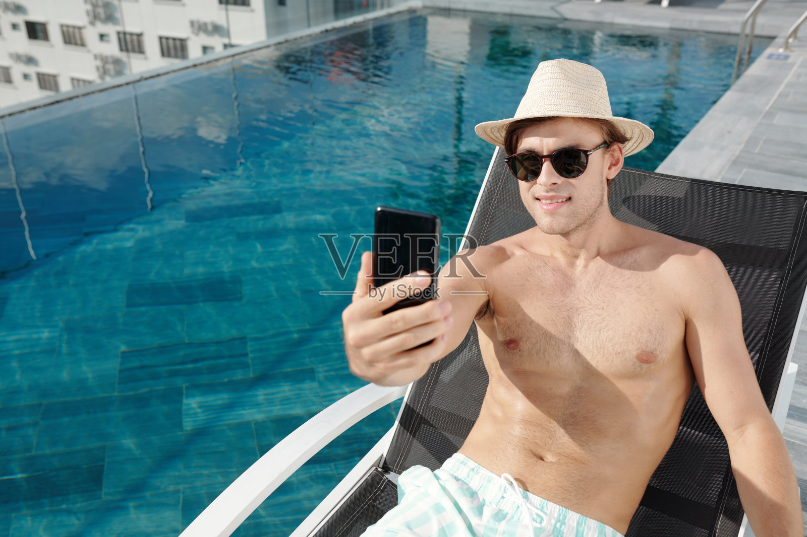

# M032 棕色偏分短发圆框墨镜草帽男性人物卡

固定外貌、独立服装、原图与测试记录一起保存。

目录

- [人物标识](#profile)
- [原始参考](#reference)
- [六项外貌细节](#appearance)
- [毛发配饰与妆容](#grooming)
- [观察边界](#limits)
- [固定描述原文](#fixed)
- [已测试调用提示词](#prompt)
- [独立服装模块](#clothing)
- [原图对比与验收](#validation)
- [调用方法](#reuse)
- [来源记录](#rights)
- [相关入口](#related)

<a id="profile"></a>
## 人物标识

编号：**M032**；分类：男性；版本：v1.0；归档日期：2026-10-07。

设计年龄：26岁，仅是成年角色创作参数。当前状态：**基础特征通过**。

<a id="reference"></a>
## 原始参考



文件：`veer-411493320.jpg`；尺寸：1600×1067。

SHA256：`13f77e017639547d1e611b8324124890583a32045c263395e5f7e4aebc6d8712`。

原图按字节保存，未改动原始照片。多人图取景规则：Select the only man. Retain straw hat and dark rounded sunglasses, slightly reclining body and subtle toothy smile. Add the test T-shirt.

<a id="appearance"></a>
## 六项外貌细节

**脸型：** 窄长方椭圆脸，面颊较平，下颌边线清楚但不锋利，下巴中等长度且圆钝。

**眉毛和眼睛：** 眉毛大部分受帽沿和墨镜遮挡；眼型、眼尾方向与虹膜颜色均未知，保留墨镜状态。

**鼻子：** 鼻梁中等偏高、鼻背较窄，鼻尖小圆，鼻翼宽度中窄；可见鼻孔下缘很少。

**嘴唇：** 轻微露齿笑，上唇偏薄、下唇中等，嘴角上提；唇峰低而圆，唇色浅粉，比例不作精确量测。

**肤色：** 白皙暖米色，阳光下偏金，面部有淡短胡茬阴影；未见明显雀斑。

**发型：** 棕色短至中短发，帽檐下前额有侧分弧线、耳侧有轻微弯曲；头顶部与后部被帽子遮住，不定义完整体积。

<a id="grooming"></a>
## 毛发配饰与妆容

保留浅色编织草帽与深色圆角墨镜；下巴和上唇极浅胡茬。

<a id="limits"></a>
## 观察边界

- 墨镜遮挡眼睛，帽子遮住顶部发型
- 原图为半躺姿态，不用来证明直立正脸几何
- 五官比例为视觉描述；无法观察的结构保持未知。
- 未验证纯文字复现、多角度或多次随机生成一致性。

<a id="fixed"></a>
## 固定描述原文

后续调用逐字复用，服装和场景在外部替换。

```text
人物卡M032：棕色偏分短发圆框墨镜草帽。成年男性角色，设计年龄26岁；年龄仅为创作参数。
脸型：窄长方椭圆脸，面颊较平，下颌边线清楚但不锋利，下巴中等长度且圆钝。
眉毛和眼睛：眉毛大部分受帽沿和墨镜遮挡；眼型、眼尾方向与虹膜颜色均未知，保留墨镜状态。
鼻子：鼻梁中等偏高、鼻背较窄，鼻尖小圆，鼻翼宽度中窄；可见鼻孔下缘很少。
嘴唇：轻微露齿笑，上唇偏薄、下唇中等，嘴角上提；唇峰低而圆，唇色浅粉，比例不作精确量测。
肤色：白皙暖米色，阳光下偏金，面部有淡短胡茬阴影；未见明显雀斑。
发型：棕色短至中短发，帽檐下前额有侧分弧线、耳侧有轻微弯曲；头顶部与后部被帽子遮住，不定义完整体积。
毛发配饰与妆容：保留浅色编织草帽与深色圆角墨镜；下巴和上唇极浅胡茬。
观察限制：墨镜遮挡眼睛，帽子遮住顶部发型；原图为半躺姿态，不用来证明直立正脸几何
```

<a id="prompt"></a>
## 已测试调用提示词

下面是当前选用样例实际执行过的完整提示词。固定文字未因生成结果而改写。

```text
Use case: photorealistic-natural. Create one new photographic character portrait based on input image 1, the ORIGINAL user-provided reference. Preserve visible face structure, natural age impression, exact head angle, gaze, expression, hair silhouette and grooming. Original visible geometry takes priority over numeric estimates. Do not impose generic idealized beauty.

固定人物描述，逐字复用：
人物卡M032：棕色偏分短发圆框墨镜草帽。成年男性角色，设计年龄26岁；年龄仅为创作参数。
脸型：窄长方椭圆脸，面颊较平，下颌边线清楚但不锋利，下巴中等长度且圆钝。
眉毛和眼睛：眉毛大部分受帽沿和墨镜遮挡；眼型、眼尾方向与虹膜颜色均未知，保留墨镜状态。
鼻子：鼻梁中等偏高、鼻背较窄，鼻尖小圆，鼻翼宽度中窄；可见鼻孔下缘很少。
嘴唇：轻微露齿笑，上唇偏薄、下唇中等，嘴角上提；唇峰低而圆，唇色浅粉，比例不作精确量测。
肤色：白皙暖米色，阳光下偏金，面部有淡短胡茬阴影；未见明显雀斑。
发型：棕色短至中短发，帽檐下前额有侧分弧线、耳侧有轻微弯曲；头顶部与后部被帽子遮住，不定义完整体积。
毛发配饰与妆容：保留浅色编织草帽与深色圆角墨镜；下巴和上唇极浅胡茬。
观察限制：墨镜遮挡眼睛，帽子遮住顶部发型；原图为半躺姿态，不用来证明直立正脸几何

Test scene: quiet warm off-white backdrop with soft natural daylight, head and upper torso framing, normal lens perspective, whole visible hairstyle in frame. Preserve the original head and body orientation, including reclined pose if present. Clothing: simple cream cotton crewneck T-shirt, relaxed regular shoulder fit, matte fabric, no graphics. Keep reference facial accessories, glasses, hat, and any phone/hand/prop occlusion that covers facial areas. Do not invent unseen eyes or concealed mouth. Props away from face can be outside frame. Preserve natural pores, fine lines and mild asymmetry. Do not enlarge eyes, sharpen jaw, intensify makeup, thicken beard, tighten curls or increase hair volume. Match source smile instead of imposing closed-mouth proportions. Single photograph, one character, no labels or collage.

Target selection: Select the only man. Retain straw hat and dark rounded sunglasses, slightly reclining body and subtle toothy smile. Add the test T-shirt.
```

<a id="clothing"></a>
## 独立服装模块

原图穿搭作为独立参考，不并入脸部固定文字。

| 层次 | 原图观察 |
| --- | --- |
| 色彩搭配逻辑 | 浅色基底加低对比细格纹 |
| 轮廓和结构 | 宽松度适中的休闲下装 |
| 材质和质感 | 轻薄织物，草帽有粗细编织纹 |
| 设计类型 | 抽绳腰短裤配有檐草帽；原图上身无上衣 |

本轮统一测试服装：奶白圆领棉T恤，常规合肩、自然宽松、柔软哑光、无图案。换装时替换完整服装条款，避免新旧要求冲突。

<a id="validation"></a>
## 原图对比与验收


测试方式：原始参考图＋固定描述，统一基础服装，保留参考角度和表情。每次重测仍从原图出发。

选用：v1；结论：基础特征通过。

保留特征：草帽、圆框墨镜、长椭圆下颌和浅露齿笑保持，半躺角度相近。

首轮偏差与限制：胡茬微纹理更明显；眼睛与完整头顶仍受遮挡，未验收摘帽摘镜状态。

本卡没有进行第二轮重测。

这是可见外貌的定性比对，不是身份识别或量化相似率。

<a id="reuse"></a>
## 调用方法

1. 按编号 M032 检索并读取完整固定描述。
2. 附上本卡登记的用户原始参考图；本轮生成样例只作结果对照。
3. 使用当前已测试提示词，独立替换服装、场景、构图；仍保持固定文字。
4. 若要求新角度、摘镜或解除遮挡，补充对应原始参考，或明确将未知部分作为创作补足。
5. 新结果继续对照原图。相同文字有助于相似，但不能保证每次完全相同。

<a id="rights"></a>
## 来源记录

2026-10-07 用户要求继续新增男女各10张卡，来源为指定的“人物场景 素材”目录。照片版权、肖像及AI使用范围沿用待核实状态；真实身份与是否公众人物未核验。

本批按文件SHA256排除已归档的相同照片；这不等于确认所有照片都来自不同人物。

<a id="related"></a>
## 相关入口

- [男性人物卡索引](男性人物卡索引.md)
- [人物卡分类索引](../人物卡分类索引.md)
