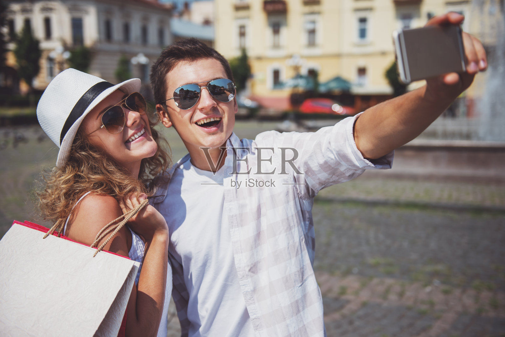
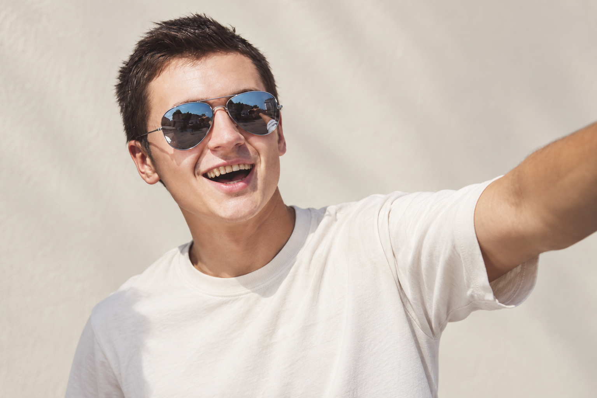

# M033 栗棕短碎发飞行员墨镜男性人物卡

固定外貌、独立服装、原图与测试记录一起保存。

目录

- [人物标识](#profile)
- [原始参考](#reference)
- [六项外貌细节](#appearance)
- [毛发配饰与妆容](#grooming)
- [观察边界](#limits)
- [固定描述原文](#fixed)
- [已测试调用提示词](#prompt)
- [独立服装模块](#clothing)
- [原图对比与验收](#validation)
- [调用方法](#reuse)
- [来源记录](#rights)
- [相关入口](#related)

<a id="profile"></a>
## 人物标识

编号：**M033**；分类：男性；版本：v1.0；归档日期：2026-10-07。

设计年龄：25岁，仅是成年角色创作参数。当前状态：**基础特征通过**。

<a id="reference"></a>
## 原始参考



文件：`veer-412569254.jpg`；尺寸：1600×1068。

SHA256：`15eaf66ff2b8f191fa5e1758bdbfd226d5a0f372f5bcda6efcbf06813b13211d`。

原图按字节保存，未改动原始照片。多人图取景规则：Select ONLY the man on the right holding up the selfie phone. Render him alone, preserve aviator sunglasses and open laughing mouth.

<a id="appearance"></a>
## 六项外貌细节

**脸型：** 偏长椭圆脸，下颌逐渐收窄，下巴圆，颧区中等宽，笑时面颊上提而不膨大。

**眉毛和眼睛：** 眉毛被飞行员镜片上沿部分遮住，可见短深棕眉；眼型、虹膜与眼尾方向不可确认，保持镜片不透明。

**鼻子：** 鼻梁中高偏窄，鼻尖小圆略向前，鼻翼不宽；鼻孔下缘只见少量，勿改宽鼻翼。

**嘴唇：** 张口笑露齿，上唇薄、下唇略厚，嘴角明显上扬，唇峰笑时展开；粉色唇，不量测闭嘴比例。

**肤色：** 浅暖米色，日照与颊部自然暖红混合，没有明确可见的密集雀斑。

**发型：** 栗棕短碎发，前额轻轻上扬，顶部低至中等蓬松度，细短发束错落，耳侧短而贴顺，无大卷与高耸发髻。

<a id="grooming"></a>
## 毛发配饰与妆容

金属细边飞行员墨镜，蓝灰反射镜片；脸部基本无明显胡须。

<a id="limits"></a>
## 观察边界

- 双人图只取画面右侧举手机男性
- 墨镜隐藏眼睛，张口笑不能当作静态唇形
- 五官比例为视觉描述；无法观察的结构保持未知。
- 未验证纯文字复现、多角度或多次随机生成一致性。

<a id="fixed"></a>
## 固定描述原文

后续调用逐字复用，服装和场景在外部替换。

```text
人物卡M033：栗棕短碎发飞行员墨镜。成年男性角色，设计年龄25岁；年龄仅为创作参数。
脸型：偏长椭圆脸，下颌逐渐收窄，下巴圆，颧区中等宽，笑时面颊上提而不膨大。
眉毛和眼睛：眉毛被飞行员镜片上沿部分遮住，可见短深棕眉；眼型、虹膜与眼尾方向不可确认，保持镜片不透明。
鼻子：鼻梁中高偏窄，鼻尖小圆略向前，鼻翼不宽；鼻孔下缘只见少量，勿改宽鼻翼。
嘴唇：张口笑露齿，上唇薄、下唇略厚，嘴角明显上扬，唇峰笑时展开；粉色唇，不量测闭嘴比例。
肤色：浅暖米色，日照与颊部自然暖红混合，没有明确可见的密集雀斑。
发型：栗棕短碎发，前额轻轻上扬，顶部低至中等蓬松度，细短发束错落，耳侧短而贴顺，无大卷与高耸发髻。
毛发配饰与妆容：金属细边飞行员墨镜，蓝灰反射镜片；脸部基本无明显胡须。
观察限制：双人图只取画面右侧举手机男性；墨镜隐藏眼睛，张口笑不能当作静态唇形
```

<a id="prompt"></a>
## 已测试调用提示词

下面是当前选用样例实际执行过的完整提示词。固定文字未因生成结果而改写。

```text
Use case: photorealistic-natural. Create one new photographic character portrait based on input image 1, the ORIGINAL user-provided reference. Preserve visible face structure, natural age impression, exact head angle, gaze, expression, hair silhouette and grooming. Original visible geometry takes priority over numeric estimates. Do not impose generic idealized beauty.

固定人物描述，逐字复用：
人物卡M033：栗棕短碎发飞行员墨镜。成年男性角色，设计年龄25岁；年龄仅为创作参数。
脸型：偏长椭圆脸，下颌逐渐收窄，下巴圆，颧区中等宽，笑时面颊上提而不膨大。
眉毛和眼睛：眉毛被飞行员镜片上沿部分遮住，可见短深棕眉；眼型、虹膜与眼尾方向不可确认，保持镜片不透明。
鼻子：鼻梁中高偏窄，鼻尖小圆略向前，鼻翼不宽；鼻孔下缘只见少量，勿改宽鼻翼。
嘴唇：张口笑露齿，上唇薄、下唇略厚，嘴角明显上扬，唇峰笑时展开；粉色唇，不量测闭嘴比例。
肤色：浅暖米色，日照与颊部自然暖红混合，没有明确可见的密集雀斑。
发型：栗棕短碎发，前额轻轻上扬，顶部低至中等蓬松度，细短发束错落，耳侧短而贴顺，无大卷与高耸发髻。
毛发配饰与妆容：金属细边飞行员墨镜，蓝灰反射镜片；脸部基本无明显胡须。
观察限制：双人图只取画面右侧举手机男性；墨镜隐藏眼睛，张口笑不能当作静态唇形

Test scene: quiet warm off-white backdrop with soft natural daylight, head and upper torso framing, normal lens perspective, whole visible hairstyle in frame. Preserve the original head and body orientation, including reclined pose if present. Clothing: simple cream cotton crewneck T-shirt, relaxed regular shoulder fit, matte fabric, no graphics. Keep reference facial accessories, glasses, hat, and any phone/hand/prop occlusion that covers facial areas. Do not invent unseen eyes or concealed mouth. Props away from face can be outside frame. Preserve natural pores, fine lines and mild asymmetry. Do not enlarge eyes, sharpen jaw, intensify makeup, thicken beard, tighten curls or increase hair volume. Match source smile instead of imposing closed-mouth proportions. Single photograph, one character, no labels or collage.

Target selection: Select ONLY the man on the right holding up the selfie phone. Render him alone, preserve aviator sunglasses and open laughing mouth.
```

<a id="clothing"></a>
## 独立服装模块

原图穿搭作为独立参考，不并入脸部固定文字。

| 层次 | 原图观察 |
| --- | --- |
| 色彩搭配逻辑 | 浅色同类色叠穿，以格纹增加层次 |
| 轮廓和结构 | 敞开合肩外衫，袖口卷起 |
| 材质和质感 | 轻薄透气棉布，褶皱自然 |
| 设计类型 | 翻领细格衬衫搭圆领素T恤 |

本轮统一测试服装：奶白圆领棉T恤，常规合肩、自然宽松、柔软哑光、无图案。换装时替换完整服装条款，避免新旧要求冲突。

<a id="validation"></a>
## 原图对比与验收



测试方式：原始参考图＋固定描述，统一基础服装，保留参考角度和表情。每次重测仍从原图出发。

选用：v1；结论：基础特征通过。

保留特征：短碎发、飞行员镜框、鼻唇轮廓和张口笑保持。

首轮偏差与限制：镜片保留了原场景反射，未来更换环境需单独检查；不影响本轮外貌比对。

本卡没有进行第二轮重测。

这是可见外貌的定性比对，不是身份识别或量化相似率。

<a id="reuse"></a>
## 调用方法

1. 按编号 M033 检索并读取完整固定描述。
2. 附上本卡登记的用户原始参考图；本轮生成样例只作结果对照。
3. 使用当前已测试提示词，独立替换服装、场景、构图；仍保持固定文字。
4. 若要求新角度、摘镜或解除遮挡，补充对应原始参考，或明确将未知部分作为创作补足。
5. 新结果继续对照原图。相同文字有助于相似，但不能保证每次完全相同。

<a id="rights"></a>
## 来源记录

2026-10-07 用户要求继续新增男女各10张卡，来源为指定的“人物场景 素材”目录。照片版权、肖像及AI使用范围沿用待核实状态；真实身份与是否公众人物未核验。

本批按文件SHA256排除已归档的相同照片；这不等于确认所有照片都来自不同人物。

<a id="related"></a>
## 相关入口

- [男性人物卡索引](男性人物卡索引.md)
- [人物卡分类索引](../人物卡分类索引.md)
