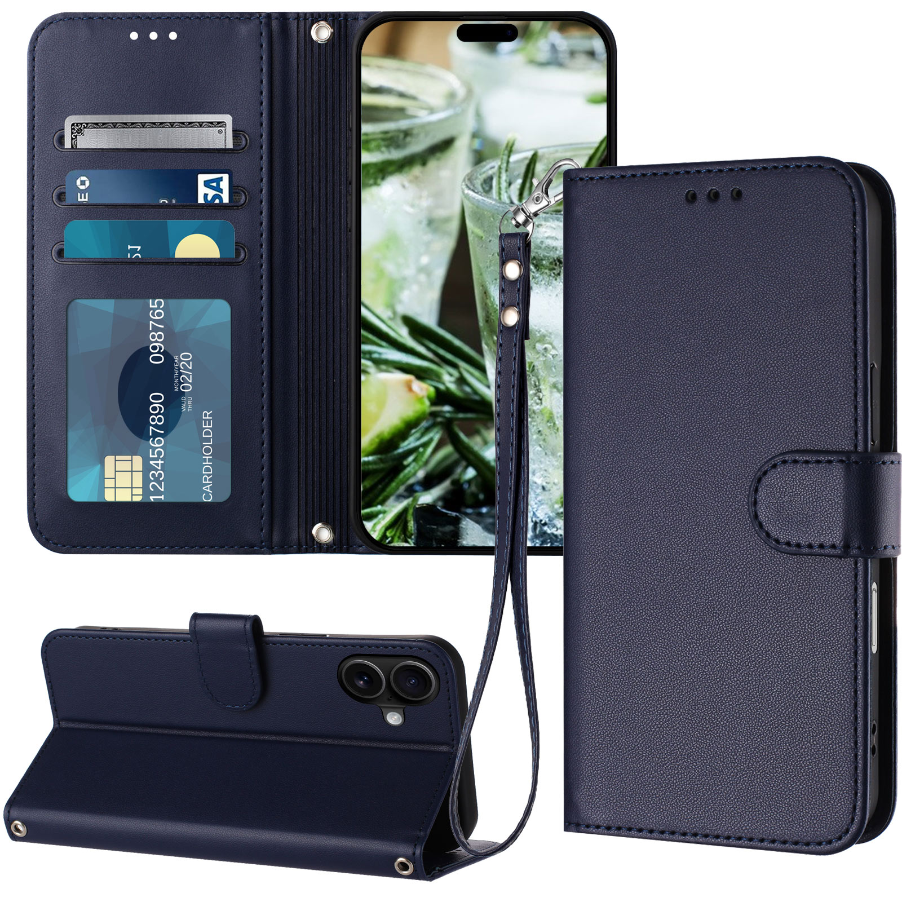
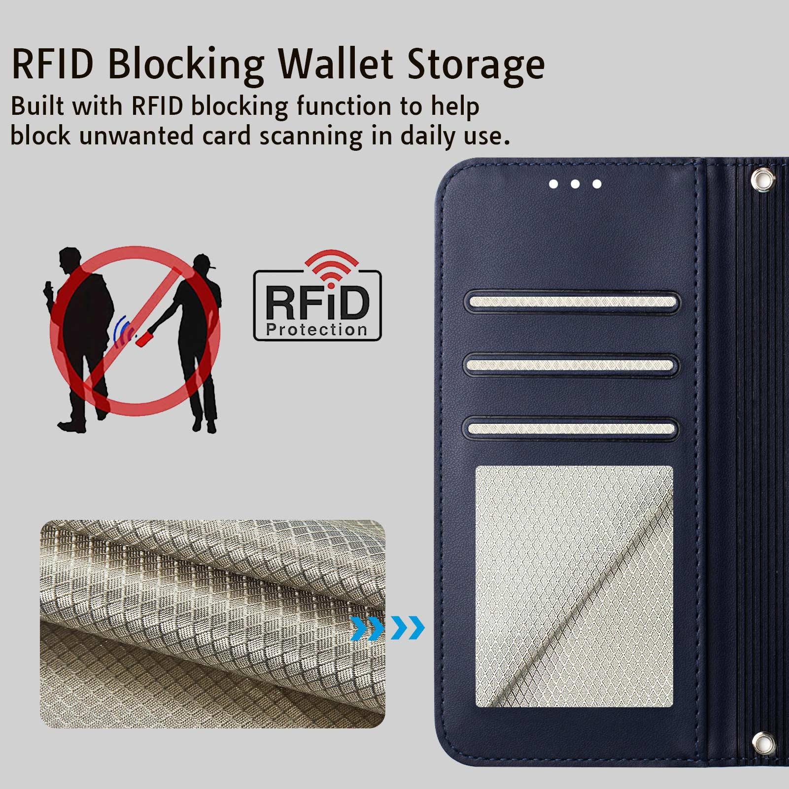
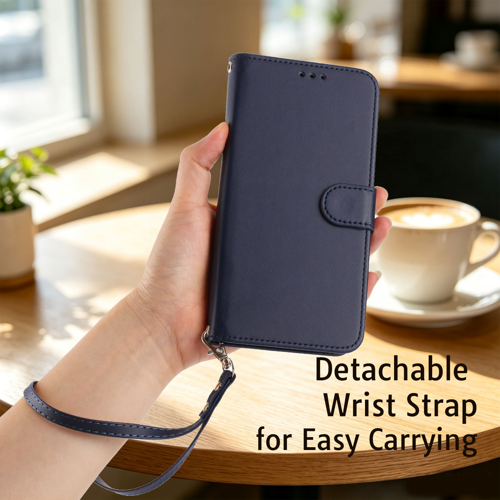
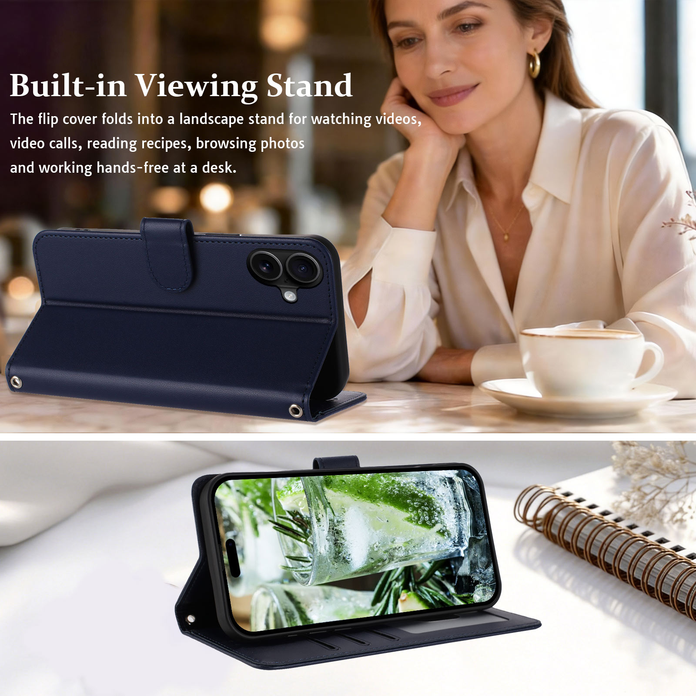
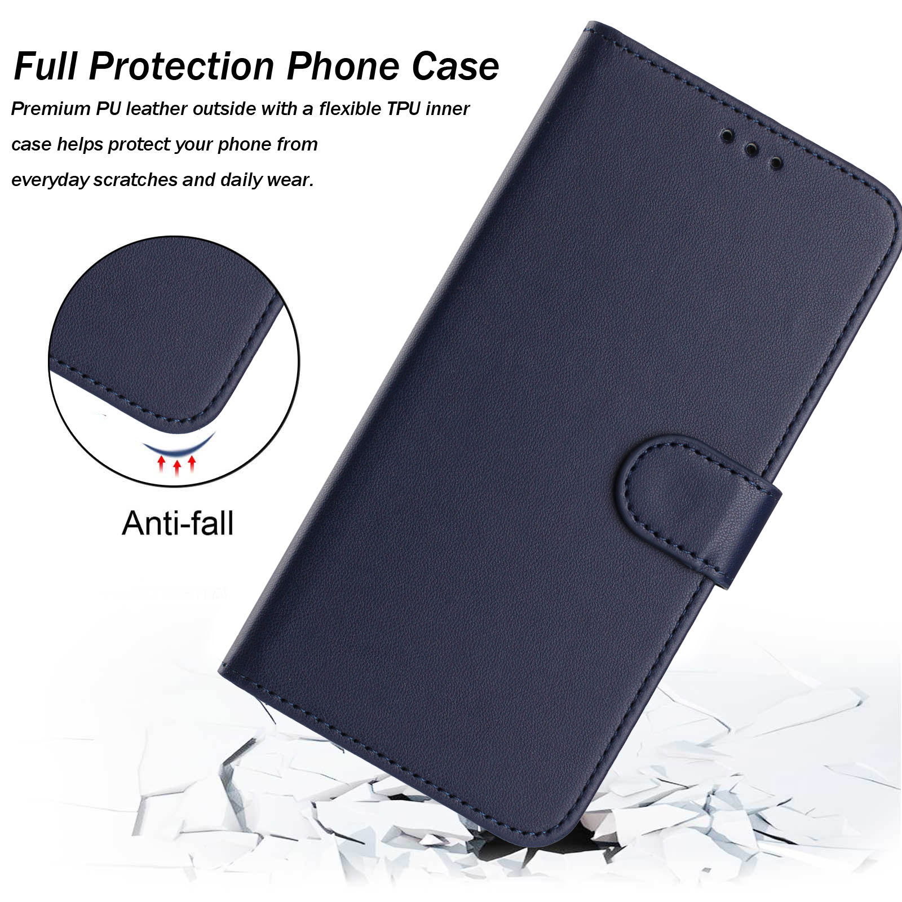
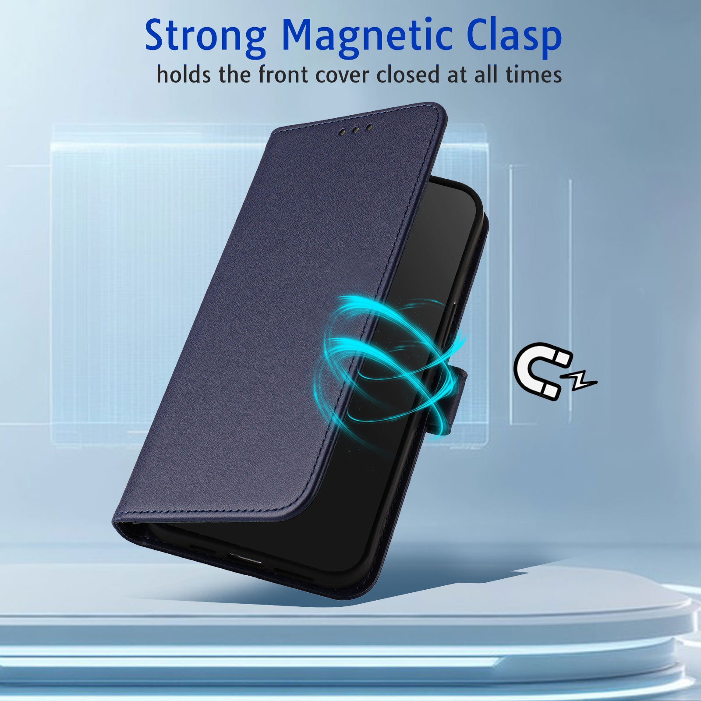

# 双孔系列钱包翻盖手机壳产品档案

> **系列识别：** “双孔”“双孔系列”“双孔手机壳”指用户自有的钱包翻盖手机壳系列。当前识别基线为翻盖连接脊上下两个金属包边挂绳孔、3 个普通卡槽、另设透明 ID／照片窗、纸币夹层、可拆腕带、磁扣和横屏折叠支架。材料按本系列图片文案及原稿记录为 PU 外层与 TPU 手机内壳，原稿和图片声明具有 RFID blocking 功能。
>
> **本次依据：** 2026-10-06 用户要求归档，提供 iPhone 16 目录的 63 张图片与 1 份 iPhone 17／RFID-PT18 文案，并明确确认：“是，同属双孔系列，仅手机型号不同”。本页记录系列共性及两个型号资料实例；外观与结构经图像核对，材料与功能以所提供资料为依据，没有新增实物性能测试。

## 目录

- [目录](#toc)
- [1 系列身份与结构基线](#series-identity)
- [2 产品特点、功能与证据](#features-evidence)
- [3 主要卖点与正向表达](#selling-points)
- [4 型号、品牌与 SKU 实例](#model-instances)
- [5 九色参考与图片定位](#colour-image-map)
- [6 原始资料归档与图例](#archived-materials)
  - [6.1 九色外观参考](#nine-colour-gallery)
  - [6.2 深蓝色完整七图](#blue-gallery)
- [7 内部核验与待补充信息](#verification-boundaries)
- [8 来源、关联知识与维护方法](#sources-maintenance)
- [9 归档记录](#archive-history)

## 1 系列身份与结构基线

“双孔”是用户确认的系列称呼，当前没有提供正式英文系列名或注册商标信息。可用 dual attachment holes 或 two metal-edged attachment holes 描述结构，但不把它们当成官方英文系列名。

图片中，翻盖与手机壳之间的连接脊上下各有一个金属包边孔位。配套腕带带金属挂扣，示例图显示其挂在其中一个孔位上；不能把“两孔可供连接”改写为配套腕带同时连接上下两处，也不能仅因孔位存在就增加肩带、斜挎带或颈绳随附承诺。前盖上方的三个小孔与这两个挂绳孔属于不同部位。

双孔系列属于 wallet case／folio case／flip phone case，使用翻盖钱包外套与手机内壳组合结构。当前收纳布局为 **3 个横向普通卡槽＋1 个独立透明 ID／照片窗＋1 个侧向纸币夹层**。透明窗另算，不计入三个普通卡槽。图中透明窗既有银行卡示意，也可按原稿作为证件或照片窗使用。

“iPhone 16”是本次图片目录的型号标识。用户已确认目录内 iPhone 17 文案属于同一双孔系列，允许作为同系列结构、材料与功能资料，但手机尺寸、镜头区、按键位置、SKU、品牌和适配对象仍按型号分别记录。以后收到其他型号的双孔系列资料，应登记对应实例及版本差异。

现有[梦幻系列档案](梦幻系列钱包翻盖手机壳产品档案.md)记录的是四个普通卡槽加独立透明窗。本系列是三个普通卡槽加独立透明窗；两系列的卡槽数量、颜色和型号资料不能混用。

## 2 产品特点、功能与证据

| 产品特点 | 当前可采用的记录 | 证据及范围 |
|---|---|---|
| 双孔连接结构 | 连接脊上下两个金属包边挂绳孔，可用于连接挂扣 | 多色 0 组组合图及深蓝色 1.jpg 可见；未测孔位承重 |
| 可拆腕带 | 与外套配色相应的腕带，带金属挂扣，可拆卸连接 | 1 组佩戴图、组合图、原稿 Detachable Wrist Strap；图中为单孔连接示例 |
| 三普通卡槽 | 卡片内页有三个横向普通槽口 | 0 组、2 组、7 组及深蓝色图可见；2 组写有 3 Card Slots + 1 Cash Pocket |
| 独立透明窗 | 三普通槽下方另设透明 ID／照片窗 | 图片可见；原稿 photo ID window／photo slot。不是第四个普通槽 |
| 纸币夹层 | 卡片页后方有侧向现金袋，可收纳折叠纸币 | 2 组图展示纸币从侧边伸出，原稿 side cash pocket |
| RFID 功能 | 本系列提供资料声明具有 RFID blocking，用于帮助减少不希望发生的卡片扫描 | 7 组和深蓝色 2.jpg 有 RFID 图文，iPhone 17 原稿重复声明；频段与测试效果未提供 |
| 外层材料 | PU leather 外层，纯色皮纹外观，可见周边缝线 | 4 组与深蓝色 6.jpg 图文直接写 Premium PU leather；iPhone 17 原稿写 smooth PU leather |
| 手机内壳 | 黑色手机内壳；所提供资料说明为 flexible TPU inner case | 组合图可见内壳，4 组和原稿说明 TPU；未做成分检测 |
| 磁性扣片 | 侧边包覆材质的磁扣，用于翻盖闭合 | 6 组与深蓝色 7.jpg 写 Magnetic Clasp，原稿 magnetic closure；磁力与满载闭合未测 |
| 横屏支架 | 翻折外套形成 landscape viewing stand | 0 组、8 组、深蓝色 5.jpg 及原稿支持横屏观看 |
| 日常包覆 | 翻盖、背部外套与内壳组成包覆结构，可围绕日常划擦和轻微碰撞组织文案 | 外观支持结构，保护效果来自资料描述；无跌落高度或认证资料 |
| 多色外观 | 资料中共有九色：黑、深绿／墨绿、紫、薄荷、棕、橙、浅紫、粉、深蓝 | 图片视觉与原稿九色名单相互对应，色号与各站点库存未提供 |

**证据口径：** “图片可见”指本次查看到的外观与结构；“资料说明／声明”指用户提供的图片文案或 TXT；“用户确认”指两个型号同属双孔系列。这三类依据不等同于材料检测、RFID 屏蔽测试、跌落测试或装载测试。

## 3 主要卖点与正向表达

本系列适合围绕“手机、卡片、证件／照片与少量现金集中携带，配腕带方便日常出行，翻盖可用于横屏观看”来组织卖点。双孔结构是系列辨识特点，RFID 是资料声明的功能亮点。

| 卖点方向 | 面向买家的具体利益 | 可复用英文表达 | 使用依据 |
|---|---|---|---|
| 钱包收纳 | 手机与常用卡片、证件／照片、折叠现金一起携带 | Three card slots, a separate ID window and a side cash pocket | 槽位和夹层图片、原稿 |
| RFID | 提供带 RFID 功能的卡片收纳区域 | RFID-blocking wallet storage to help reduce unwanted card scanning | 本系列图片与原稿功能声明；不得扩展成所有频段与所有卡片保护 |
| 可拆腕带与双孔 | 腕带便于购物、通勤和短途出行时随手携带；上下两个孔位提供连接位置 | A detachable wrist strap with two metal-edged attachment holes | 实际结构和佩戴图；不附加承重数值或双点同时受力结论 |
| PU／TPU 与磁扣 | 纯色皮纹外观配手机内壳，扣片让翻盖方便开合 | PU leather exterior, flexible TPU inner shell and magnetic clasp | 本系列图文与原稿 |
| 横屏观看 | 外套折成支架，用于视频、视频通话或桌面查看内容 | The folio cover folds into a landscape viewing stand | 支架图及原稿 |
| 九色选择 | 提供不同外观偏好的配色参考 | A range of solid colours | 本次九色素材；在售颜色按具体型号与站点确认 |

后续标题五点采用正向表述，以真实结构、资料支持的功能和场景为主体。内部待核验项目保留在第 7 节，不直接搬进五点，也不用未证实的绝对保护、满载保证或超薄承诺补充文案。本表是产品事实与卖点素材，不是经过站点关键词研究的最终 Listing。

建议五点内容分工为：具体型号适配；钱包收纳与 RFID；可拆腕带及双孔连接；PU／TPU 与磁扣；横屏支架。实际顺序按站点与目标买家调整，数量和结构保持准确。

## 4 型号、品牌与 SKU 实例

| 实例 | 已提供信息 | 后续使用范围 |
|---|---|---|
| iPhone 16 图片实例 | 原目录名 iPhone 16；56 张根目录 JPG 加子目录 7 张深蓝色 JPG，展示双孔、三槽、透明窗、现金夹层、腕带、RFID 图文、磁扣和横屏支架 | 用作 iPhone 16 目录素材及系列结构参考；目录名与图片不构成全部子型号的适配实测 |
| iPhone 17 文案实例 | 文件名 iPhone 17-RFID-PT18系列已查询8.18.txt；原稿品牌 Moment Dextrad，型号 iPhone 17，尺寸写 6.3 Inch／6.3"，SKU 写 F31 iPhone17 RFID-PT18 | 用户确认与图片同属双孔系列。品牌、尺寸、SKU 和型号文字只归于此文案实例 |
| 参考 ASIN | 原稿首行写“复制和参考 ASIN: B0GDQJ71MQ” | 只记录为原稿参考对象，未联网核验；不能据此认定是本产品已上架 ASIN |

原稿标题：`Moment Dextrad for iPhone 17 RFID Wallet Case, Wrist Strap, Blue`。

原稿 Item Highlight：`RFID Blocking, Folio Cover, PU Leather & TPU Protection, 3 Card Slots, Photo Slot, Cash Pocket, Stand, Magnetic Clasp`。

原稿颜色名单：`Black / Pink / Mint / Orange / Brown / Dark Green / Purple / Lavender / Blue`。图片深蓝色与原稿 Blue 对应作为颜色参考，不能推导店铺正式色名必须为 Navy。

原稿还包含 A+、主副图、广告关键词、9.99／10.99 定价与变体分层建议。这些是提供文件中的历史策划内容，本次未核验其执行状态、货币、销售站点或市场效果，不把它们登记成当前售价、在售状态或已验证的转化结论。完整原稿已原样归档，文件名中的“8.18”年份不明，不自行补成年份。

## 5 九色参考与图片定位

图片观察名称与英文原稿名称如下。九色是当前素材范围，不代表每一型号、销售站点或库存均同时提供九色。

| 图片观察颜色 | 原稿名称 | 主要外观参考 | 备注 |
|---|---|---|---|
| 黑色 | Black | 0 (1).jpg | 黑色外层配可见棕色系缝线 |
| 深绿／墨绿 | Dark Green | 0 (2).jpg | 图像带青绿感，正式色号待产品资料 |
| 深紫／紫色 | Purple | 0 (3).jpg | 与浅紫区分 |
| 薄荷色 | Mint | 0 (4).jpg | 浅青绿外观 |
| 棕色 | Brown | 0 (5).jpg | 与黑色、橙色分别登记 |
| 橙色 | Orange | 0 (6).jpg | 鲜橙外观 |
| 浅紫／薰衣草色 | Lavender | 0 (7).jpg | 浅紫外观 |
| 粉色 | Pink | 0 (8).jpg | 浅粉外观 |
| 深蓝色 | Blue | 新建文件夹/1.jpg | 子目录全部七图为深蓝色资料 |

**文件编号规则：** 前缀主要对应图片主题，括号内编号并不是全目录统一色号。例如 0 (1).jpg 是黑色，1 (1).jpg 是棕色，2 (1).jpg 是紫色。后续取图必须核对画面，不按括号编号直接匹配颜色。

| 原始文件组 | 数量 | 主题 |
|---|---:|---|
| 0 (1)—0 (8) | 8 | 各色闭合、收纳、腕带和支架组合 |
| 1 组 | 8 | 可拆腕带与手持佩戴 |
| 2 组 | 8 | 三普通卡槽、透明窗与侧向纸币夹层 |
| 4 组 | 8 | PU／TPU 材料图文及保护示意 |
| 6 组 | 8 | 磁性扣片图文 |
| 7 组 | 8 | RFID 卡片页与屏蔽材料示意 |
| 8 组 | 8 | 横屏支架场景 |
| 新建文件夹/1.jpg—7.jpg | 7 | 深蓝色完整七图 |
| TXT 原稿 | 1 | iPhone 17／RFID-PT18 标题、功能、五点和策划内容 |

8 组中的 8 (7).jpg 与 8 (8).jpg 均呈深紫色外观，当前没有独立橙色支架图。两个文件并非字节相同的重复文件；保留原文件，不擅自更名为其他颜色。根目录没有 3 组、5 组，不自动认定素材丢失。

## 6 原始资料归档与图例

本页配套资料在同级 `双孔系列资料/` 中，保持原图尺寸、颜色、文件名与目录关系。归档共 **63 张 JPG＋1 份 TXT**；本次按每个文件的字节数和 SHA-256 核对复制结果。图片中的手机、卡片、纸币和场景道具不自动构成包装清单。

- [完整原始资料清单与 SHA-256](双孔系列资料/素材清单.json)
- [iPhone 17／RFID-PT18 原稿](双孔系列资料/原始资料/iPhone%2017-RFID-PT18系列已查询8.18.txt)
- 原图保存位置：`双孔系列资料/原始资料/`。
- 图片是用户提供的资料，没有使用 AI 生成或改图；缩略图总览仅用于本次核对，不作为产品原图归档。

### 6.1 九色外观参考

下列八张根目录组合图与一张深蓝色组合图，覆盖本次九色参考。

**黑色**

.jpg>)

**深绿／墨绿**

.jpg>)

**深紫／紫色**

.jpg>)

**薄荷色**

.jpg>)

**棕色**

.jpg>)

**橙色**

.jpg>)

**浅紫／薰衣草色**

.jpg>)

**粉色**

.jpg>)

**深蓝色**

### 6.2 深蓝色完整七图

深蓝色第 1 图已展示在上方，包含闭合外观、内页、双孔、腕带和横屏支架。下面继续按原序号保存第 2—7 图。

**2：RFID 卡片页、三普通卡槽与独立透明窗**

**3：三普通卡槽与纸币夹层**

**4：可拆腕带佩戴**

**5：横屏支架正反面**

**6：PU 外层与 TPU 内壳材料说明**

**7：磁性扣片说明**

## 7 内部核验与待补充信息

本节保存内部产品事实边界，帮助后续写作、客服和视觉制作取用正确资料，不是对外五点正文。

| 需要区分的问题 | 当前结论与待补充信息 |
|---|---|
| RFID 效果 | 图片和原稿声明有 RFID blocking；未提供屏蔽层实际位置、频段、卡片类型或测试报告。不能写成阻止所有扫描、全面防盗或保护所有个人信息 |
| 双孔与加强结构 | 两个金属包边孔可见；原稿 dual reinforced connection points 的“加强”效果没有结构或承重测试。不能称双点同时连接、承重翻倍或永不脱落 |
| 磁扣效果 | 磁性闭合有图文和原稿支持；“holds ... at all times”是原稿绝对措辞，空载、装卡与现金后闭合及吸力待测 |
| 材料 | PU 与 flexible TPU 是本系列资料说明；不能改写真皮、天然皮革、环保认证或 100% 手工 |
| 保护与耐久 | 图中破碎地面和 Anti-fall 字样为宣传示意，未提供跌落认证；不建立军规、防摔高度、抗冲击百分比或长期耐久结论 |
| 支架 | 证据支持横屏；竖屏、连续调节、多档角度和稳定范围待实物确认 |
| 无线充电 | 原稿提醒 Wireless Charger Friendly 需验证，没有提供本系列装壳充电测试；不登记为已支持或已不支持 |
| MagSafe／可拆内壳 | 翻盖磁扣不能证明 MagSafe、Qi2、磁吸车载或可拆内壳结构 |
| 槽位与满载 | 三普通槽加独立透明窗是结构数量，未测不同厚卡与纸币组合下的总容量及闭合状态 |
| 配件与尺寸 | 展示腕带，但正式包装清单、产品净重、外形尺寸、厚度、腕带长度和承重未提供 |
| 闭盖通话 | 前盖上方有三个小孔；未提供声学或闭盖通话实测，不仅凭孔位增加该功能 |
| 防指纹、防水 | 当前资料未证明相关工艺或等级，不据 PU 皮纹推导 |
| 型号适配 | 图片目录是 iPhone 16，原稿是 iPhone 17；两者同系列已确认，不代表一只壳跨型号通用 |
| 品牌与 SKU | Moment Dextrad、F31 iPhone17 RFID-PT18 只在 iPhone 17 原稿实例中登记；iPhone 16 品牌与 SKU 待补充 |

后续优先补充包装清单、各型号的适配与开孔记录、装载闭合测试、无线充电结果、RFID 说明及腕带／孔位承重信息。新增确认须记录来源、日期、具体型号和版本，不覆盖其他实例的既有事实。

## 8 来源、关联知识与维护方法

**主要来源**

- 用户 2026-10-06 的归档要求：将 iPhone 16 目录中的双孔系列保存到“电商运营／亚马逊／产品”作为产品档案，确认卖点和特点。
- 用户当日明确回复：“是，同属双孔系列，仅手机型号不同”，确认目录中的 iPhone 17／RFID-PT18 TXT 与图片同属双孔系列。
- 原始本地目录：`C:\Users\AI454\OneDrive\Desktop\产品\iPhone 16`。56 张根目录图片、7 张子目录图片、1 份 TXT，共 64 个文件；63 张图片均纳入本次图像核对。
- 参考结构：知识库 `.templates/01-Codex对话知识整理模板.md` 与现有梦幻系列产品档案。本页采用适合产品事实档案的章节，区分用户事实、图片观察与资料功能声明。
- 本次没有联网查询参考 ASIN、平台规则、市场价格或手机官方参数。原稿 6.3 Inch 与品牌信息按原文保存。

**关联知识**

- [知识库导航](../../../知识库导航.md)：本系列产品档案的入口。
- [梦幻系列钱包翻盖手机壳产品档案](梦幻系列钱包翻盖手机壳产品档案.md)：另一系列产品结构，主要区别为四普通卡槽加独立透明窗。
- [FlipCase 完整 Listing 编写与优化指南](../listing/flipcase完整listing指南.md)：从产品事实形成 Listing 的流程。
- [FlipCase 榜单 Listing 统计与写作分析库](../listing/flipcase榜单listing统计与写作分析库.md#positive-bullets)：五点正向表达与研究写法参考；竞品数据不能充当本产品性能证据。

**后续调用**

用户说“双孔系列”“双孔 iPhone 16”“PT18”“双孔钱包手机壳”时，先检索本页的结构基线、卖点及目标型号实例。写 Listing 时用“three card slots and a separate ID window”，不取用梦幻系列的四槽描述。制作图像、改色或主图时，以用户原图为基础，保留两个金属包边孔、透明窗、扣片、腕带、手机内壳与对应型号开孔。

型号、配色、材料、功能、附件或测试状态变化时，更新对应实例与证据表；新增章节后根据完整正文重新生成目录，保留稳定锚点。原始素材保持原样，后续新增资料单独记录版本和来源。

## 9 归档记录

- **2026-10-06**：新建双孔系列产品主档案；核对 63 张图片与 1 份 TXT；确认两个型号同属一个系列；登记九色及三普通卡槽加独立透明窗；保存完整原始资料，建立素材清单与逐文件 SHA-256；建立知识库导航到本页的关系链接，并通过 GBrain MCP 写入与核验页面、分块和检索状态。
