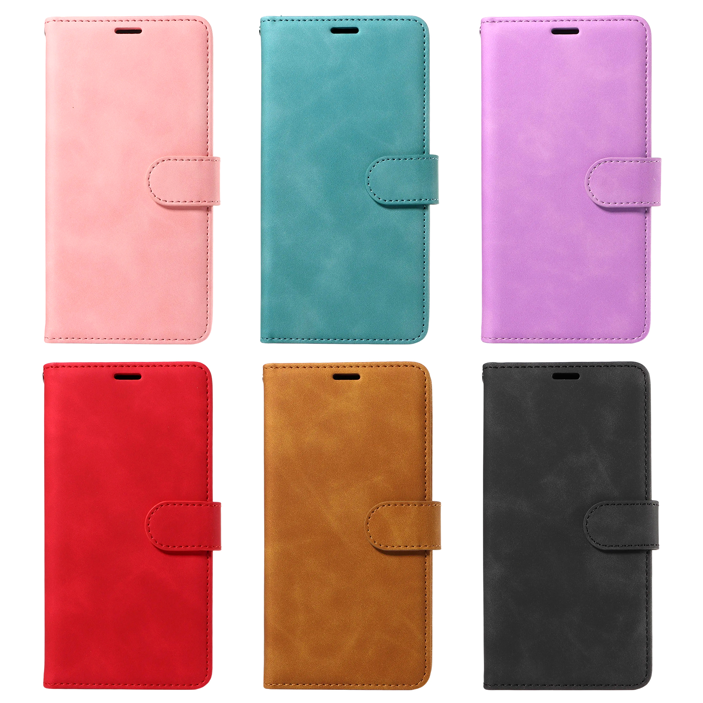

# 梦幻系列钱包翻盖手机壳产品档案

> **系列识别：** 用户说“梦幻”“梦幻系列”“梦幻手机壳”或“S25 梦幻白底”时，优先识别为用户自有的这款钱包翻盖手机壳系列。其当前结构基线为四个普通卡槽、另设透明 ID 窗、纸币夹层、可拆腕带、翻盖扣片及横屏支架。系列名称跨手机型号使用；品牌、具体型号、颜色、站点和性能参数按对应实例读取。
>
> **归档范围：** 用户于 2026-09-23 明确要求将“梦幻系列的手机壳（任何型号）”写入知识库。本文是系列产品资料的主入口，汇总提供的 S26 标题五点、S25 目录全部 43 张产品图、此前用户确认及已有知识库记录。图片说明是对用户图片的观察；性能测试、材料检测和兼容性实测未由本次归档补做。

## 目录

- [目录](#toc)
- [1 系列身份与后续识别](#series-identity)
- [2 系列结构、卖点及证据等级](#series-features)
- [3 型号、品牌与站点实例](#model-instances)
- [4 产品图、颜色和部件定位](#image-evidence)
  - [4.1 完整六色色系图](#colour-overview)
  - [4.2 青绿色完整图片组](#green-gallery)
- [5 内部核验与事实依据](#claim-boundaries)
- [6 S26 标题五点原文](#s26-original)
- [7 后续调用和更新方法](#reuse-maintenance)
  - [7.1 梦幻系列五点的正向表达约定](#positive-copy-preference)
- [8 来源、相关知识与归档记录](#sources-history)

## 1 系列身份与后续识别

“梦幻”是用户对这一产品系列的称呼。当前资料没有提供正式英文系列名、系列商标或统一 SKU 编码，不自行翻译为 Dream Series 并当成商品上的正式名称。

此系列属于 wallet case / folio case / flip phone case：翻盖钱包外套结合手机内壳，内页可以收纳卡片和纸币，配腕带，外套可折成横屏支架。“S25 梦幻白底”是用户提供的图片目录名称；“白底”指这套素材的白色背景，不代表商品只有白色，目录名也不限制系列只能用于 S25。

系列知识可以用于辨认产品、建立事实表、写标题五点、规划主图或 A+、核对改色和视觉结构。手机型号变化时，可以复用已确认的系列结构描述，但不能沿用其他型号的镜头开孔、手机尺寸或兼容性结论。用户在本次要求中没有宣布所有未来型号的材料、容量及附件永远完全一致；发现新版本差异时，以该版本资料更新。

后续谈到“梦幻”无需重新询问整个系列是什么。先调用本档案，再利用当次上下文确定目标品牌、型号、颜色、销售站点和版本；只有缺失的信息会影响准确性时才补问。

## 2 系列结构、卖点及证据等级

梦幻系列当前的收纳结构基线是 **4 个普通卡槽＋1 个独立透明 ID 窗＋纸币长夹层**。透明 ID 窗另算，不包含在四个普通卡槽中。用户在 2026-09-23 的 S26 Ultra 黑色任务中明确确认“4 个普通卡槽，透明 ID 窗另算”；S25 系列开合图也可见相同布局。这个结论描述槽位结构，不等于已经验证任意五张厚卡与纸币同时装满后都能顺利闭合。

| 项目 | 当前记录 | 依据与适用范围 |
|---|---|---|
| 产品形态 | 钱包翻盖外套与手机内壳结合；前盖、背部和扣片可见缝线 | S25 全套产品图可见；S26 文案对应同类结构 |
| 普通卡槽 | 四个横向普通卡槽 | S25 的各色第 7 张内页图可见；2026-09-23 用户针对 S26 Ultra 黑色明确确认四槽 |
| 透明窗 | 普通槽下方另设透明 ID／照片窗 | 图片可见；用户确认透明 ID 窗另算。窗内示意照片不是随附赠品承诺 |
| 纸币夹层 | 卡片页后方有纵向长夹层，可放纸币 | S25 内页图和 S26 原文 cash compartment。纸币规格、数量及装载闭合另核 |
| 腕带 | 可拆卸腕带，带金属挂扣，连接壳体金属孔位 | S25 图可见；S26 原文 detachable wristlet lanyard。未提供承重数据 |
| 支架 | 翻折外套形成横屏支撑 | S25 第 5、6 张及拼图可见；S26 文案说明 landscape viewing。角度范围、档位未实测 |
| 扣片 | 翻盖有包覆材质的扣片，原稿称 magnetic closure | 扣片形状可见；磁性属于用户产品资料的描述，不由外观推断吸力或装满闭合能力 |
| 外层材料 | 按 S26 用户资料记录 PU leather／synthetic leather | 属于供应资料；没有材料检测证书，不写成 genuine leather |
| 手机内壳 | 图片可见黑色内壳；S26 文案称 TPU inner shell | 图片支持形态，TPU 成分由文案声明，不能仅凭照片验证 |
| RFID | 用户 S26 标题、五点有 RFID blocking 功能声称 | 保留为系列资料中的功能线索；屏蔽材料、覆盖位置、频段及效果没有测试证据 |
| 颜色参考 | 棕、红、黑、紫、青绿、粉，共六色 | S25 目录图像记录，不代表每个型号、站点或当前库存都有六色 |

用于介绍这款产品时，可先组织“手机、卡片和纸币集中携带；透明窗便于查看卡片或照片；可拆腕带；横屏观看”这些结构与用途。RFID、材料名称等按对应实例的资料状态表达，效果性承诺见第 5 节。

## 3 型号、品牌与站点实例

| 资料实例 | 品牌／目标对象 | 已有信息 | 复用范围 |
|---|---|---|---|
| 本次 S26.txt | JHWVVTF；标准 Samsung Galaxy S26；黑色 | 标题写 Galaxy S26，五点写 6.3 Inches；包含 RFID、四卡槽、现金夹层、腕带、支架、PU／合成皮革及 TPU 等描述 | 作为本次明确提供的标准 S26 文案来源。品牌、屏幕尺寸与型号文字均按原稿归档，未补做外部规格核验。本次归档未另指定这份 S26.txt 的销售站点 |
| S25 梦幻白底图片 | 文件夹标识 S25；六色产品图 | 43 张原图，展示同系列外观、收纳、扣片、腕带和支架结构；图片本身不足以确认全部手机子型号 | 作为同系列结构及视觉参考；不能用来证明标准 S26 或 S26 Ultra 的开孔和实际适配 |
| 此前英国站任务 | GOTOURED；Samsung Galaxy S26 Ultra；黑色；Amazon UK | 用户明确：“以原稿 S26 Ultra 黑色为准，图片只参考同系列结构”；另确认“四个普通卡槽，透明 ID 窗另算” | 保留这一明确的 UK 实例。品牌与型号不能替换进 JHWVVTF 标准 S26 原稿 |
| 已有标准 S26 历史确认 | 2026-09-18 讨论的标准 Galaxy S26 产品 | 已有指南记录：“无线充电前需取下整个手机壳”“支架仅支持横屏” | 仅在当时标准 S26 产品范围内沿用；新版本或其他型号需单独确认 |

JHWVVTF 与 GOTOURED 是已提供资料中的不同品牌实例。它们可以在用户指定的梦幻系列档案内共同登记，但本档案不证明两者属于同一个法律主体，也不将两个品牌作为可互换的 Listing 字段。

“任何型号”在此指系列档案的覆盖方式，不表示一只手机壳通用适配所有手机。S26、S26 Ultra 和 S25 图片的型号信息需要分别保持完整。

## 4 产品图、颜色和部件定位

**本页配套原图：** 按用户指定，已将青绿色完整一组 7 张图片和六色总览 1 张图片保存到同级的 `梦幻系列图片/` 文件夹。下方图片通过相对路径引用，可以随产品目录一起保存和迁移。8 张文件均为原图直接复制，尺寸、色彩和内容保持与来源一致，逐张 SHA-256 已核对。

这组图片来自 S25 素材，用于认识梦幻系列的外观、收纳和折叠结构；其他手机型号的开孔与适配仍按对应实例确认。

原图目录：`C:\Users\AI454\OneDrive\Desktop\产品\S25 梦幻白底`

共有 43 张 JPG：一张 0.jpg 六色总览，以及 1—6 六组，每组第 1—7 张。原文件名保留，用“目录＋文件名”可以准确定位；本次逐文件建立 SHA-256 清单，便于以后识别是否换过素材。图像中的手机、卡片、照片和纸币是展示内容，不能自动当成销售包装内的物品。

| 文件组 | 观察到的外层颜色 | 文件范围 |
|---|---|---|
| 0.jpg | 六色正面总览 | 0.jpg |
| 1 | 棕色／棕黄色 | 1 (1).jpg—1 (7).jpg |
| 2 | 红色 | 2 (1).jpg—2 (7).jpg |
| 3 | 黑色 | 3 (1).jpg—3 (7).jpg |
| 4 | 紫色 | 4 (1).jpg—4 (7).jpg |
| 5 | 青绿色 | 5 (1).jpg—5 (7).jpg |
| 6 | 粉色 | 6 (1).jpg—6 (7).jpg |

这些颜色是图片观察名称，不是已确认的店铺变体名称或色号。黑色款展开时可见棕色内侧连接区域，因此制作视觉时不能把所有内侧部件都直接涂成黑色。

| 组内序号 | 画面内容 | 可用于核对的重点 |
|---|---|---|
| (1) | 闭合正面、背面与腕带 | 外层纹理、缝线、扣片、镜头区、金属连接和腕带 |
| (2) | 多状态拼图 | 闭合、收纳与横屏支架的关系 |
| (3) | 斜角半开合 | 内壳、翻盖厚度感、包边、扣片与缝线位置 |
| (4) | 当前款多视图及六色参考 | 系列配色和各部件的位置关系 |
| (5) | 横屏支架背面 | 外套折叠方式、背面与支撑接触 |
| (6) | 横屏支架正面 | 手机处于横屏及正面观看状态 |
| (7) | 展开的卡片页与手机内壳 | 四普通槽、另设透明窗、后方纸币长夹层 |

建议优先查看 0.jpg 识别配色，3 (7).jpg 识别收纳布局，3 (1).jpg 识别黑色款外观与腕带，3 (5).jpg 和 3 (6).jpg 识别支架结构。其他颜色对应序号可直接定位同一用途的参考图。

全部 43 张图片在本会话前序 Listing 审阅中已查看；本次归档重新核对文件清单，并复看 0.jpg 与 3 (7).jpg。图片支持外观和结构说明，不能替代尺寸测量、材料分析、跌落测试或 RFID 测试。

### 4.1 完整六色色系图

用户原图 0.jpg 展示粉、青绿、紫、红、棕、黑六色。本图是系列配色参考，不代表所有型号与站点都有全部颜色在售。

### 4.2 青绿色完整图片组

下面按用户原文件顺序保存青绿色 7 张图。图片目录里的“5”是这组青绿色素材的文件前缀。

**青绿色 1：闭合正面、背面与可拆腕带**

查看外层配色、扣片、缝线、镜头区和腕带连接。

.jpg>)

**青绿色 2：多状态组合**

查看外观、收纳与横屏支架的使用状态。

.jpg>)

**青绿色 3：斜角半开合**

查看翻盖、手机内壳、包边和扣片位置。

.jpg>)

**青绿色 4：多视图与配色参考**

查看当前颜色的多角度结构及系列配色。

.jpg>)

**青绿色 5：横屏支架背面**

查看外套折叠与背部支撑方式。

.jpg>)

**青绿色 6：横屏支架正面**

查看横屏观看时手机与外套的相对位置。

.jpg>)

**青绿色 7：展开收纳内页**

查看 4 个普通卡槽、独立透明 ID 窗及后方纸币夹层。

.jpg>)

## 5 内部核验与事实依据

**本节用于内部核验，不作为五点正文。** 产品性能与型号范围仍按实际证据保存；对外文案采用第 7.1 节的正向表达约定。

| 表述／问题 | 档案中的处理方式 |
|---|---|
| RFID blocking／防盗刷 | 作为用户资料声称记录，未核验频段、屏蔽部位或测试结果；不能写成阻止所有未经授权扫描或保护一切个人信息 |
| PU、synthetic、vegan leather | PU／合成皮革来自原稿；“vegan”保留为原稿用词，不扩展为环保认证、可持续认证或第三方动物成分认证 |
| anti-fingerprint coating | 防指纹“涂层”仅见于原稿，图片无法证明存在该工艺，待供应商资料或测试支持 |
| 2.0mm raised camera bezels | 具体 2.0 mm 数值仅见于本次 S26 原稿，没有测量证据；不能迁移到其他型号 |
| shockproof、guards against drops、prevents fraying | 原文保护和耐久效果声明，没有跌落标准、测试高度或耐磨数据；保留为待核验声明 |
| slim、pocket-friendly、without unnecessary bulk | 属于主观定位，未提供空载／装载后的厚度、重量或参照物；不作量化薄度结论 |
| multi-angle／adjustable kickstand | 原文这样描述；图片确认横屏支撑，未确认连续调节、档位数量或稳定角度范围 |
| 横屏与竖屏 | 图片证据和标准 S26 历史确认支持横屏；没有竖屏支架证据，不增写竖屏 |
| 无线充电 | 历史确认只覆盖当时标准 S26“需取下整个手机壳”；其他型号不自动继承支持或不支持的结论 |
| MagSafe、Qi2、磁吸车载、可拆内壳 | 当前资料没有确认；翻盖磁扣不能被当作上述功能证据 |
| S Pen | 当前未提供 S26 Ultra 装壳后使用表现，不把磁扣推导为兼容或干扰结论 |
| 装满后闭合与容量 | 四普通槽和独立 ID 窗是槽位数，不等于所有卡厚、纸币组合都能闭合；实物装载状态待对应型号验证 |
| 纸币尺寸及通勤刷卡 | 图中纸币道具不构成英镑尺寸适配证据；不承诺卡留在 RFID 区内可正常感应刷卡 |
| Wash Pocket | 原卖点原文保留；结合正文 cash compartment 和图片纸币夹层，推断为 Cash Pocket 的笔误。后续编辑可改成 cash pocket，不据此增加可水洗功能 |

这些是产品档案中的证据边界，不是判定产品一定没有这些性能。用户补充供应商规格、测试或新的型号确认后，应将对应项目更新为有来源、有范围的事实。

## 6 S26 标题五点原文

来源：`C:\Users\AI454\Downloads\标题 描述 主图 A+\S26.txt`

以下保留用户文件中的标题、卖点及五点措辞，供追溯。只统一换行并去除文末空白，没有修正拼写、语法、型号或性能声明。原稿中的 6.3 Inches、2.0mm、RFID 等按第 3、5 节理解，不因保存在知识库而变成实测结论。

~~~text
S26 标题：
JHWVVTF Wallet Case for Galaxy S26, RFID Blocking, 4 Card Slots, Black

卖点：4 Card Slots With ID Window, Wash Pocket, Wrist Strap, Stand Function, Magnetic Closure, Flip PU Leather, Folio Cover

五点描述：
[RFID Wallet Case Compatible with Samsung Galaxy S26 (6.3 Inches)] Phone case is outfitted with advanced RFID blocking material that will protect your personal information from unauthorized scans while you travel,shop or Daily use. This flip cases comes in a variety of colours. Choose the style that suits you

[4-Slot Utility & Slim Profile] Simplify your daily carry. Engineered with 4 precision-cut card slots and a dedicated cash compartment, this case organizes your essentials without adding unnecessary bulk. It maintains a sleek, pocket-friendly designed specifically for the 6.3-inch for Galaxy S26 display

[Artisan Vegan Leather Texture] Experience a sophisticated, professional aesthetic with our high-grade synthetic leather. The reinforced precision stitching prevents fraying, while the anti-fingerprint coating offers a soft-touch, non-slip grips that feels luxurious and resists daily wear

[Multi-Angle Stand & Secure Carry] Enjoy hands-free freedom with the integrated adjustable kickstand, optimized for landscape viewing and video calls. Includes a premium detachable wristlet lanyard, ensuring your phone remains secure and accessible while multitasking on the move

[Dual-Layer Protection] JHWVVTF S26 wallet case folio blends a shockproof TPU inner shell with a full-coverage leather exterior. Featuring 2.0mm raised camera bezels, this dual-layer designed guards the screen and lenses against drops and scratches while maintaining a slim, pocket-friendly profile
~~~

## 7 后续调用和更新方法

后续收到“梦幻系列”“梦幻 S26”“梦幻英国站文案”“梦幻换色”等请求时，先检索本页的系列身份、结构及对应型号实例，按任务需要选用图片记录或英文原稿，不必重新建立系列概念。

1. 从当次消息和会话确定具体型号、品牌、颜色、销售站点和材料／结构版本；现有明确确认可以直接沿用。
2. 取用四个普通卡槽、独立 ID 窗、纸币夹层、腕带及横屏折叠等基线；若新资料出现结构变化，新增对应实例并说明差异，不覆盖所有型号。
3. 从对应型号资料中取用尺寸、镜头孔位、按键、充电、附件和性能信息；历史 S26 确认保持其原有范围。
4. 写 Listing 时，系列事实与站点关键词分别处理。用户指定 UK 时，AMZ123 使用 [英国站关键词入口](https://www.amz123.com/uktopkeywords)；不能把历史 US 查询结果当成 UK 数据。本文不储存永久有效的关键词排名，也不把本系列永久限定为 UK。
5. 写五点时先读[本系列正向表达约定](#positive-copy-preference)，取用真实结构、功能和场景；内部核验备注不进入五点。
6. 制作主图、A+ 或改色时，以用户原图及本款结构为基础；更换手机型号需要相应型号的开孔和手机外观依据。
7. 补充新颜色、结构修订、测试或配件变化时，记录日期、来源、适用实例和被替代的旧结论，再维护本页的目录、稳定锚点、相关链接及检索状态。

可复用的事实表达为：**four card slots and a separate ID window**、**a cash pocket**、**a detachable wrist strap**、**a folio cover that folds into a landscape stand**。这些短语用于整理已记录的结构，仍应与当次目标版本对应。

常用检索问法：“梦幻系列是什么手机壳”“梦幻卡槽包含 ID 窗吗”“梦幻有哪些颜色”“梦幻 S26 文案”“梦幻 S25 产品图”“梦幻 UK 用哪个 AMZ123 入口”。

### 7.1 梦幻系列五点的正向表达约定

**2026-09-24 用户明确要求：五点不写负面提示，知识库同步执行。** 后续梦幻系列各型号均按[榜单分析库的统一写作要求](../listing/flipcase榜单listing统计与写作分析库.md#positive-bullets)处理。

本次 GOTOURED UK S26 Ultra 黑色款保留准确适配、四普通卡槽加独立 ID 窗、现金袋、PU／TPU、可拆腕带、磁扣及横屏支架等事实。五点移出“黑色版本／图片手机不附送”的提醒句、卡片厚度及现金装载影响闭合的提示，以及排除其他型号和购买前核对的句子；黑色可自然作为外观描述，型号正面说明完整适配对象。

第 5 节继续保存内部核验资料，原稿和历史确认保留来源；后续不得为了正向表达新增满载保证、全方向支架或未证实的充电性能。本页第 4.1、4.2 节的六色总览与绿色整组原图继续用作系列结构参考，具体型号适配仍以对应资料为准。

## 8 来源、相关知识与归档记录

**主要原始来源**

- 用户 2026-09-23 的本次归档要求，明确将“梦幻系列的手机壳（任何型号）”作为系列知识保存。
- 本次 S26.txt：`C:\Users\AI454\Downloads\标题 描述 主图 A+\S26.txt`。SHA-256：2695b42f915cf792e4cafc89c2434881e058667f403dfe485e4f307c795902c7。
- S25 图片：`C:\Users\AI454\OneDrive\Desktop\产品\S25 梦幻白底`，共 43 张 JPG；完整逐图文件名、字节数及 SHA-256 见本次素材清单。
- 此前 UK 原稿：`C:\Users\AI454\Downloads\GOTOURED 英国 Z系列 9.23.txt`；用户明确确认：“以原稿 S26 Ultra 黑色为准，图片只参考同系列结构”；“4 个普通卡槽，透明 ID 窗另算”。
- 2026-09-18 标准 S26 使用限制的来源为既有指南记录，本次按原范围继承，没有将它记成今天新增的用户确认。

**相关知识**

- [知识库导航](../../../知识库导航.md)：系列产品档案的总入口。
- [FlipCase 完整 Listing 编写与优化指南](../listing/flipcase完整listing指南.md)：用于从产品事实形成 Listing；其中 [S25 图片案例](../listing/flipcase完整listing指南.md#s25-visual-case) 保存历史视觉任务，[标准 S26 产品边界](../listing/flipcase完整listing指南.md#s26-boundaries) 保存历史使用限制。
- [FlipCase 榜单 Listing 统计与写作分析库](../listing/flipcase榜单listing统计与写作分析库.md)：写法与竞争样本参考，不能作为本系列实物性能的来源。

**归档附件路径**

- 素材清单：`C:\ai_project\listing优化\output\20260923_梦幻系列知识归档\素材清单.json`。
- 本次选定的 8 张原图：同级 `梦幻系列图片/`，已直接嵌入本页第 4.1、4.2 节。
- 本次图片归档清单：`C:\ai_project\listing优化\output\20260923_梦幻系列产品归档\图片归档清单.json`。
- 本次迁移校验记录：`C:\ai_project\listing优化\output\20260923_梦幻系列产品归档\迁移校验.json`。
- 归档校验记录：`C:\ai_project\listing优化\output\20260923_梦幻系列知识归档\归档校验.json`。

**维护记录**

- 2026-09-23：新建系列档案，沿用既有“电商运营／亚马逊／listing”目录，不以某个手机型号单独定义整个系列。将分散的 S25 图像结构、此次 S26 原文和本会话 S26 Ultra 确认连接起来；保留各自来源与适用范围。
- 本页是产品事实主档案；Listing 指南负责通用流程，榜单分析库负责竞品研究。本页新增内容不意味着已重新核验任何平台政策、市场数据或既有性能声称。
- 2026-09-23：按用户指定，将系列主档案归入“电商运营／亚马逊／产品”；配套保存青绿色整组 7 张原图及六色总览图，正文嵌入相对图片链接。原 listing 位置保留迁移入口，系列事实以后以产品目录主档案为准。

- 2026-09-24：按用户要求更新五点正向表达偏好；将性能与使用条件章节明确为内部核验，新增第 7.1 节并链接通用主规则。当前 UK S26 Ultra 黑色实例保持四普通卡槽加独立 ID 窗；图片附件与原稿证据保持。
