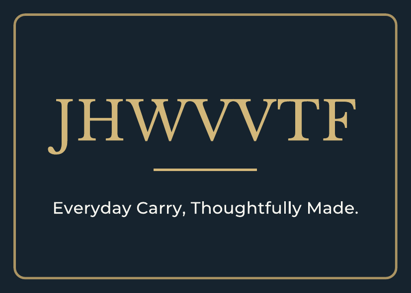
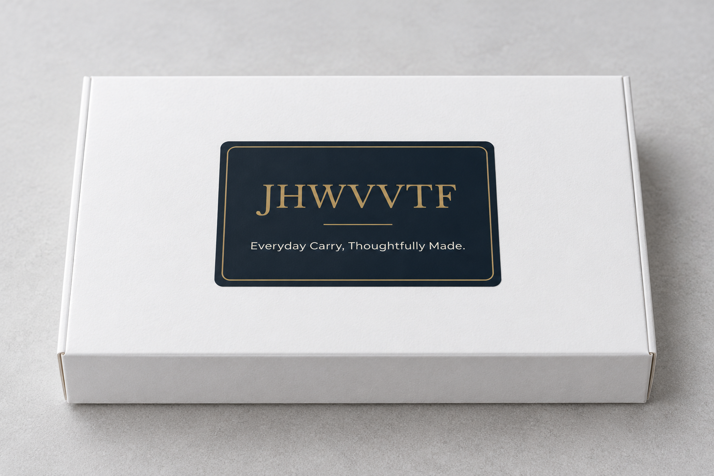

# JHWVVTF品牌视觉与印刷规范

> **默认约定：** 用户于 2026-10-13 最终选择第三版 Libre Baskerville，并明确要求“以后用关于这个JHWVVTF的 就用这个字体”。后续制作 JHWVVTF 品牌字标、包装、品牌视觉和 Listing/A+ 中的品牌名时，默认使用 **Libre Baskerville Regular，字重 400**，保留官方原始 J 字形。配套标语沿用已确认版本的 **Montserrat Medium，字重 500**。官方字体、源文件、印刷稿与白盒效果均现统一保存在本页同级的 `JHWVVTF品牌素材/字标/`。

**目录**

- [1. 后续默认字体与复用约定](#default-font-policy)
- [2. 已确认的品牌文字与贴纸版式](#approved-design)
- [3. 品牌贴纸与白色包装盒效果](#visual-preview)
- [4. 源文件、印刷稿与素材入口](#asset-files)
- [5. 打印方法与尺寸检查](#print-workflow)
- [6. 官方字体、许可与文件核验](#official-fonts)
- [7. 后续设计执行流程](#reuse-workflow)
- [8. 相关知识、来源与维护](#sources-maintenance)
  - [2026年10月16日目录整理同步](#directory-sync-20261016)

## 1. 后续默认字体与复用约定

JHWVVTF 的品牌名保持全大写，准确拼写为 `JHWVVTF`，共七个字母：J、H、W、V、V、T、F。

| 文字角色 | 默认字体 | 字重 | 执行方式 |
| --- | --- | --- | --- |
| 品牌名／品牌字标 JHWVVTF | Libre Baskerville | Regular 400 | 使用本页归档的官方字体，或直接复用转曲字标轮廓 |
| 配套标语 Everyday Carry, Thoughtfully Made. | Montserrat | Medium 500 | 沿用当前已确认版本的排版与大小写 |

品牌字标保留 Libre Baskerville 官方原始 J 的下伸弯钩，也保留 W 的原始常规字形。后续默认沿用这一确定方案；用户另行明确修改字体或字形时，更新本页及配套源文件。不得因为其他方案的推荐而覆盖用户最终选择。

该约定固定的是 JHWVVTF 的品牌字标字体。7 × 5 cm 是本次包装贴纸的成品尺寸，其他版面按各自用途调整尺寸。正文与其他说明文字未被指定为统一使用 Libre Baskerville；当前配套标语按上述 Montserrat 执行。

## 2. 已确认的品牌文字与贴纸版式

| 项目 | 已确认内容 |
| --- | --- |
| 品牌名 | JHWVVTF |
| 底部标语 | Everyday Carry, Thoughtfully Made. |
| 版式 | 品牌名、短分隔线、底部标语，共两行文字 |
| 中间说明文字 | 已移除 WALLET CASE COLLECTION，后续默认不恢复 |
| 贴纸成品 | 横向 70 × 50 mm，即 7 × 5 cm |
| 包装盒 | 白色纸盒，由用户确认 |
| 品牌字号 | Libre Baskerville 400，9.2 mm，约 26.08 pt；字距 0.12 mm |
| 标语字号 | Montserrat 500，2.85 mm，约 8.08 pt；字距 0.03 mm |
| 品牌文字颜色 | 金黄 #D2B77A |
| 背景颜色 | 深蓝 #16232E |
| 标语颜色 | 浅象牙白 #F8F7F1 |
| 边框颜色与线宽 | #AB9463，线宽 0.4 mm，距离成品边缘 2.5 mm |
| 分隔线线宽 | 0.36 mm |
| 普通彩印工艺 | 金色采用平色金黄；源稿为 RGB，未指定印刷厂 CMYK 色彩配置 |

详细的坐标、字距、尺寸和颜色见 [设计参数_尺寸颜色与排版.json](JHWVVTF品牌素材/字标/02_源文件/设计参数_尺寸颜色与排版.json)。

## 3. 品牌贴纸与白色包装盒效果

下面的贴纸图由官方字体精确排字生成，与最终 PDF 的图形一致，是字形及排版的核对依据。

下面的白色纸盒图为 **AI 包装效果模拟**，用于观察深蓝贴纸、金黄色字标和白色盒子的整体搭配。它不是实物照片或实体印刷色样，图中透视、文字和比例可能近似。模拟时暂按约 18 × 11 × 2.5 cm 白盒设定；实际盒体尺寸由用户后续提供。正式印刷的标签尺寸和字形以矢量 PDF/SVG 为准。

## 4. 源文件、印刷稿与素材入口

所有素材采用本知识库内的相对路径链接，不依赖 Codex 工作区的临时文件。素材文件夹：`JHWVVTF品牌素材/字标/`。2026-10-16整理后，当前保留13个散文件：原解压文件12个，另附白盒效果图1个。历史压缩包 `JHWVVTF_第三版_印刷稿与源文件.zip` 本次未在店铺目录找到；以下直接链接当前可用文件。

| 用途 | 归档文件 |
| --- | --- |
| 自己用 A4 打印机试印一张 | [01_自己打印_A4单张_7x5厘米.pdf](JHWVVTF品牌素材/字标/01_打印文件/01_自己打印_A4单张_7x5厘米.pdf) |
| 印刷店用，四边各 3 mm 出血 | [02_印刷店用_3毫米出血_成品7x5厘米.pdf](JHWVVTF品牌素材/字标/01_打印文件/02_印刷店用_3毫米出血_成品7x5厘米.pdf) |
| 单张 7 × 5 cm 成品尺寸 | [03_单张成品尺寸_7x5厘米.pdf](JHWVVTF品牌素材/字标/01_打印文件/03_单张成品尺寸_7x5厘米.pdf) |
| 品牌与标语保留可编辑文字 | [可编辑文字源文件_7x5厘米.svg](JHWVVTF品牌素材/字标/02_源文件/可编辑文字源文件_7x5厘米.svg) |
| 文字轮廓转曲，无需安装字体即可保持字形 | [转曲矢量源文件_7x5厘米.svg](JHWVVTF品牌素材/字标/02_源文件/转曲矢量源文件_7x5厘米.svg) |
| 尺寸、颜色、字重、字距与坐标 | [设计参数_尺寸颜色与排版.json](JHWVVTF品牌素材/字标/02_源文件/设计参数_尺寸颜色与排版.json) |
| 品牌官方字体文件 | [品牌字体_LibreBaskerville_官方.ttf](JHWVVTF品牌素材/字标/03_官方字体与授权/品牌字体_LibreBaskerville_官方.ttf) |
| 标语官方字体文件 | [标语字体_Montserrat_官方.ttf](JHWVVTF品牌素材/字标/03_官方字体与授权/标语字体_Montserrat_官方.ttf) |
| 品牌字体许可全文 | [品牌字体_商用授权原文.txt](JHWVVTF品牌素材/字标/03_官方字体与授权/品牌字体_商用授权原文.txt) |
| 标语字体许可全文 | [标语字体_商用授权原文.txt](JHWVVTF品牌素材/字标/03_官方字体与授权/标语字体_商用授权原文.txt) |
| 300 dpi 平面预览 | [贴纸预览_7x5厘米_300dpi.png](JHWVVTF品牌素材/字标/04_预览图片/贴纸预览_7x5厘米_300dpi.png) |
| 白盒模拟效果 | [白色纸盒效果图_普通彩印模拟.png](JHWVVTF品牌素材/字标/白色纸盒效果图_普通彩印模拟.png) |
| 打印设置与源文件使用说明 | [请先阅读_打印与源文件说明.txt](JHWVVTF品牌素材/字标/请先阅读_打印与源文件说明.txt) |

## 5. 打印方法与尺寸检查

1. **A4 普通打印机试印：** 使用 A4 单张 PDF，选择“实际大小／100%”，关闭“适合页面”、自动缩放与无边距放大。页面上只有一张 70 × 50 mm 标签，并附裁切标记。
2. **尺寸确认：** 打印后测量成品宽 70 mm、高 50 mm。A4 页下方检查线两端间距应为 50 mm，然后按四角裁切标记裁切。
3. **交印刷店：** 使用带 3 mm 出血的 PDF。整页 76 × 56 mm，PDF TrimBox 内成品仍为 70 × 50 mm；请按成品尺寸裁切。
4. **单张标签纸：** 70 × 50 mm 成品 PDF 用于尺寸匹配的标签纸或单张输出，仍选择实际大小／100%。
5. **颜色试印：** 当前为 RGB 平色原稿。先在适配打印机的白色不干胶纸上试印，确认深蓝底、金黄文字与浅色标语；印刷厂如需要 CMYK，由其按纸张和设备色彩配置转换。

三份 PDF 的品牌和标语均已转曲为矢量轮廓，不需要字体替换。PNG 为 827 × 591 像素、300 dpi，像素取整会带来不足 0.1 mm 的换算差异；精确尺寸以 PDF/SVG 为准。打印方式、实际白盒尺寸和实体打样结果尚未由用户提供。

## 6. 官方字体、许可与文件核验

两款字体来自 Google Fonts 官方仓库，授权为 **SIL Open Font License 1.1**，可用于商用设计与包装印刷；许可全文已随源文件归档。官方字体文件内容保持原始字节，中文名称仅用于文件导航。字体许可不替代品牌名称的商标审查。

- Libre Baskerville：[官方字体目录](https://github.com/google/fonts/tree/main/ofl/librebaskerville)、[官方许可全文](https://raw.githubusercontent.com/google/fonts/main/ofl/librebaskerville/OFL.txt)。
- Montserrat：[官方字体目录](https://github.com/google/fonts/tree/main/ofl/montserrat)、[官方许可全文](https://raw.githubusercontent.com/google/fonts/main/ofl/montserrat/OFL.txt)。
- 商用设计许可说明：[OFL 官方常见问题](https://openfontlicense.org/ofl-faq/)。

| 官方文件 | SHA-256 |
| --- | --- |
| Libre Baskerville 字体 | `05a95421961341c5b2556285e8415df9db27dab4f4abe22b446b3c6a8b916c5d` |
| Montserrat 字体 | `0f7b311b2f3279e4eef9b2f968bcdbab6e28f4daeb1f049f4f278a902bcd82f7` |

2026-10-13归档时曾逐一核对14个素材文件的SHA-256，并对原始印刷包执行ZIP CRC校验；这是历史核验记录。2026-10-16整理后当前目录保留13个散文件，旧ZIP包未在本目录找到，不将历史CRC记录视为当前ZIP可用。可编辑SVG中的字体相对路径仍指向同一字标目录下的 `03_官方字体与授权/`，可随整个字标目录一起迁移。

## 7. 后续设计执行流程

1. 接到 JHWVVTF 品牌相关任务时，先检索本页，按默认字体约定执行。
2. 优先复用已转曲的品牌字标；需要编辑文字时，使用归档的 Libre Baskerville 与 Montserrat 官方字体文件，在可编辑 SVG 中精确排字。
3. 保持 JHWVVTF 的准确拼写及字形；底部标语沿用 `Everyday Carry, Thoughtfully Made.`，保留句末英文句号。
4. 包装效果模拟与正式印刷稿分开使用。正式品牌文字以真实字体排版或矢量轮廓为准；图像生成的效果图只用于外观展示。
5. 后续图片修改以用户原始参考或用户明确指定的源稿为基础，不用此前 AI 生成的效果图反复迭代，除非用户明确指定。
6. 若用户明确调整字体、品牌拼写、标语、尺寸或工艺，保存新的源文件与效果，并同步更新本页、素材入口与默认字体记忆。

## 8. 相关知识、来源与维护

- 店铺导航：[店铺品牌资料索引](店铺品牌资料索引.md)。
- 同品牌关联产品资料：[梦幻系列钱包翻盖手机壳产品档案](../产品/梦幻系列钱包翻盖手机壳产品档案.md)。仅作为产品资料关联，不自动把本字体约定扩展到其他品牌。
- 来源：2026-10-13 的 Codex 对话，线程 `01a1330b-dcca-7f01-8fac-4e9587524714`。
- 用户确认：保留 JHWVVTF；贴纸 7 × 5 cm；白色纸盒；删除中间 collection 文字；选择第三版 Libre Baskerville；要求中文命名源文件与印刷包。
- 用户后续约定原话：“帮我把这个 JHWVVTF的品牌 效果整理 到C:\\software\\GBrain\\brain\\电商运营\\亚马逊\\店铺，以后用关于这个JHWVVTF的 就用这个字体”。
- 已确认并归档的成果：第三版精确排字贴纸、三份印刷 PDF、可编辑与转曲 SVG、官方字体和授权、白盒普通彩印模拟图。
- 最后核验：2026-10-13。实体色样、实际盒体尺寸和印刷方法在收到用户资料后补充；字体偏好持续有效，直到用户明确修改。

### 2026年10月16日目录整理同步

- 当前素材位置为 `JHWVVTF品牌素材/字标/`，保留 `01_打印文件/`、`02_源文件/`、`03_官方字体与授权/`、`04_预览图片/` 子目录，以及字标目录下的白盒效果图和使用说明。
- 已修正本页16处移位链接；历史ZIP入口改为文件状态说明，现行打印与编辑入口均指向实际散文件。
- 当前13份素材已核对存在；两份字体的SHA-256与本页原归档记录一致。字体、颜色、尺寸和字形约定沿用原确认，未重新核验外部授权或平台规则。
- 此次只同步知识页与目录导航；素材文件原样保留。
