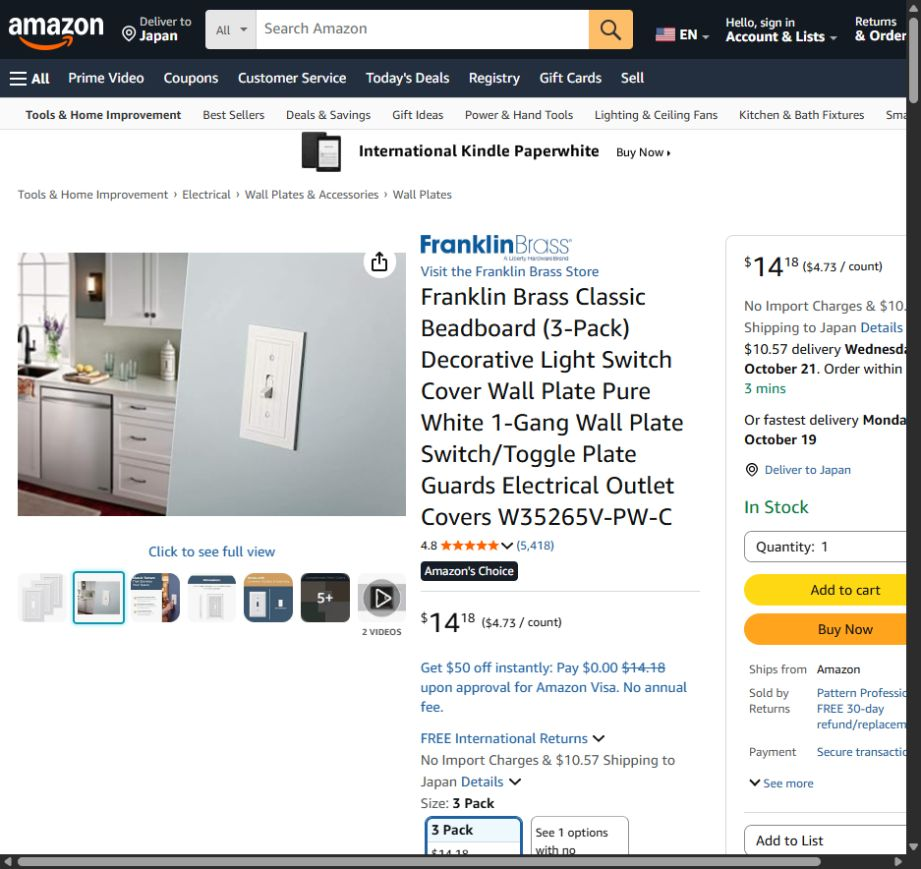
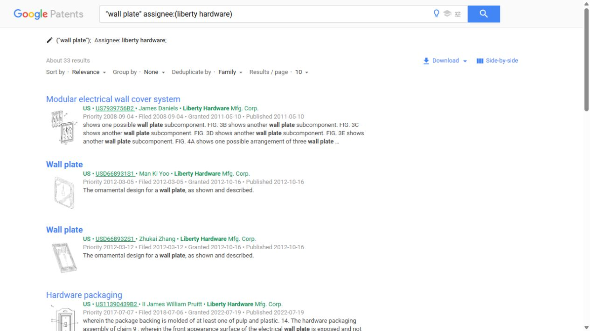
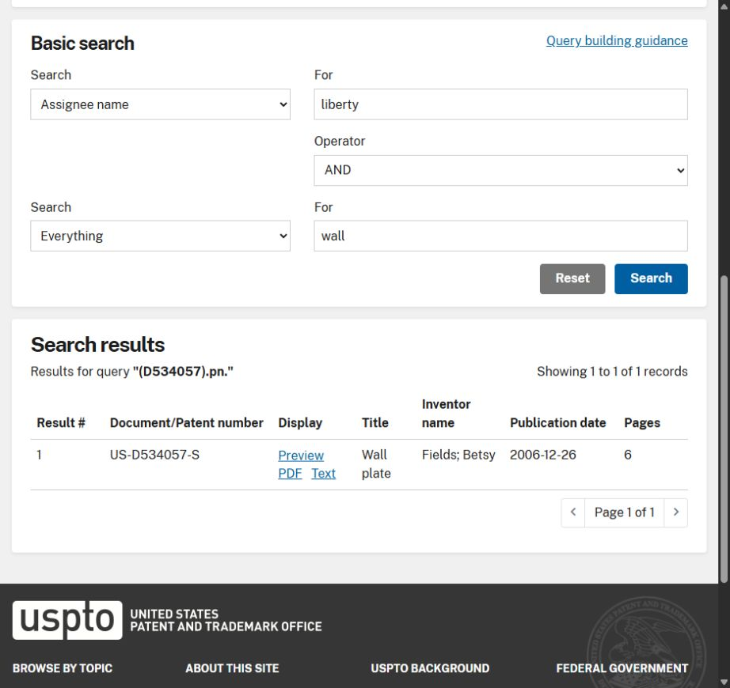
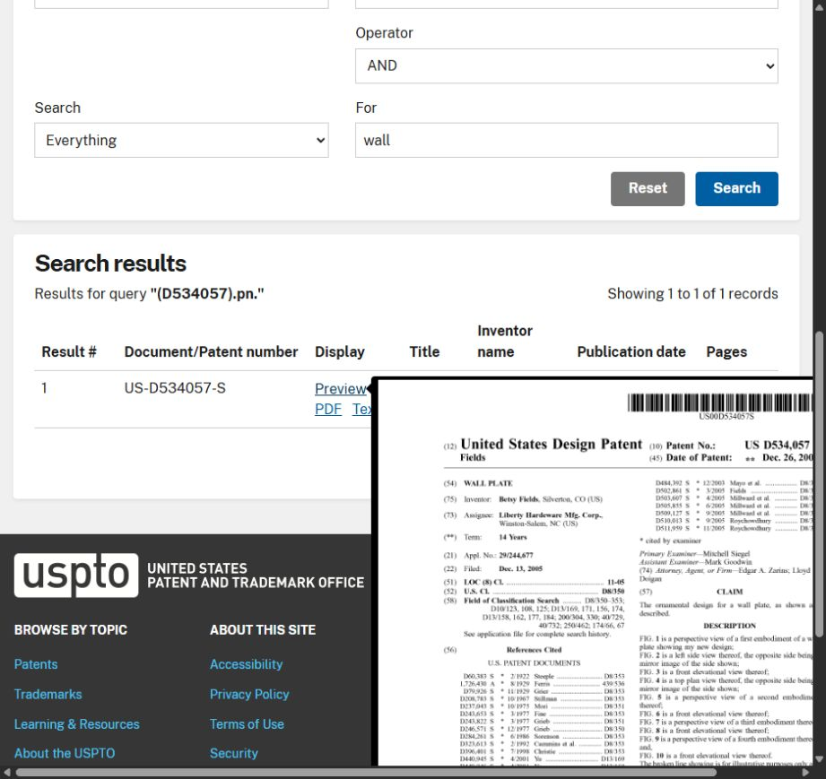
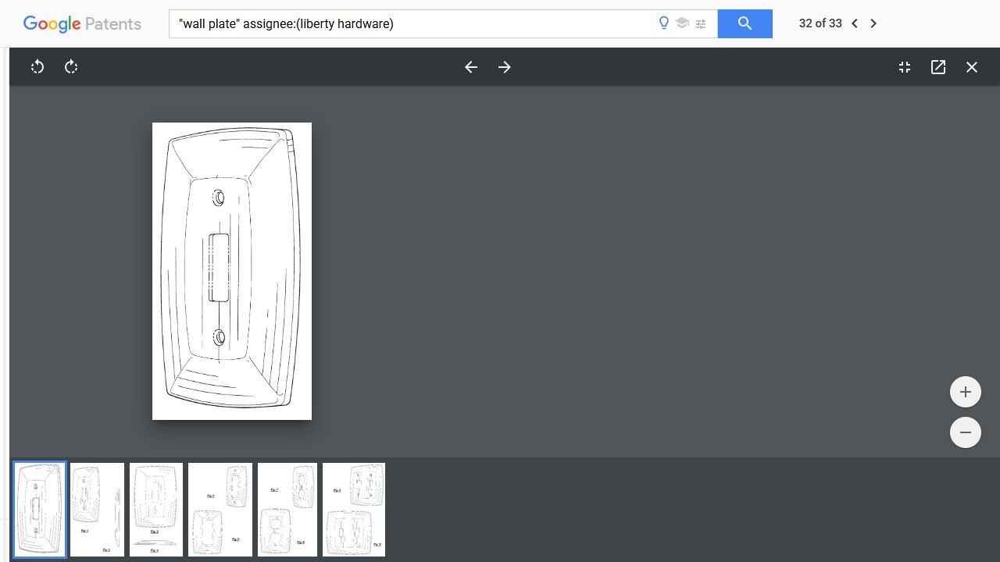

# 商品图片外观专利查询流程：Amazon 线索与 USPTO 核验

> **重点：** 从商品图片提取英文商品名称和外观特征，在 Amazon 找品牌与型号，再检索相关专利、回 USPTO 核实记录并比较完整图纸。本文保存 2026-10-09 竖纹开关面板的实际浏览器演示；该图片对应专利仍未确认，不能将本次结果用作无专利或放心销售证明。

**目录**

- [1. 用途、适用范围与结论边界](#scope)
- [2. 从参考图片提取检索输入](#inputs)
- [3. 本次已经实测的浏览器流程](#browser-workflow)
  - [3.1 在 Amazon 找相似商品和品牌线索](#amazon-leads)
  - [3.2 在 Google Patents 查产品名称与公司名](#google-patents-search)
  - [3.3 用 USPTO 基础版做公司关键词查询](#uspto-basic-search)
  - [3.4 用专利号核实 USPTO 官方记录](#uspto-number-lookup)
  - [3.5 放大图纸并核对状态线索](#drawing-review)
- [4. 后续扩大检索的方法与高级版参考](#search-expansion)
  - [4.1 USPTO 高级版标题与外观类型参考语句](#advanced-title-query)
  - [4.2 D8 分类检索补充](#classification-query)
- [5. 图纸、保护范围与权利状态怎样核对](#scope-and-status-review)
- [6. 本例候选记录、实际结果与留档格式](#case-results)
- [7. 用户 PDF 的纠正要点](#pdf-corrections)
- [8. 本次遇到的问题与排查顺序](#troubleshooting)
- [9. 来源、截图资料与维护](#sources-and-assets)
- [10. 相关知识](#related-knowledge)

<a id="scope"></a>
## 1. 用途、适用范围与结论边界

本流程用于：只有产品图片时，初步查找商品造型、表面花纹或凹槽是否涉及美国外观专利。案例目标为 Amazon 美国站相关商品；其他国家或地区要另查当地权利，不能把美国结果直接迁移到其他站点。

应先区分三类问题：商品的装饰外观主要查 Design patent；技术结构、功能和工作方式可能需要另查 Utility patent；复制商品照片或二维美术素材还涉及版权与使用授权。Amazon 是寻找商品、品牌及权利人线索的入口，专利记录要到专利数据库查询。

本次已完成浏览器演示和若干候选图纸核对，**尚未确认图片里的竖纹设计对应哪一件专利，也未完成全面检索或销售自由实施分析**。检索到相关专利不等于产品侵权；没有查到对应记录不等于没有专利。存在未公开申请、名称差异、申请人差异和检索遗漏等限制。

<a id="inputs"></a>
## 2. 从参考图片提取检索输入

查询前记录目标市场、图片来源、商品类别及可见外观。将图片里的产品与背景分开描述，避免把墙纸纹理当成商品花纹。

本例图像表现为：白色单拨杆开关面板，直边矩形外轮廓、宽斜面边框、内凹面板、重复竖向凹槽，以及开关上下两个螺丝位置。这里只记录可见特征，不推断真实材质、尺寸、品牌或结构。

[查看本次参考原图](资料/外观专利查询案例_2026-10-09/reference-wall-plate.png)

| 检索维度 | 本例英文词 |
| --- | --- |
| 商品名称 | wall plate、wallplate、switch plate、switchplate、light switch cover、toggle switch wall plate |
| 花纹或风格 | beadboard、wainscot、fluted、ribbed、grooved |
| 款式 | single toggle、1 gang、switch |
| 确认品牌后 | Franklin Brass、Liberty Hardware，以及公司全称和历史名称 |

先用商品名称寻找相关领域，再用花纹词缩小范围。不要只搜“竖纹专利”：很多外观专利标题只有 Wall plate，说明书未必包含 beadboard 或 fluted。

<a id="browser-workflow"></a>
## 3. 本次已经实测的浏览器流程

以下记录的是 2026-10-09 的实际操作，页面菜单、商品内容和结果数量可能变化。

<a id="amazon-leads"></a>
### 3.1 在 Amazon 找相似商品和品牌线索

1. 打开 Amazon.com，搜索 `beadboard toggle wall plate`。
2. 查看相似商品，进入详情页；切换为 Switch 款式，确认看到的是单拨杆开关盖板。
3. 记录品牌、系列、具体型号、ASIN、款式和商品链接；留意包装、品牌 Logo、说明书或专利标注。
4. 将商品照片与原图比较，把“相似商品”与“确认原始商品”分开登记。

本次找到 [Franklin Brass Classic Beadboard 商品](https://www.amazon.com/dp/B01HMCXHFS)：型号 **W35265V-PW-C**，ASIN **B01HMCXHFS**，Switch 款式、Single 配置。竖向凹槽和斜边框与参考图片接近，但没有确认它就是原图来源。商品品牌标识显示 A Liberty Hardware Brand，因此 Liberty Hardware 是下一步检索线索。商品卖家不自动等于专利权利人。



<a id="google-patents-search"></a>
### 3.2 在 Google Patents 查产品名称与公司名

打开 [Google Patents](https://patents.google.com/)，在搜索框输入：

```text
"wall plate" assignee:(liberty hardware)
```

点击搜索并查看列表、缩略图和专利详情。本次 [该检索](https://patents.google.com/?q=%22wall+plate%22&assignee=liberty+hardware)显示约 **33 条结果**，混有外观与技术结构相关记录，不代表 33 件外观专利，更不代表已经覆盖全部相关专利。逐页查看后打开候选，避免仅凭同公司、同标题判断对应关系。

公司名称可有简称、拼写差异、旧名称或转让后的名称。后续检索还应覆盖 Franklin Brass、Liberty Hardware Mfg. Corp.、Liberty Hardware Manufacturing Corp 等已取得的名称线索，不把当前公司词检索当成全领域查全。



<a id="uspto-basic-search"></a>
### 3.3 用 USPTO 基础版做公司关键词查询

从 [USPTO Patent Public Search 官方入口](https://www.uspto.gov/patents/search/patent-public-search)进入 [PPUBS Basic](https://ppubs.uspto.gov/basic/)。

本次高级检索应用在浏览器中持续空白，基础版可以使用。该现象只记作这次会话的访问问题，不能写成“USPTO 高级版已停用”。

基础版的本次实测条件如下：

| 控件 | 输入或选择 |
| --- | --- |
| 第一组 Search | Assignee name |
| 第一组 For | liberty |
| Operator | AND |
| 第二组 Search | Everything |
| 第二组 For | wall |

点击 Search 后页面显示查询 `(liberty).as. AND wall`，返回 **382 条记录**。这个结果较宽，包含名称有 liberty 的其他公司以及无关产品，只适合演示和初筛。

本次把 liberty hardware、wall plate 分别当作一个文本框的多词输入时，页面提示每个文本框只输入一个词。改成 liberty 和 wall 后成功。实际使用应服从当前页面的输入提示。

<a id="uspto-number-lookup"></a>
### 3.4 用专利号核实 USPTO 官方记录

取得候选专利号后，优先用精确查号核实。进入 PPUBS Basic 上方 **Quick lookup → Patent or Publication number**，输入：

```text
D534057
```

点击 Search，等待结果区域实际加载。本次返回唯一记录：

| 字段 | 官方返回内容 |
| --- | --- |
| Document/Patent number | US-D534057-S |
| Title | Wall plate |
| Inventor name | Fields; Betsy |
| Publication date | 2006-12-26 |
| Pages | 6 |

Google Patents 展示 USD534057S1，USPTO 列表展示 US-D534057-S；这是本例中同一专利的不同显示格式。**D534057 是本次实测可用的输入，不要自行添加前导零或把申请号当成授权专利号。**

点击 Preview 可预览原始专利首页；PDF、Text 为其他查看入口。首次点击后可能短暂显示 Loading，需要核对结果区域和预览内容，不能把刚点击后的空白当成零结果。





<a id="drawing-review"></a>
### 3.5 放大图纸并核对状态线索

在候选详情页点击图纸缩略图，打开图片查看器并放大。对照正面、透视图、侧面和其他实施例；同时阅读 Claims、Description、虚线说明及时间线。

本次放大的 [D534057 图纸](https://patents.google.com/patent/USD534057S1/en)显示有弧度的边框，与原图直边矩形框不同。图中的细线还要区分造型线、表面阴影线与虚线，不能全部当成竖纹凹槽。该候选未被确认对应原图；外观差异也不直接构成法律上的不侵权结论。

Google Patents 页面对该件显示 Expired - Lifetime，并列出预计到期日 2020-12-26。本次仅记录这个数据库状态线索，没有在 Patent Center 完成当前法律状态的全面核验。



<a id="search-expansion"></a>
## 4. 后续扩大检索的方法与高级版参考

以下属于继续检索的方法，**本次浏览器演示没有完整执行**。不能把下面的语句或分类列为“已检索且无命中”。

扩大范围时同时检查：商品名称变体、其他品牌和供应商、申请人旧名称、候选的引证与被引证专利、同一产品的其他款式和相关分类。公司名检索与商品名称检索应相互补充。

<a id="advanced-title-query"></a>
### 4.1 USPTO 高级版标题与外观类型参考语句

按 [USPTO 官方字段表](https://www.uspto.gov/patents/search/patent-public-search/searchable-indexes)，.TI. 用于标题，.AS. 用于受让人名称，.CCLS. 用于当前美国分类；S.KD. 可用于限定外观专利类型。字段语句适用于 Advanced Search，不能直接当作基础版单词框输入。

可先从较宽的标题查询开始：

```text
S.KD. AND ((wall ADJ plate) OR wallplate OR (switch ADJ plate) OR switchplate OR (switch ADJ cover)).TI.
```

同义商品名称放在 OR 组中；类型、商品名称和公司等不同条件用 AND 组合。执行前按当前帮助核对语法、选中数据库和页面提示。花纹词可用于补充检索，但不要把它们全部作为强制 AND 条件，否则容易遗漏标题和文字里未写出纹理名称的外观专利。

<a id="classification-query"></a>
### 4.2 D8 分类检索补充

[USPTO D08 分类表](https://www.uspto.gov/web/patents/classification/uspcd08/schedd08.htm)中的 D8/350 为 Escutcheon，D8/351 为仿形，D8/352 为大致圆形或椭圆形，D8/353 为大致矩形或方形。它们可作为本例墙板候选的分类线索，不能只看一类就宣称查全。

高级版参考：

```text
S.KD. AND D8/353.CCLS.
```

需要扩展时参考：

```text
S.KD. AND (D8/350 OR D8/351 OR D8/352 OR D8/353).CCLS.
```

打开候选首页后，记录其实际分类，再回到分类表扩展；分类号用于找相关记录，不直接表示保护范围。

<a id="scope-and-status-review"></a>
## 5. 图纸、保护范围与权利状态怎样核对

外观专利要结合完整图纸和说明看所主张的装饰外观。实线、虚线、阴影线承担不同作用：虚线常表示未主张的环境或边界，具体含义以该件说明书为准；表面阴影线可能用于表示曲面或形态，不能自动认作纹理。表面花纹或凹槽也可能与所附着的商品外观一同成为检索和比较对象。[USPTO MPEP 1503](https://www.uspto.gov/web/offices/pac/mpep/s1503.html)

本例逐项记录外轮廓、边框斜面、内面板边界、竖纹的位置与间距、开关和螺丝相关部分的画法。必须看正面和侧面等视图，不能只看一张缩略图，也不能因为开孔位置一样就认定相同。

对相关候选继续核对：授权还是申请记录、申请日与授权日、当前权利人及转让、期限、放弃或撤销等事件、同族和延续申请。Google 的 Active、Expired 和 Anticipated expiration 是检索线索，重要结论回查 [USPTO Patent Center](https://patentcenter.uspto.gov/)及相关原始记录。本次 D534057 的申请号为 29/244,677，其 [Patent Center 入口](https://patentcenter.uspto.gov/applications/29244677)可作为后续核验入口，本次未完成该入口核验。

外观专利没有实用专利那种常规维持费要求，不能用“没查到维持费缴纳”判断外观专利失效。简单改颜色、材料或少量线条也不自动证明能够规避某件外观专利。

<a id="case-results"></a>
## 6. 本例候选记录、实际结果与留档格式

本次确认的相似商品线索是 Franklin Brass Classic Beadboard，型号 W35265V-PW-C，ASIN B01HMCXHFS。没有确认原图品牌或来源，也没有确认商品与某件专利的对应关系。

| 本次打开的候选 | 图样观察或用途 | 本次可下的结论 |
| --- | --- | --- |
| [USD674268S1](https://patents.google.com/patent/USD674268S1/en) | 花卉装饰图样 | 未确认对应原图竖纹 |
| [USD668932S1](https://patents.google.com/patent/USD668932S1/en) | 带其他装饰元素的墙板 | 同公司、同标题不足以确认对应 |
| [USD534057S1](https://patents.google.com/patent/USD534057S1/en) | 放大后可见弧形边框；官方查号唯一命中 | 记录存在已核实；未确认对应原图；Google 标注到期 |
| [USD561006S1](https://patents.google.com/patent/USD561006S1/en) | 其他边框造型和多种实施例 | 未确认对应原图 |
| [USD503284S1](https://patents.google.com/patent/USD503284S1/en) | 其他装饰边框造型 | 未确认对应原图 |

**本例最终状态：流程演示完成，图片对应专利尚未锁定，继续检索与权利状态核验仍有必要。** 未做全领域图像查全、未逐件检查全部相关申请、未确认当前法律状态；本次约 33 条与 382 条均是具体查询当时的结果数。

每次实际产品查询建议填写：

| 留档字段 | 应记录的信息 |
| --- | --- |
| 查询目标 | 目标国家、商品类别、图片来源及所关心的装饰特征 |
| 商品证据 | ASIN、品牌、型号、款式、链接和采集日期；是否已确认原始商品 |
| 查询证据 | 数据库、完整检索式、筛选项、日期及结果范围 |
| 专利记录 | 授权号与申请号分别填写，标题、申请人或受让人、日期 |
| 图纸比较 | 哪些视图已看、相似点、差异、实线与虚线说明 |
| 状态证据 | 数据库提示、官方原始事件、核验日期；不确定项保留 |
| 结论 | 相关候选／对应关系待核验／需要进一步评估，并写明证据及未完成事项 |

不要把以上标签当成自动风险分数，也不要把“暂未发现”填写成“无专利”。

<a id="pdf-corrections"></a>
## 7. 用户 PDF 的纠正要点

知识来源之一是用户提供的《美国外观专利具体查询方法（USPTO举例）.pdf》。它可以帮助理解按英文商品词搜索、逐件看图的思路，但不能照原文直接执行。

| 原材料问题 | 整理后采用的做法 |
| --- | --- |
| Utility 与 Design 的概念或中英文对应混淆 | 美国外观设计查询用 Design patent；Utility patent 是另一类技术专利，不能互换 |
| 用 PatFT／AppFT 旧界面作为当前操作入口 | 使用 Patent Public Search；旧数据库于 2022-09-30 退役，旧截图仅作历史参考 |
| 用过宽产品词，如 electronic device | 先用具体商品名称，辅以同义词、公司和分类 |
| OR 与 AND 的作用混用 | 同义名称用 OR 扩展，不同约束用 AND 组合 |
| 查到图片后直接作判断 | 加上完整图纸、虚线说明、当前状态、相关申请和证据范围核对 |

旧入口退役说明见 [USPTO Patent Public Search 官方页面](https://www.uspto.gov/patents/search/patent-public-search)；字段用法按当前官方帮助核对。该 PDF 不作为本页法律结论或当前界面规则的独立依据。

<a id="troubleshooting"></a>
## 8. 本次遇到的问题与排查顺序

| 现象 | 本次处理及复用方法 |
| --- | --- |
| 高级版持续白屏 | 核对当前状态并重载；本次仍无法正常使用，于是换基础版并借助 Google Patents 找候选，再回官方查号。不能声称高级版查询已执行 |
| 基础版多词输入报错 | 按提示改为一框一个词；需要短语和复杂逻辑时用支持它们的入口 |
| 查询或 Preview 刚点击后暂时空白 | 等结果区域或 Loading 完成；核对页面上的实际查询和记录数，再决定下一步 |
| 专利号没有命中 | 区分授权号与申请号，核对当前页面格式和编号；本例 D534057 可用。不要猜前导零或连续试造编号 |
| 同名结果很多 | 看申请人、缩略图和完整图纸；公司名、标题和分类只提供线索 |
| 图纸线条看起来像竖纹 | 放大并结合其他视图与说明，区分表面阴影线和实际造型 |
| 页面显示已到期 | 记录该件和该时点的状态提示；继续检查相关权利，不能扩展成商品整体安全结论 |
| 类似产品在 Amazon 大量销售 | 仅记录市场存在，不把在售、评价多或品牌注册视为无侵权证明 |

2026-10-09 官方页面显示：计划从 **2026-11-07** 起 PPUBS 要求 USPTO 账户登录。该日期为当时公告快照，复用本流程时先核对当前入口和登录提示，不依赖当时无需登录的状态。

<a id="sources-and-assets"></a>
## 9. 来源、截图资料与维护

**来源分层：** 原图、PDF 和提问来自用户；浏览器操作、字段输入、商品线索、结果数量和候选图样是本次实际观察；流程编排、后续检索方法和记录模板是 Codex 整理；高级版参考语句及图纸规则依据 USPTO 官方资料。实测部分与未执行的扩展步骤已分别标明。

**时间与维护：** 案例操作日期 2026-10-09；本文整理及官方字段、分类、图纸说明核对日期 2026-10-09。以后有界面、登录规则、分类、公司名称或候选状态变化时更新，并保留当时观察的日期。本页 verified 仅表示上述范围核对，不表示已确认原图专利或得出销售许可结论。

主要入口与资料：
- [USPTO Patent Public Search](https://www.uspto.gov/patents/search/patent-public-search)
- [USPTO PPUBS Basic](https://ppubs.uspto.gov/basic/)
- [USPTO 高级版字段表](https://www.uspto.gov/patents/search/patent-public-search/searchable-indexes)
- [USPTO D08 分类表](https://www.uspto.gov/web/patents/classification/uspcd08/schedd08.htm)
- [USPTO MPEP 1502：Utility 与 Design](https://www.uspto.gov/web/offices/pac/mpep/s1502.html)
- [USPTO MPEP 1503：图纸、阴影和虚线](https://www.uspto.gov/web/offices/pac/mpep/s1503.html)

本页配套保存原图及 5 张关键浏览器截图，采用相对路径；复制前后逐项核对 SHA-256 一致。截图是当时的界面证据，不是实时状态：

| 相对资料路径 | 内容 |
| --- | --- |
| [资料/外观专利查询案例_2026-10-09/reference-wall-plate.png](资料/外观专利查询案例_2026-10-09/reference-wall-plate.png) | 用户参考图 |
| [资料/外观专利查询案例_2026-10-09/amazon-beadboard-product.jpg](资料/外观专利查询案例_2026-10-09/amazon-beadboard-product.jpg) | 相似商品、品牌与型号 |
| [资料/外观专利查询案例_2026-10-09/google-patents-company-results.jpg](资料/外观专利查询案例_2026-10-09/google-patents-company-results.jpg) | 公司与产品检索结果 |
| [资料/外观专利查询案例_2026-10-09/uspto-exact-patent-result.jpg](资料/外观专利查询案例_2026-10-09/uspto-exact-patent-result.jpg) | 官方专利号唯一命中 |
| [资料/外观专利查询案例_2026-10-09/uspto-original-preview.jpg](资料/外观专利查询案例_2026-10-09/uspto-original-preview.jpg) | 官方原始专利首页预览 |
| [资料/外观专利查询案例_2026-10-09/d534057-drawing-comparison.jpg](资料/外观专利查询案例_2026-10-09/d534057-drawing-comparison.jpg) | 放大的图纸及数据库状态 |

常见检索问法：怎么判断 Amazon 产品图片有没有专利、产品花纹外观专利怎么查、竖纹开关面板专利查询、USPTO 基础版查专利号、Google Patents 公司名查询、同名专利为什么还要看图纸。

<a id="related-knowledge"></a>
## 10. 相关知识

- [品牌故事卡片学习指南](../listing/品牌故事/品牌故事卡片学习指南.md)：借鉴竞品视觉与素材时，区分品牌自述、素材使用权及商品设计权利；该指南的素材学习结论不能替代本页的专利初筛。

本页放在既有“电商运营／亚马逊／选品”目录，主题是商品设计权利初筛。案例原图和截图独立放在资料目录，方便按新产品和新核验日期继续积累。
